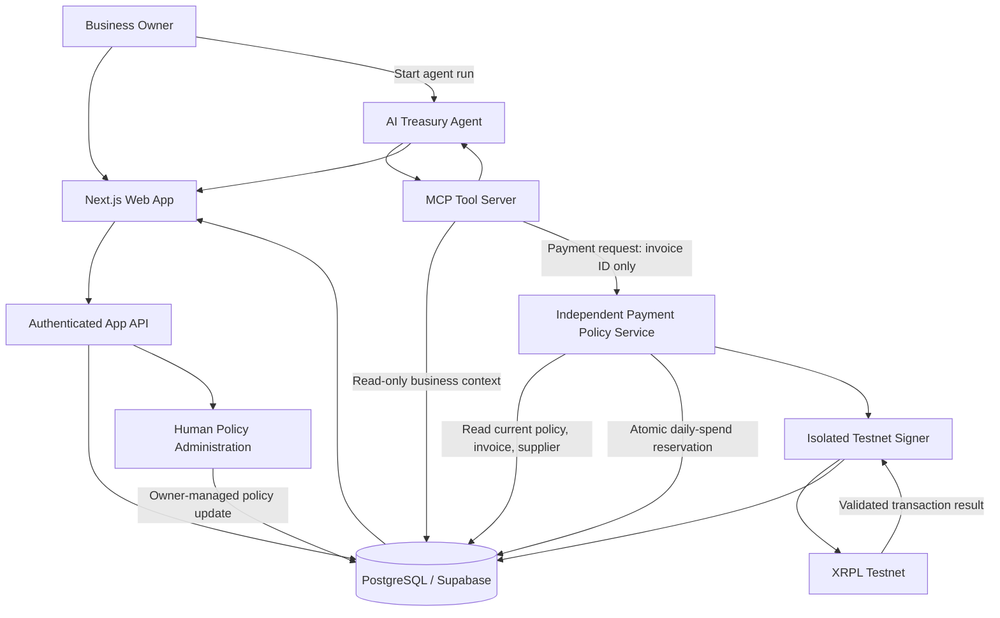

# Flow AI

> **Version:** 3.0.0  
> **Document type:** Product requirements, business case, UX specification and engineering build brief  
> **Prepared:** 11 November 2026  
> **Product owner:** Koeneng Hub  
> **Hackathon track:** Agentic Finance  
> **Network:** XRP Ledger (XRPL) Testnet only  
> **Settlement asset:** RLUSD issued on XRPL Testnet  
> **Status:** Active MVP build specification  
> **Audience:** AI coding agents, software engineers, product/design collaborators and hackathon reviewers

**Product promise:** Flow AI helps small businesses prioritise supplier invoices and run pre-authorised stablecoin payments through an AI agent, while independent controls enforce the business owner's spending rules.

> **Naming rule:** The product name is **Flow AI** and the repository name is `flow-ai`. Use this name in all new code, UI copy, documentation, screenshots and demos. Do not introduce the retired working name into new product surfaces.

---

## 0. Instructions to AI coding agents

### Document control and v3.0 decisions

Version 3.0 consolidates the project concept, Agentic Finance challenge requirements, product scope, system architecture, financial-control model, UX expectations and XRPL implementation references into one build specification.

### What changed in v3.0

- Product renamed to **Flow AI**. New user-facing material and repository paths must use this name.
- Product positioning is sharper: autonomous supplier-payment operations for South African small retailers and independent distributors, not a general-purpose finance chatbot.
- The autonomous workflow is explicit: the owner sets policy in advance; the agent selects and requests a qualifying invoice payment without a fresh approval click for every transaction; the independent policy service makes the allow/block decision; the isolated signer submits only approved transactions.
- The agent receives no signer secret, policy-edit tool, arbitrary payment destination input or arbitrary transaction-submission tool.
- XRPL's RLUSD Testnet currency code is specified using the 40-character hexadecimal representation required for non-standard issued-token currency codes. The display label remains `RLUSD`.
- Transaction success must be based on a validated ledger result, not merely a submission response.
- The architecture is designed to be modular but not needlessly distributed. Keep the security boundaries separate even if the first deployment uses a small number of services.
- The target market, willingness-to-pay assumptions and supplier readiness are labelled as hypotheses to validate, not proven traction.

### Priority of requirements

1. The mandatory Agentic Finance MVP requirements and the security boundaries in this document.
2. The P0 user journey and acceptance criteria.
3. Product quality, accessibility and demo polish.
4. P1 enhancements.

Do not add optional features while a P0 requirement or its test is incomplete.

---


This README is the v3.0 source of truth for the Flow AI product, business case, user experience, architecture, security model and hackathon MVP. Read it fully before creating or changing code, database schemas, UI flows, agent tools, payment logic or deployment configuration. If the repository contains older documentation, prefer this document unless a newer, explicitly approved decision record supersedes it.

### Your operating rules

1. **Build the smallest complete product that proves the core promise.** Prioritise one end-to-end supplier-payment workflow over many disconnected features.
2. **Do not weaken the three Agentic Finance requirements:**
   - At least one XRPL Testnet or Devnet transaction must be initiated autonomously by the AI agent.
   - Spending limits must be enforced by a component the agent cannot control.
   - A human operator must be able to set and change those limits outside the agent.
3. **The agent must never possess the XRPL signing secret.** Only the isolated payment execution service may access the dedicated Testnet signing key, and only after it independently validates a payment request.
4. **The agent must not have tools or credentials to edit policies, add trusted recipients, change wallet configuration, increase limits, or access signing material.**
5. **The payment service must derive the amount, recipient, asset and business from trusted application records.** The agent submits an invoice ID, not arbitrary payment instructions.
6. **All payment rules must be enforced server-side.** UI validation and LLM reasoning are not security controls.
7. **Use deterministic code for arithmetic and policy decisions.** The LLM can explain, prioritise and initiate a workflow, but must not be the source of truth for balances, invoice amounts, spending totals or eligibility.
8. **Test on XRPL Testnet only.** Do not add a Mainnet switch, real-money flow, live custody or production payment capability to this MVP.
9. **Never put secrets in browser code, prompts, chat transcripts, source control, logs or screenshots.** Do not use `NEXT_PUBLIC_` for secrets.
10. **Do not invent user research, pilot customers, supplier partnerships, transaction results or business traction.** Label sample data and unvalidated assumptions honestly.
11. **Keep the product demoable at every stage.** Add loading, empty, error and success states. A reviewer should understand what happened without reading source code.
12. **Before adding a dependency or major service, explain why it is needed and prefer the simplest reliable option.**
13. **Keep code typed, modular, documented and testable.** Add automated tests for policy enforcement and payment status transitions before polishing secondary features.
14. **Do not silently change this product brief.** When a requirement cannot be met, document the blocker and propose the smallest safe alternative.

### Definition of done

The MVP is not done when a chatbot says it would pay an invoice. It is done when a reviewer can:

1. Sign in as the demo business owner.
2. View a funded Testnet treasury account, a sample RLUSD balance and supplier invoices.
3. Set a per-payment cap, daily spend cap, minimum RLUSD reserve and approved supplier list in the dashboard.
4. Start the treasury agent.
5. See the agent independently select an eligible invoice and call the payment tool without a new per-payment human approval.
6. See the independent policy service validate or reject the request using the owner's current rules.
7. See at least one RLUSD payment submitted and validated on XRPL Testnet.
8. Open the payment record and inspect its transaction hash, recipient, amount, network and final status.
9. Change a policy as the human owner and prove that the agent cannot change it or bypass the new limit.

---

## 1. Product overview

### 1.1 One-sentence description

**Flow AI is an AI-powered treasury assistant that helps small businesses prioritise supplier invoices and autonomously execute owner-authorised stablecoin payments within spending rules enforced by an independent service.**

### 1.2 Product positioning

Flow AI is not a generic finance chatbot, a crypto wallet with a chat interface, or an autonomous agent with unrestricted access to funds.

It is a controlled treasury workflow for small businesses. It brings supplier obligations, a narrow view of available onchain funds, payment policies and transaction records into one understandable workspace. The AI agent helps decide *which eligible invoice to process next*. A separate policy and execution service decides whether the proposed payment is permitted and carries it out only when the rules pass.

**Core principle:**

> The agent recommends and initiates. The policy service validates. The isolated signer executes. XRPL records and confirms. The business owner controls the rules.

### 1.3 Hackathon alignment

The selected track is **Agentic Finance**. The challenge asks for a working product where an AI agent moves money on behalf of a business and the XRP Ledger enforces the rules it plays by. The MVP must include:

- At least one transaction on XRPL Testnet or Devnet executed autonomously by an agent.
- Limits enforced somewhere the agent does not control: on-ledger, by an independent service, or by a funded Payment Channel it cannot overdraw.
- A way for a human operator to set or change those limits outside the agent.
- A real customer pain point, a named target user and a go-to-market strategy.

For this time-boxed MVP, Flow AI will use an **independent payment policy service** as the enforcement boundary. This is simpler to demonstrate than a custom on-ledger contract and is explicitly one of the allowed enforcement approaches in the challenge brief. Be honest that this is an application-layer enforcement service, not a trustless on-ledger spending restriction.

---

### 1.4 Product identity and positioning

**Name:** Flow AI  
**Category:** AI-enabled treasury operations / Agentic Finance  
**Initial geography:** South Africa  
**Initial customer:** owner-operated retailers and small distributors  
**Primary workflow:** policy-bounded autonomous supplier payments using RLUSD on XRPL Testnet  
**Product owner:** Koeneng Hub

**Positioning statement:** For independent retailers and small distributors who need to manage supplier obligations without exhausting operating funds, Flow AI brings invoice prioritisation, owner-defined spending controls and verifiable stablecoin settlement into one workflow. Unlike a generic AI finance assistant, Flow AI can initiate an actual onchain payment, but only after an independent service validates it against the business owner's current rules.

**Short product description:** An AI treasury agent that helps a business decide which supplier invoice to pay next and autonomously processes eligible payments within limits set by the owner.

**Product principle:** useful automation without surrendering financial control.

### 1.5 What Flow AI is and is not

Flow AI **is**:
- A focused treasury workflow for supplier invoices.
- An agentic application that can call a payment tool and initiate a qualifying Testnet transaction.
- A system where human owners set payment limits outside the AI agent.
- An auditable product that explains why a payment was allowed or blocked.

Flow AI **is not**:
- A general-purpose chatbot that gives unverified financial advice.
- An unrestricted autonomous wallet.
- A trading bot, investment platform, lending product or yield product.
- A replacement for bookkeeping, accounting, banks or regulated payment providers.
- A live-money service. The hackathon MVP is restricted to XRPL Testnet and test RLUSD with no financial value.

## 2. Business case: why we are building Flow AI

### 2.1 The problem

Small retailers and independent distributors regularly need to pay suppliers while protecting the money required to keep operating. A business owner may be juggling:

- Several supplier invoices with different due dates.
- Frequent stock purchases and restocking needs.
- Incoming sales and an uncertain short-term cash position.
- A minimum amount that must remain available for day-to-day operations.
- Payment details spread across spreadsheets, messages, paper invoices and separate banking or payment tools.

This fragmentation makes it harder to answer basic operating questions:

- Which supplier invoice should be paid first?
- Can the business afford this payment today?
- How much will remain after payment?
- Will paying this supplier leave enough money for the next operating cycle?
- Was the payment actually completed, and where is the proof?

A poor payment decision can create a working-capital squeeze, delay restocking, strain supplier relationships or leave the business short of operating funds.

### 2.2 Why the problem deserves a solution

The product is built around a practical business need, not around adding blockchain for its own sake. Small businesses need clearer payment prioritisation and a reliable record of what has been paid. They also need automation that does not remove their control over business funds.

Flow AI explores whether AI-assisted treasury operations and programmable stablecoin payments can make this workflow easier to understand, more consistent and more auditable.

**Important market-validation note:** The problem statement is the product hypothesis for the hackathon. Do not claim that all South African SMEs experience it in the same way. Validate it with real owner/operators and capture their actual workflow, preferred payment methods, supplier requirements and willingness to use an onchain settlement option.

### 2.3 Initial target customer

**Primary beachhead:** owner-operated South African retailers and small distributors that:

- Purchase stock or services from multiple suppliers.
- Have recurring supplier invoices.
- Need to preserve working capital for daily operations.
- Currently use a mixture of spreadsheets, messaging apps, paper records or separate finance tools.
- Are digitally curious and open to testing a wallet-based payment workflow with willing suppliers.

**Primary user:** the business owner or owner-operator who makes payment decisions and is accountable for cash availability.

**Secondary user:** a bookkeeper, finance clerk or operations manager who captures invoices and monitors payments under the owner's authority.

**Supplier:** a business receiving payment. Supplier portal access is not required for the MVP; the supplier is represented by an approved XRPL destination address.

### 2.4 Example customer story

Use this as a demo persona, not as a real customer testimonial:

> Thandi runs an independent retail shop and buys stock from several suppliers. She has three invoices due, but she also needs to keep enough funds available for the next restock and daily operating costs. Her records are spread across messages and a spreadsheet. She wants help deciding which invoice can be paid without breaching the reserve she has set for the business. She does not want an AI model to have unlimited control of her money. She wants to set the rules herself, let the system process suitable payments within those rules, and see reliable proof of settlement.

### 2.5 Value proposition

For a small-business owner who needs to manage supplier payments with limited working capital, Flow AI provides:

- **Clarity:** invoices, available RLUSD, payment activity and reserve requirements in one dashboard.
- **Prioritisation:** an agent that identifies the next invoice that fits the business's current rules.
- **Controlled automation:** payments can execute without a separate approval click for every transaction, but only within limits configured by the owner.
- **Transparency:** understandable explanations, policy decisions, audit events and XRPL transaction references.
- **Verifiability:** payment status is based on the XRPL ledger result, not only an internal success message.

### 2.6 Why AI and why XRPL

**AI is used for workflow orchestration, prioritisation and explanation.** It can review the invoice queue, summarise why an invoice is a suitable candidate and call the payment tool. It must not calculate authoritative financial balances, make up payment amounts, or decide whether its own request is allowed.

**XRPL is used for stablecoin settlement and verifiable transaction records.** RLUSD on XRPL Testnet gives the MVP a concrete issued-token payment flow to demonstrate. Each receiving account must have the required trust line with the RLUSD issuer before it can receive the token.

### 2.7 Business model hypothesis

The MVP is for demonstrating product value, not proving revenue. A plausible future model to validate is:

- **Starter subscription:** invoice organisation, treasury visibility and basic payment workflows.
- **Business subscription:** more supplier records, configurable policies, agent automation and reporting.
- **Partner/integration offering:** integrations for wholesalers, distributors, accounting platforms or SME-support programmes.

Do not hard-code prices or imply that customers have agreed to pay. Research willingness to pay and compare subscription pricing with the cost and value of the current manual workflow.

### 2.8 Go-to-market hypothesis

Start with a narrow pilot rather than launching to every SME segment:

1. Identify a small group of independent retailers or distributors in one South African market.
2. Interview owners about invoice handling, supplier-payment decisions, cash reserves and current payment methods.
3. Map the workflow and identify suppliers willing to test wallet-based settlement in a sandbox.
4. Demonstrate Flow AI using Testnet first, then investigate operational, legal, compliance and supplier-readiness requirements before any real-world deployment.
5. Pilot with a small number of businesses only after appropriate review, safeguards and partner readiness.
6. Use feedback to decide which accounting, inventory or supplier integrations have the highest value.

### 2.9 Customer discovery questions and validation evidence

The MVP team should seek direct feedback from owner-operators or people who handle supplier payments. Keep the research lightweight and honest. Ask about the current process before pitching the proposed product.

Suggested interview prompts:
- How do you currently record supplier invoices and payment due dates?
- Who decides which supplier gets paid first when funds are limited?
- How do you decide how much money must remain for stock purchases and daily operating costs?
- What causes the most confusion, delays or rework in the current process?
- How do you confirm that a supplier payment has actually cleared?
- Which payment methods do your suppliers currently accept?
- Would you consider a system that executes payments automatically within limits you set? What would make you trust or reject it?
- What would need to be integrated with the tools you already use?

Record interview date, participant role, anonymised notes, recurring themes and evidence that challenges the product hypothesis. Do not invent quotes, customer numbers, validation results or willingness-to-pay evidence. A statement such as “we plan to validate this with retailers” is acceptable when validation has not yet happened.

### 2.10 Product success metrics

For the hackathon MVP, measure product and technical proof rather than unsupported commercial traction:
- Percentage of seeded invoice scenarios classified correctly by deterministic rules.
- Number of policy-violating requests blocked before signing.
- Number of qualifying agent-initiated payments reaching a validated Testnet result.
- Duplicate payment requests prevented by idempotency.
- Time from agent run start to a final or explicitly pending status.
- Percentage of demo participants who can understand the owner policy and payment status without coaching.

These are prototype metrics, not proof of customer impact. Do not claim reduced costs, faster settlement for real businesses or improved cash flow without measured evidence.

---

## 3. Product goals and scope

### 3.1 MVP end goal

Deliver a polished, reliable demonstration of **one complete autonomous supplier-payment journey**:

A business owner configures payment limits outside the agent. The agent reviews invoices and available RLUSD, selects an eligible invoice, calls a narrowly scoped payment tool, and a separate service independently validates the request. If the policy passes, the service signs and submits an RLUSD payment on XRPL Testnet. Flow AI verifies the validated ledger result and displays the transaction evidence.

The MVP should make this sequence obvious to a product judge, technical judge and business judge without requiring an explanation of the source code.

### 3.2 Must-have capabilities (P0)

1. Demo sign-in and a single demo business workspace.
2. Overview dashboard with Testnet treasury balance, invoice totals, remaining daily allowance, reserve floor and recent activity.
3. Supplier records with XRPL destination addresses and an approved/unapproved state.
4. Manual invoice creation and a seeded demo invoice set. OCR/document extraction is not required.
5. Human-managed policy settings: per-payment cap, daily cap, minimum RLUSD reserve, approved supplier list and automation enabled/paused state.
6. Agent that reads the invoice queue, explains a candidate and initiates a payment request through its tools.
7. MCP-compatible tool interface or a clearly documented MCP server exposing only the approved agent capabilities.
8. Independent policy service that validates all payment requests against current stored policies and authoritative invoice/supplier records.
9. Server-side Testnet signer and XRPL payment submission.
10. Validated transaction result, transaction hash, payment detail page and audit trail.
11. Clear blocked/failed states for policy violations, missing trust lines, insufficient funds and network errors.
12. Automated tests for policy enforcement, idempotency and agent permission boundaries.

### 3.3 Should-have capabilities (P1)

- Agent activity feed showing what data it reviewed, what it selected and why.
- Payment queue status and an easy way to pause automation.
- Search and filter invoices/payments.
- Exportable audit history (CSV is sufficient).
- A clean seeded demo mode with repeatable sample data.
- Testnet explorer link for validated transactions.

### 3.4 Explicit non-goals for this hackathon MVP

Do not build these unless all P0 acceptance criteria are complete:

- XRPL Mainnet or real-money payment capability.
- Fiat deposits, withdrawals, bank connections or fiat conversion.
- Cross-border remittance functionality.
- Supplier self-service portal or supplier account onboarding.
- Complex accounting, inventory or POS integrations.
- OCR or autonomous document extraction from arbitrary uploaded invoices.
- Multi-currency treasury or foreign-exchange calculations.
- Multiple blockchain networks.
- Autonomous trading, yield generation, lending or investment recommendations.
- A custom smart-contract wallet or payment channel unless the independent service approach is already complete and a clear reason to change exists.
- Production custody, production compliance claims or public launch claims.

---

## 4. Users, roles and permissions

### 4.1 Business owner

Can:
- View all business invoices, balances, payments and audit events.
- Add, edit and approve supplier records.
- Create and update invoices.
- Set and change payment policies.
- Pause or resume the agent.
- Start an agent run and inspect its reasoning summary.
- View payment details and transaction evidence.

Cannot:
- Change XRPL network configuration from the normal product UI.
- View or export signing secrets.

### 4.2 Finance operator (optional for MVP)

Can:
- View invoices and payment activity.
- Create or update invoice details.
- View policy settings.

Cannot:
- Change policy limits unless explicitly granted owner permissions.
- Access wallet signing secrets.

### 4.3 AI treasury agent

Can only:
- Read a business snapshot and eligible invoice queue through narrowly scoped tools.
- Request that a specific stored invoice be considered for payment.
- Read the policy decision and payment status returned by the payment service.
- Explain the decision to the human operator.

Cannot:
- Create or edit policies.
- Add or approve suppliers.
- Change invoice amount, currency, recipient or business identity.
- Change the payment network or token issuer.
- Read the signer secret or sign transactions directly.
- Bypass the independent policy service.
- Submit arbitrary XRPL transactions.

### 4.4 Independent policy and execution service

Can:
- Read the authoritative policy, invoice, supplier and treasury records it needs.
- Atomically reserve daily spending capacity.
- Validate payment eligibility and limits.
- Access the dedicated Testnet signer secret.
- Submit approved Testnet transactions and verify results.
- Write payment state and audit events.

Cannot:
- Let the agent change policy records.
- Accept arbitrary asset, issuer, network, recipient or amount values from the agent.
- Execute if the network configuration is not explicitly Testnet.

---

## 5. Core user journey

### Journey A: owner configures Flow AI

1. Owner opens the application and signs into the demo business workspace.
2. The dashboard clearly displays **TESTNET DEMO** and the connected treasury address.
3. Owner reviews the treasury's RLUSD balance and confirms that the receiving supplier accounts are configured for the demo.
4. Owner visits **Payment Policies**.
5. Owner sets:
   - Maximum amount per payment.
   - Maximum total automated spend per business day.
   - Minimum RLUSD reserve that must remain after a payment.
   - Approved supplier list.
   - Agent automation state (enabled or paused).
6. Owner saves the policy. The app records who changed it, when and what changed.
7. The policy is persisted outside the agent's access path. The agent cannot edit it through tools or service credentials.

### Journey B: agent processes a supplier invoice

1. Owner starts **Run treasury agent** or the demo's scheduled/manual run trigger.
2. Agent calls `get_business_snapshot` and `list_open_invoices`.
3. Agent identifies a candidate invoice based on due date, business priority and available balance.
4. Agent explains its proposed choice in plain language, including amount, supplier and expected remaining reserve. This is an explanation, not the policy decision.
5. Agent calls `request_supplier_payment` with only the stored invoice ID and an idempotency key.
6. Payment service reloads the invoice, supplier, wallet and policy from trusted storage. It ignores any amount or recipient asserted in agent text.
7. Payment service checks all payment rules and atomically reserves the daily allowance.
8. If the request passes, the isolated signer constructs and signs the XRPL Payment transaction and submits it to Testnet.
9. Service waits for a validated ledger outcome and records the transaction hash and result. If finality cannot be determined because of a timeout, the service records an uncertain/pending state and checks the original transaction rather than blindly sending another payment.
10. Agent receives the structured result and reports the outcome accurately.
11. Dashboard updates the payment timeline, invoice status, RLUSD balance, daily allowance and audit feed.

### Journey C: policy blocks a payment

1. Agent requests payment for an invoice.
2. Payment service independently checks the current policy.
3. A rule fails, for example the invoice exceeds the per-payment limit, the recipient is not approved, or paying it would breach the reserve.
4. No XRPL transaction is signed or submitted.
5. Service returns a structured rejection code and human-readable explanation.
6. Dashboard shows **Blocked by policy**, the failed rule and the amount/limit involved.
7. Owner can change the policy in the dashboard if appropriate. The agent cannot make that change.

### Journey D: owner changes rules

1. Owner edits one or more policy settings in the dashboard.
2. Authenticated application API validates the values and persists the change.
3. An audit event records the previous and new values, actor and timestamp.
4. The policy service reads the latest committed policy for every payment request.
5. The agent receives no policy-edit tool and cannot update the stored policy.

---

## 5A. Payment lifecycle and status model

Use explicit, durable payment states. The UI, agent and backend must use the same vocabulary.

```text
REQUESTED
   |   | policy fails                 policy passes
   v                                  v
BLOCKED                           RESERVED
                                      |
                                      | transaction constructed and signed
                                      v
                                  SUBMITTED
                                      |
                     +----------------+----------------+
                     |                                 |
             validated success                 validated failure
                     |                                 |
                     v                                 v
                 VALIDATED                           FAILED

If submission outcome cannot be determined, use PENDING_CONFIRMATION and reconcile
using the existing transaction hash/sequence rather than creating a fresh payment.
```

Rules:
- `REQUESTED`: payment request received; no transaction has been signed or submitted.
- `BLOCKED`: independent policy service rejected the request; no onchain transaction should exist.
- `RESERVED`: daily-spend capacity and invoice execution lock are held; transaction is not yet confirmed.
- `SUBMITTED`: signed transaction was submitted; do not call it paid.
- `PENDING_CONFIRMATION`: submission or network response is ambiguous; reconcile by hash and sequence.
- `VALIDATED`: XRPL confirms the transaction in a validated ledger and the transaction result indicates success.
- `FAILED`: a validated or definitively failed attempt did not transfer the intended token amount; handle reservation according to the failure type.
- `CANCELLED`: an owner or system cancellation occurred before submission and the reservation was safely released.

Do not move a payment from `VALIDATED` back to `SUBMITTED`. Preserve every transition as an append-only event or auditable history row. A retry must either resume/reconcile the original transaction or create a new, explicitly linked attempt after the prior attempt is definitively non-executing.

## 6. Product rules and financial logic

### 6.1 Source of truth

- Invoice amounts and supplier destinations come from stored application records.
- Treasury balances come from XRPL ledger queries, not LLM estimates or stale dashboard values.
- Daily automated spend comes from payment reservations and completed payments stored by the policy service.
- Payment eligibility is determined by deterministic server-side policy code.
- The blockchain's validated transaction result is the source of truth for onchain settlement status.

### 6.2 Required policy fields

At minimum, each business policy should include:

| Field | Meaning |
|---|---|
| `enabled` | Whether automated execution is currently enabled |
| `max_payment_amount` | Maximum RLUSD value allowed for one payment |
| `daily_spend_limit` | Maximum RLUSD value that may be spent/reserved by automation per business day |
| `minimum_reserve` | Minimum RLUSD balance that must remain after the payment |
| `timezone` | Business timezone used to define the daily spending window; default `Africa/Johannesburg` |
| `approved_supplier_ids` | Suppliers the agent is allowed to pay |
| `updated_by` / `updated_at` | Human actor and timestamp for the latest change |
| `version` | Incrementing policy version used for audit and concurrency checks |

All amounts must be represented using decimal-safe handling. Do not use JavaScript floating-point arithmetic for money. Persist fixed-precision decimal values or validated decimal strings. Convert to XRPL issued-token amount format only in the XRPL adapter.

### 6.3 Eligibility checks

A payment may proceed only when **all** checks pass:

1. Automation is enabled.
2. Business, wallet, invoice and supplier records are active.
3. Invoice is unpaid and belongs to the same business as the request.
4. Supplier is explicitly approved.
5. Supplier destination is a valid XRPL classic address and is not the treasury's own address.
6. Invoice amount is positive, within the configured per-payment cap and uses the configured asset.
7. The business's RLUSD balance can cover the payment.
8. The post-payment RLUSD balance will be greater than or equal to the minimum reserve.
9. Completed daily spend plus pending reservations plus this payment will not exceed the daily spend limit.
10. The payment request is not a duplicate and the invoice is not already being paid.
11. The active network and issuer match the Testnet configuration.
12. The receiving account has a suitable RLUSD trust line and the treasury account meets the necessary XRPL account/reserve requirements.

If any check fails, reject the request without signing or submitting a transaction. Return a specific reason code. Never let the LLM override a rejection.

### 6.4 Daily spending and concurrency

The policy service must prevent two simultaneous requests from spending the same daily allowance.

- Use a database transaction/row lock or an atomic database function to reserve capacity before signing.
- Treat a pending payment as reserved spend until its final status is known.
- Release a reservation only when a payment is definitively failed or cancelled and cannot still validate.
- Use the business timezone when calculating the daily window.
- Do not rely on a frontend calculation for the remaining daily limit.

### 6.5 Human control

The owner must be able to:
- Set and change every policy limit in the dashboard.
- Add or remove approved suppliers.
- Pause and resume agent automation.
- Inspect an audit trail of all changes.

Policy editing must use a separate authenticated application path. It must not be exposed as an MCP tool to the agent.

---

## 7. Solution architecture

### 7.1 Recommended high-level architecture

Use a modular TypeScript monorepo. The exact framework versions should be selected from current stable releases when the repository is created. Prefer Node.js 22 or a currently supported version compatible with the selected XRPL library.



### 7.2 Component responsibilities

#### A. Web application

Responsibilities:
- Authentication and business workspace.
- Dashboard, invoices, suppliers, payment policies, payment history and agent activity.
- Forms and client-side validation for usability only.
- Calls authenticated backend APIs.
- Displays an unmistakable Testnet environment label.

The browser must never connect to a signer secret or receive privileged policy-service credentials.

#### B. Application API

Responsibilities:
- Authenticated CRUD operations for invoices, suppliers and policies.
- Role and business-ownership checks.
- Dashboard aggregation.
- Audit events for human actions.
- Triggering/monitoring agent runs.

Only authenticated human roles may call policy mutation endpoints. Validate all input server-side.

#### C. AI treasury agent

Responsibilities:
- Read business snapshot and open invoice list.
- Apply understandable prioritisation logic to identify a candidate invoice.
- Explain the candidate using retrieved facts.
- Invoke a narrow payment request tool.
- Report structured success, pending or blocked status.

The LLM must not be trusted with financial calculations or policy enforcement. For consistent demo behaviour, deterministic candidate selection may be used initially, with the LLM providing explanations and tool orchestration. The agent must still initiate the payment tool autonomously for the hackathon requirement.

#### D. MCP tool server

Expose only a small allowlist of tools:

| Tool | Permission | Purpose |
|---|---|---|
| `get_business_snapshot` | Read | Get authoritative Testnet balance, reserve and daily allowance summary |
| `list_open_invoices` | Read | List unpaid invoices and supplier metadata |
| `get_invoice_details` | Read | Read a specific invoice |
| `request_supplier_payment` | Execute request | Submit a stored invoice ID for independent policy validation and possible payment |
| `get_payment_status` | Read | Retrieve status and transaction evidence |

**Do not expose:** `update_policy`, `set_spending_limit`, `add_supplier`, `change_recipient`, `change_wallet`, `get_signing_secret`, `sign_transaction`, `submit_arbitrary_transaction` or any generic database-write tool.

Suggested payment tool input:

```json
{
  "invoice_id": "uuid",
  "idempotency_key": "unique-request-key",
  "agent_reason": "Invoice is due and is eligible under the current business context."
}
```

The server must derive business ID, amount, asset and destination from the stored invoice and supplier records. `agent_reason` is untrusted explanatory metadata, not an instruction to the signer.

#### E. Independent payment policy service

This is the most important trust boundary in the MVP.

Responsibilities:
- Authenticate requests from the MCP/agent service using a server-to-server credential.
- Accept only invoice ID and idempotency key, with a bounded optional reason string.
- Reload current policy and business data from trusted storage.
- Validate every eligibility rule independently.
- Atomically reserve daily spend capacity.
- Construct the payment from canonical stored records.
- Call the signer module only when all checks pass.
- Persist state transitions and audit events.
- Return structured outcomes to the agent.

The payment service must have no endpoint that lets the agent mutate the policy. If it needs to update payment reservations, implement a narrowly scoped database function/permission. Do not give the agent's database role broad write permissions.

#### F. Isolated XRPL signer

Responsibilities:
- Load the dedicated demo Testnet wallet from a server-side environment secret or a suitable secret manager.
- Refuse to start if the configured network is not Testnet.
- Construct only an RLUSD `Payment` transaction using validated canonical data.
- Autofill, sign, submit and wait for a validated result.
- Persist transaction hash before or as part of the submission workflow so timeouts can be reconciled safely.
- Never reveal the seed/secret in API responses or logs.

For this hackathon, a dedicated server-side Testnet demo account is acceptable. This is a controlled demo wallet, not a production custody architecture. The agent does not hold the wallet key and cannot sign directly.

#### G. XRPL adapter

Wrap `xrpl.js` calls behind an interface so the rest of the application is not coupled to low-level ledger response shapes. It should support:
- Testnet connection health.
- Treasury account information.
- RLUSD trust-line/balance lookup.
- Payment submission.
- Validated transaction lookup.
- Recipient account/trust-line checks where feasible.

Do not scatter RPC URLs, issuer addresses or transaction parsing across UI components.

### 7.3 Suggested repository layout

```text
flow-ai/
├── apps/
│   ├── web/                  # Next.js application and dashboard
│   ├── api/                  # Authenticated application API
│   ├── agent/                # Treasury agent orchestration
│   ├── mcp-server/            # Narrow agent tools
│   └── payment-guard/         # Independent policy service and signer boundary
├── packages/
│   ├── contracts/             # Shared Zod schemas and API types
│   ├── database/              # Schema, migrations, queries and seed data
│   ├── xrpl-adapter/          # XRPL client and RLUSD payment adapter
│   ├── policy-engine/         # Pure deterministic eligibility functions
│   ├── ui/                    # Shared UI components/design tokens
│   └── config/                # Shared lint, TypeScript and environment config
├── docs/
│   ├── architecture.md
│   ├── threat-model.md
│   ├── demo-script.md
│   └── decisions/
├── .env.example
├── .gitignore
├── package.json
├── pnpm-workspace.yaml
└── README.md
```

This is a target structure, not a reason to create empty packages prematurely. Build and test each boundary in sequence. If the hackathon implementation needs fewer deployable services, keep logical separation and separate credentials even if some code initially lives in one workspace.

---

## 8. Data model

Use PostgreSQL (Supabase is acceptable) with migrations checked into source control. Apply row-level security for user-facing data access. Keep agent and policy-service credentials separate.

### 8.1 Core tables

#### `businesses`
- `id` UUID primary key
- `name`
- `country_code` (default `ZA`)
- `timezone` (default `Africa/Johannesburg`)
- `created_at`

#### `business_members`
- `id`
- `business_id`
- `user_id`
- `role` (`owner`, `finance_operator`, `viewer`)
- Unique constraint on (`business_id`, `user_id`)

#### `treasury_wallets`
- `id`
- `business_id`
- `network` (MVP accepts only `xrpl-testnet`)
- `address`
- `asset_currency` (MVP `RLUSD`)
- `asset_issuer`
- `is_active`
- `created_at`

Do not store the wallet seed in this table.

#### `suppliers`
- `id`
- `business_id`
- `name`
- `xrpl_address`
- `is_approved`
- `created_at`
- `updated_at`

#### `invoices`
- `id`
- `business_id`
- `supplier_id`
- `invoice_number`
- `description`
- `amount` as fixed-precision decimal/numeric
- `currency` (MVP `RLUSD`)
- `issue_date`
- `due_date`
- `priority` (optional owner-defined value)
- `status` (`draft`, `open`, `processing`, `paid`, `blocked`, `cancelled`)
- `created_at`
- `updated_at`

#### `treasury_policies`
- `id`
- `business_id` unique
- `enabled`
- `max_payment_amount`
- `daily_spend_limit`
- `minimum_reserve`
- `timezone`
- `version`
- `updated_by`
- `updated_at`

Approved suppliers can be represented by the `suppliers.is_approved` field or a separate policy relation if needed. Do not duplicate approval state in multiple places.

#### `daily_spend_reservations`
- `id`
- `business_id`
- `business_date`
- `payment_id`
- `amount`
- `status` (`reserved`, `committed`, `released`)
- `created_at`
- `updated_at`

Use a unique/locking strategy that prevents concurrent requests from exceeding the daily cap.

#### `payments`
- `id`
- `business_id`
- `invoice_id`
- `supplier_id`
- `wallet_id`
- `network`
- `asset_currency`
- `asset_issuer`
- `amount`
- `destination_address`
- `status` (`requested`, `blocked`, `reserved`, `submitted`, `validated`, `failed`, `pending_confirmation`, `cancelled`)
- `policy_version`
- `idempotency_key`
- `tx_hash` nullable
- `ledger_index` nullable
- `result_code` nullable
- `failure_code` nullable
- `failure_message` nullable and sanitised
- `requested_at`
- `submitted_at` nullable
- `validated_at` nullable

Add unique constraints for idempotency key within the business and prevent multiple active payment attempts for the same invoice.

#### `agent_runs`
- `id`
- `business_id`
- `status`
- `started_at`
- `completed_at`
- `summary`
- `candidate_invoice_id` nullable

#### `audit_events`
- `id`
- `business_id`
- `actor_type` (`human`, `agent`, `policy_service`, `system`)
- `actor_id` nullable
- `event_type`
- `entity_type`
- `entity_id`
- `metadata` JSONB with secrets and unnecessary personal data excluded
- `created_at`

### 8.2 Seed data

Provide a clearly labelled demo business and a handful of sample suppliers/invoices. Include:
- At least one invoice that should pass all configured rules.
- At least one invoice exceeding the per-payment cap.
- At least one invoice from an unapproved supplier.
- At least one invoice that would breach the minimum reserve.

The data should make both successful and blocked outcomes easy to demonstrate. Never label seed data as customer data.

---

## 9. API and tool contracts

The exact routing framework can vary, but the permission boundaries and payload semantics must remain intact.

### 9.1 Human application endpoints

Suggested endpoints:

| Method | Path | Purpose | Access |
|---|---|---|---|
| `GET` | `/api/dashboard` | Dashboard snapshot | Authenticated member |
| `GET/POST` | `/api/invoices` | List/create invoices | Owner/operator |
| `GET/PATCH` | `/api/invoices/:id` | Read/update an invoice | Owner/operator |
| `GET/POST` | `/api/suppliers` | List/create suppliers | Owner |
| `PATCH` | `/api/suppliers/:id` | Update supplier or approval | Owner |
| `GET` | `/api/policy` | Read current policy | Owner/operator |
| `PUT` | `/api/policy` | Update policy | Owner only |
| `POST` | `/api/agent-runs` | Start an agent run | Owner |
| `GET` | `/api/agent-runs/:id` | View run status | Member |
| `GET` | `/api/payments` | List payments | Member |
| `GET` | `/api/payments/:id` | Payment detail | Member |
| `GET` | `/api/audit-events` | Audit history | Owner |

All routes must verify that the authenticated user belongs to the business referenced by the request. Never trust a client-supplied `business_id` without checking membership.

### 9.2 Internal agent/payment endpoint

Suggested internal endpoint:

`POST /internal/payment-requests`

Request body:

```json
{
  "invoice_id": "uuid",
  "idempotency_key": "stable-unique-key",
  "agent_reason": "Invoice is due and is the best eligible candidate in the current queue."
}
```

Response shape:

```json
{
  "payment_id": "uuid",
  "status": "validated",
  "amount": "125.00",
  "currency": "RLUSD",
  "destination": "r...",
  "network": "xrpl-testnet",
  "tx_hash": "ABC123...",
  "explorer_url": "https://testnet.xrpl.org/transactions/ABC123...",
  "policy_decision": {
    "allowed": true,
    "policy_version": 4,
    "checks_passed": [
      "automation_enabled",
      "supplier_approved",
      "per_payment_limit",
      "daily_spend_limit",
      "minimum_reserve",
      "sufficient_rlusd_balance",
      "not_duplicate"
    ]
  }
}
```

This is an illustrative contract. Implement validation schemas and stable enum types. A blocked response must include a machine-readable `failure_code`, a concise human-readable explanation and no transaction hash if nothing was submitted.

### 9.3 Policy decision codes

Use stable codes such as:
- `AUTOMATION_PAUSED`
- `INVOICE_NOT_FOUND`
- `INVOICE_NOT_PAYABLE`
- `SUPPLIER_NOT_APPROVED`
- `INVALID_DESTINATION`
- `PAYMENT_LIMIT_EXCEEDED`
- `DAILY_LIMIT_EXCEEDED`
- `MINIMUM_RESERVE_BREACHED`
- `INSUFFICIENT_RLUSD_BALANCE`
- `MISSING_RLUSD_TRUSTLINE`
- `XRPL_RESERVE_INSUFFICIENT`
- `DUPLICATE_REQUEST`
- `PAYMENT_ALREADY_IN_PROGRESS`
- `NETWORK_NOT_ALLOWED`
- `XRPL_SUBMISSION_FAILED`
- `VALIDATION_PENDING`

### 9.4 Auditability

Record at least:
- Human policy changes and supplier approval changes.
- Agent run start/stop and selected invoice.
- Payment request received.
- Policy checks and decision code.
- Daily spend reservation committed/released.
- XRPL transaction hash and validated result.
- Failures and retries/reconciliation actions.

Never log signing secrets, API keys, full auth tokens or private credentials. Avoid logging full invoice documents or unnecessary personal information.

---

## 10. XRPL and RLUSD implementation requirements

### 10.1 Network configuration

The MVP must use XRPL Testnet only. Keep network values in server-side configuration and assert them at application startup and again in the payment execution path.

Suggested environment values:

```dotenv
XRPL_NETWORK=xrpl-testnet
XRPL_WS_URL=wss://s.altnet.rippletest.net:51233
XRPL_RPC_URL=https://s.altnet.rippletest.net:51234/
RLUSD_DISPLAY_SYMBOL=RLUSD
RLUSD_CURRENCY_HEX=524C555344000000000000000000000000000000
RLUSD_ISSUER=rQhWct2fv4Vc4KRjRgMrxa8xPN9Zx9iLKV
```

Treat the issuer as configuration and verify it against Ripple's current documentation before each hackathon deployment. Do not use the Mainnet issuer or endpoint in this MVP.

### 10.2 RLUSD trust lines, currency encoding and reserves

Use the Testnet RLUSD issuer and network endpoints from Ripple's current documentation:

| Setting | Testnet value |
|---|---|
| Network | `XRPL Testnet` |
| JSON-RPC | `https://s.altnet.rippletest.net:51234/` |
| WebSocket | `wss://s.altnet.rippletest.net:51233/` |
| RLUSD issuer | `rQhWct2fv4Vc4KRjRgMrxa8xPN9Zx9iLKV` |
| RLUSD currency hex | `524C555344000000000000000000000000000000` |
| Explorer | `https://testnet.xrpl.org/` |

**Important currency encoding:** Ripple documents that non-standard issued-token currency codes longer than three characters must be represented as a 40-character hexadecimal string. Use the 40-character `RLUSD_CURRENCY_HEX` value in XRPL transaction objects. Use the human-readable label `RLUSD` only for UI copy and internal display metadata. Do not pass the literal four-character string `RLUSD` as the issued-token `currency` field unless the current official XRPL library/documentation explicitly confirms a supported conversion path.

For an issued-token `Payment`, the amount must include:

```ts
const rlusdAmount = {
  currency: process.env.RLUSD_CURRENCY_HEX!,
  issuer: process.env.RLUSD_ISSUER!,
  value: invoice.amount, // canonical decimal string, never a JS float
};
```

Before any transfer, confirm that the destination account can receive the configured issued token and has a suitable trust line. The issuer and currency must be checked as a pair; matching the display symbol alone is not sufficient.


RLUSD is an XRPL issued token. A receiving account must establish a trust line with the correct RLUSD issuer before it can receive RLUSD. The account also needs sufficient XRP for the account and owner reserves associated with the trust line. Ripple currently documents a 1 XRP base reserve plus a 0.2 XRP owner reserve for one trust line, but these ledger reserve values can change. Query or verify current network requirements during setup; do not encode the values as permanent constants.

The onboarding/demo instructions must explain:
- The treasury account needs Testnet XRP for account activation, transaction fees and required reserves.
- The treasury account needs a valid RLUSD trust line and Testnet RLUSD balance.
- Every destination used in the demo must be prepared to receive the configured RLUSD issued token.
- Testnet balances and RLUSD Testnet tokens have no real monetary value and may be reset.

### 10.3 Payment construction and submission

Use the official `xrpl` JavaScript/TypeScript library (`xrpl.js`) behind the XRPL adapter.

For each payment:
1. Verify the configured network is Testnet.
2. Reload the invoice and supplier destination from trusted records.
3. Query current treasury balance and required token/trust-line state.
4. Run policy checks and reserve daily spend atomically.
5. Build a native XRPL `Payment` transaction for the configured RLUSD issued token.
6. Ensure the amount uses a safe decimal string and includes the configured currency and issuer.
7. Use the dedicated server-side Testnet signer only after all prior checks pass.
8. Autofill transaction fields as required by the library.
9. Persist the transaction hash and submission state.
10. Wait for a validated ledger result (prefer the library's `submitAndWait` flow where appropriate).
11. Mark the payment `validated` only when the ledger result confirms successful validation.
12. Reconcile uncertain outcomes by looking up the known transaction hash. Do not blindly resubmit after a timeout.
13. Confirm the returned transaction is from a validated ledger (`validated: true`) and inspect `meta.TransactionResult`. Mark the payment `VALIDATED` only when the validated result is successful (for example, `tesSUCCESS`). A submission acknowledgement or unvalidated result is not proof of settlement.

### 10.4 Demo wallet and secrets

- Create a fresh, dedicated Testnet account for the demo.
- Never reuse a Mainnet wallet or secret.
- Store the Testnet seed only in the payment service's server-side environment or secret manager.
- Keep `.env`, local secret files and generated wallet files out of Git.
- Redact secrets from error messages and logs.
- Do not expose the seed to the AI model, MCP tool output, frontend, browser network responses or README examples.
- If a secret has been committed or displayed, treat it as compromised and replace it.

### 10.5 Honest product boundary

The Testnet flow demonstrates technical feasibility, not a live remittance or production payment service. Do not imply that Testnet RLUSD represents cash, is redeemable, or has market value. Do not build Mainnet support into the MVP.

---

## 11. UI/UX and visual design direction

### 11.1 Product feel

The interface should feel like a modern, trustworthy small-business treasury tool: clear, calm, practical and polished. Avoid a generic crypto trading terminal, neon hacker aesthetic, excessive charts or a chatbot-first layout.

The owner should understand four things quickly:
1. How much RLUSD is in the demo treasury?
2. How much automated payment capacity remains today?
3. Which invoices need attention?
4. Is Flow AI active, paused, processing or blocked by a rule?

### 11.2 Visual design principles

- Use a light, professional application canvas with a strong dark-ink text colour.
- Use one restrained green/teal accent for positive financial actions and validated payments.
- Use amber for pending or needs-attention states and red only for failures or blocked risks.
- Use neutral slate/grey surfaces for navigation, cards and secondary information.
- Reserve colour for meaning; do not colour every card or metric.
- Use consistent spacing, typography, icon sizing, border radius and button hierarchy.
- Prefer clean data tables and concise explanations over decorative charts.
- Use a contemporary sans-serif font with clear numeric alignment for money values.
- Avoid tiny low-contrast labels and dense, all-caps dashboards.

### 11.3 Application shell

Desktop layout:
- Fixed or collapsible left sidebar.
- Top bar with business name, Testnet environment badge, wallet status and user menu.
- Main content with a clear page title, short description and one primary action.
- Responsive content grid that collapses cleanly for tablet and mobile.

Suggested sidebar:
1. Overview
2. Invoices
3. Suppliers
4. Payments
5. Agent activity
6. Payment policies
7. Settings (only what the MVP needs)

### 11.4 Overview dashboard

The overview should contain:

**Header:** `Good morning, [Owner]` or `Business overview`, business name and `TESTNET DEMO` badge.

**Primary metrics:**
- Treasury balance (RLUSD).
- Today's automated spend.
- Remaining daily allowance.
- Minimum reserve requirement.

**Invoice queue:**
- Supplier name.
- Invoice reference.
- Due date.
- Amount.
- Status.
- Priority or due indicator.

**Agent panel:**
- Agent state: Ready, Running, Paused or Needs attention.
- Last run time.
- Short explanation of the latest decision.
- `Run treasury agent` action.
- Link to full activity timeline.

**Recent payment activity:**
- Supplier.
- Amount.
- Payment status.
- Date/time.
- Short transaction hash with copy action.

Do not let mock values look like live values. If a balance is seeded or unavailable, label it clearly.

### 11.5 Invoice experience

Provide a readable invoice list and details panel/page. Keep the MVP invoice form short:
- Supplier (select an existing supplier).
- Invoice number.
- Description.
- Amount in RLUSD.
- Issue date and due date.
- Optional priority.

Show badges or labels for Open, Eligible, Processing, Paid, Blocked and Cancelled. The status must come from backend state and policy evaluation, not a client guess.

Invoice details should show:
- Supplier and destination address (shortened with copy action).
- Amount and due date.
- Eligibility summary.
- Related payment, if any.
- Why it is blocked, when applicable.

### 11.6 Supplier experience

Supplier rows should show:
- Supplier/business name.
- Shortened XRPL address and copy action.
- Approved or not approved state.
- Number of open invoices.

Owner can add or edit a supplier and explicitly approve it for autonomous payments. Make it clear that approving a supplier allows the agent to request payment to that address within the owner's other limits.

### 11.7 Payment Policies screen

This screen is central to the judging demonstration. It must clearly show that the human owner controls the rules.

Required fields:
- Automated payments: On/Off.
- Maximum per payment (RLUSD).
- Daily automated spend limit (RLUSD).
- Minimum RLUSD reserve.
- Approved suppliers (multi-select/checklist).

UX expectations:
- Show a short explanation of each limit.
- Validate numeric values and relationships.
- Show a confirmation summary before saving.
- Show `Last updated by` and timestamp.
- Save through an authenticated human API endpoint.
- Display a clear message: `These limits are enforced by Flow AI's independent payment service. The AI agent cannot change them.`
- Provide an obvious Pause automation control.

Do not allow the agent panel to edit or suggest applying policy changes as an action. It may explain that a payment was blocked and tell the owner which rule failed.

### 11.8 Agent activity timeline

Each event should explain:
- What the agent inspected.
- Which invoice it selected and why.
- Which tool it called.
- Which policy decision was returned.
- Whether a transaction was submitted and validated.

Keep LLM reasoning concise and user-facing. Do not expose hidden chain-of-thought or raw private prompts. Show a short decision summary supported by actual data, e.g.:

> Selected invoice INV-104 because it is due soon, the supplier is approved, and the payment fits the current per-payment and daily limits while leaving the required reserve untouched.

If blocked:

> Payment not submitted. The invoice is above the business's per-payment limit. No funds were moved.

### 11.9 Payment details

Show:
- Status with plain-language definition.
- Supplier and destination.
- Amount and asset.
- Network (`XRPL Testnet`).
- Transaction hash.
- Validated ledger index/time where available.
- Policy version and checks passed/failed.
- Link to the XRPL Testnet explorer when a transaction hash exists.

Never show `Paid` merely because the transaction was submitted. Use `Submitted` or `Pending confirmation` until a validated successful result is confirmed.

### 11.10 Component and accessibility expectations

- Use semantic headings and landmarks.
- Ensure keyboard navigation for menus, forms, dialogs and tables.
- Label every form field; do not rely on placeholder text alone.
- Provide visible focus states.
- Use sufficient text/background contrast.
- Use status text/icons in addition to colour.
- Format addresses and hashes so they can be copied without selecting hidden characters.
- Show loading skeletons or clear progress states for network calls.
- Avoid layout shifts when agent or blockchain status updates.
- Include responsive empty, loading, success, blocked and error states.

---

## 12. Product copy and terminology

Use consistent language:

| Prefer | Avoid |
|---|---|
| Treasury balance | Cash balance (unless it is actually fiat) |
| RLUSD Testnet | Dollars, cash or real RLUSD |
| Automated payment | Guaranteed payment |
| Validated on XRPL Testnet | Completed, before validation |
| Blocked by policy | Agent error, when a policy rule caused it |
| Payment policy | AI instructions |
| Approved supplier | Trusted person, without verification |
| Demo business / sample data | Customer or pilot customer, unless real |

Suggested product message:

**Smarter supplier payments, with business-controlled limits.**

Suggested explanation below the agent:

`Flow AI can process eligible supplier payments automatically. Your payment rules are managed by you and checked by a separate service before any transaction is submitted.`

---

## 13. Reliability, security and risk controls

### 13.1 Hard security requirements

- Testnet-only allowlist enforced in code and configuration.
- Server-side signer secret isolated from web and agent processes.
- Agent credentials cannot call policy update routes or write policy tables.
- Owner-only policy mutation with server-side authorization.
- Payment service reloads all authoritative records before execution.
- Payment service validates the exact currency, issuer, destination, amount and network.
- Database-level idempotency and duplicate-payment prevention.
- Atomic daily spend reservation.
- Rate limit internal payment requests.
- Validate all IDs, amount formats and XRPL addresses.
- Sanitize logs and user-facing errors.
- Audit policy changes and every payment decision.
- Never permit arbitrary transaction blobs from the agent.

### 13.1A Agent and data-boundary protections

Invoices, supplier names, invoice descriptions, uploaded text and other business records are untrusted data. They may contain accidental or malicious instructions. Treat them only as business data, never as instructions that can override the system prompt, agent policy or payment tool contract.

- The agent may receive only the fields it needs to rank or explain invoices.
- Escape or render user-supplied text safely; do not execute embedded scripts or markup.
- Do not let invoice text add a new supplier, alter a wallet destination, change an amount or request a policy update.
- The payment guard must ignore recipient, amount, token, issuer, network and business identifiers supplied by the model. Resolve these only from canonical database records.
- Do not expose broad database query tools, shell tools or generic HTTP tools to the agent.
- Restrict tool outputs to structured data; do not include environment variables, credentials or raw stack traces.
- Apply timeouts, rate limits and maximum tool-call counts to agent runs.
- Validate every tool input and output against a schema.

### 13.1B Separation of duties and credential scopes

Use distinct identities/credentials for:
- Human application sessions.
- Agent/MCP read access.
- Agent-to-payment-guard request authentication.
- Payment-guard database access.
- XRPL signer access.

The agent should not use a database service-role credential that bypasses row-level security. The payment guard should receive only the data and write permissions it needs. Policy administration must be performed through a separate authenticated human endpoint. The signer should accept a typed, policy-approved payment instruction from the guard, not arbitrary user/model-provided transaction JSON.

### 13.1C Operational kill switch

The owner-facing `Automation: Paused` setting must be read by the payment guard on every request. Also provide an operator-controlled emergency kill switch in server configuration or deployment controls for disabling all automated payment execution. The emergency switch must default to disabled only when explicitly configured for the Testnet demo and must fail closed if its state cannot be read.

### 13.2 Failure handling

| Scenario | Expected behaviour |
|---|---|
| Agent asks to pay an unapproved supplier | Block; no transaction submitted |
| Payment exceeds per-payment cap | Block; show actual cap and invoice amount |
| Daily cap would be exceeded | Block; show remaining allowance |
| Payment would breach minimum reserve | Block; show expected remaining RLUSD and reserve |
| Insufficient RLUSD | Block; no signing or submission |
| Missing RLUSD trust line | Block with setup guidance |
| Insufficient XRP reserve/fees | Block with Testnet setup guidance |
| Duplicate request | Return existing payment/request state; do not resubmit |
| XRPL network unavailable before submission | Keep request pending/failed appropriately; do not claim payment occurred |
| Submission timeout after a hash exists | Reconcile the same hash; do not blindly create a new payment |
| XRPL result is not successful | Mark failed with a safe, understandable reason |
| Policy changed during an agent run | Payment service uses the latest committed policy at execution time |
| Automation paused | Reject new automated payments immediately |

### 13.3 Trust and threat model

The payment policy service is an independent application service, not a trustless blockchain enforcement mechanism. The hackathon requirement accepts an independent service, but judges should be able to see that the agent cannot administer or bypass it.

For the MVP, the trust assumptions are:
- The business owner trusts the application API to save policy changes correctly.
- The policy service is isolated from the agent and has limited permissions.
- The Testnet signer is trusted to sign only transactions approved by the policy service.
- XRPL Testnet provides a public, inspectable transaction result but no real financial value.

Document this honestly. A production design would need a deeper custody/security review and may move more enforcement to constrained on-ledger controls or a separately governed signer architecture.

---

## 13A. Repeatable demo fixture

Use clearly labelled Testnet-only sample values. The values below are illustrative and should be stored as seed data, not represented as real customer activity.

**Demo policy example:**
- Automation: enabled.
- Maximum per payment: `200.00 RLUSD`.
- Daily automated spend limit: `400.00 RLUSD`.
- Minimum treasury reserve: `250.00 RLUSD`.
- Treasury balance at start: `1,000.00 RLUSD`.
- Approved supplier: `Supplier A`.

**Seed invoices:**

| Invoice | Supplier | Amount | Example status under the policy | Reason |
|---|---|---:|---|---|
| `INV-101` | Supplier A (approved) | `120.00 RLUSD` | Eligible | Within per-payment and daily caps; reserve remains intact |
| `INV-102` | Supplier A (approved) | `275.00 RLUSD` | Blocked | Exceeds per-payment cap |
| `INV-103` | Supplier B (not approved) | `90.00 RLUSD` | Blocked | Supplier is not approved |
| `INV-104` | Supplier A (approved) | `800.00 RLUSD` | Blocked | Would breach the configured reserve and per-payment cap |

After a successful `INV-101` payment, the demo should show a reduced onchain RLUSD balance, the updated daily spend allowance and a validated transaction record. Use a fresh seed/reset process before each full demo. The exact Testnet balance can differ if the Testnet is reset; the application must query the ledger rather than rely on a hardcoded balance.

## 14. Testing and acceptance criteria

### 14.1 Unit tests

- Payment amount parser rejects invalid, negative, zero and excessive precision values.
- Per-payment limit accepts a value at the cap and rejects a value above it.
- Daily limit accounts for committed spend and pending reservations.
- Minimum reserve calculation blocks a payment that would leave less than the reserve.
- Unapproved supplier is always rejected.
- Paused automation rejects new agent payment requests.
- Agent payload cannot override canonical invoice amount or destination.
- Policy version is recorded against each decision.

### 14.2 Integration tests

- Owner can update policy through an authenticated endpoint.
- Agent credential cannot update policy.
- Agent can read only the business context it is authorised to access.
- Agent can request payment only through the narrow payment tool.
- Payment guard fetches the latest policy and canonical invoice/supplier records.
- Duplicate idempotency key does not create a second transaction.
- Concurrent payment requests cannot exceed daily limits.
- XRPL adapter can query Testnet account and RLUSD balance.
- Receiving account trust-line state is checked before payment.
- Payment status changes only after the relevant ledger result.

### 14.3 End-to-end demo acceptance

The following must work on a clean demo environment:

- [ ] Owner signs into the demo business.
- [ ] UI clearly identifies XRPL Testnet.
- [ ] Treasury wallet address and RLUSD balance are visible.
- [ ] Owner can set and save a payment cap, daily cap, reserve and approved supplier.
- [ ] Owner can pause and resume automation.
- [ ] Agent can read invoices and choose an eligible candidate.
- [ ] Agent can initiate a payment request without a new per-payment approval click.
- [ ] Payment service validates using current policy and trusted invoice/supplier data.
- [ ] A violating request is blocked before signing/submission.
- [ ] A qualifying request causes at least one actual RLUSD Testnet payment.
- [ ] Payment is marked validated only after confirmation from XRPL.
- [ ] Transaction hash and Testnet explorer link are visible.
- [ ] Audit feed records policy decision and payment result.
- [ ] Agent has no policy-edit or signer-secret access.
- [ ] A three-minute demo video can show the complete journey.

### 14.4 Security proof for judges

Prepare a short, controlled demonstration:

1. Set the maximum payment amount below the amount of a seeded invoice.
2. Let the agent request that invoice.
3. Show the independent service blocking it and confirm that no transaction hash was created.
4. As the human owner, raise the limit through the dashboard.
5. Run the agent again.
6. Show it autonomously requesting and executing a qualifying payment.
7. Show the validated XRPL Testnet transaction.
8. Explain that the agent has no tool or credential to change the limit or access the signer.

This makes the core distinction visible: the agent can initiate a payment, but the independent service decides whether it is permitted.

---

## 14A. W3Node judging alignment

The supplied hackathon guide describes a 90-point rubric with three 30-point categories. Build and test against each category.

| Category | What judges assess | Flow AI evidence to prepare |
|---|---|---|
| Product (30) | UX, interface quality, usability, user flow, accessibility and polish | Owner policy setup, clear invoice queue, simple agent activity, readable payment states and responsive layout |
| Technical (30) | Code quality, architecture, functionality, deployment, implementation, performance and reliability | Typed architecture, isolated agent/guard/signer boundaries, policy tests, idempotency and an actual validated Testnet RLUSD transaction |
| Business (30) | African problem, target user, solution-market fit, commercial viability and go-to-market | Specific South African retailer/distributor persona, problem hypothesis, interview evidence if available, realistic pilot and pricing hypothesis |

For the sponsored Agentic Finance track, demonstrate meaningful use of XRPL and RLUSD. The key proof is a real agent-initiated Testnet transaction and a policy boundary the agent cannot administer.

### Submission items

According to the participant guidance supplied by the team:
- Checkpoint: Monday 9 November 2026, 17:00 SAST (mandatory feedback checkpoint; this date has passed as of this document's preparation date).
- Final submission: Friday 13 November 2026, 23:59 SAST.
- Judging: Saturday 14 November 2026 at Park View Event Space, Woodstock, Cape Town; time to be confirmed by organisers.
- BuilderBase submission requires a demo video of up to three minutes, hosted on YouTube or Google Drive with access set to `Anyone with the link can view`.

Do not infer extra submission requirements beyond the current organiser guide. Recheck BuilderBase and official organiser updates for any changes.

## 15. Delivery plan and hackathon priorities

The event submission information supplied by the team sets these milestones:

- **Checkpoint:** Monday 9 November 2026, 17:00 SAST. Mandatory feedback checkpoint, not an elimination round.
- **Final submission:** Friday 13 November 2026, 23:59 SAST.
- **Judging:** Saturday 14 November 2026 at Park View Event Space, Woodstock, Cape Town; exact times to be confirmed.
- **Demo video:** maximum three minutes, hosted on YouTube or Google Drive with `Anyone with the link can view` permissions.

### Phase 1: foundation and checkpoint evidence

Deliver:
- Repository with meaningful commits.
- App shell and primary dashboard wireframe or working screen.
- Initial database schema and seeded demo data.
- Architecture diagram showing agent, MCP, independent policy service, signer and XRPL Testnet.
- Project concept: problem, target South African customer, 3-5 features and track fit.
- Team names, roles, progress, plan for 10-14 November and blockers.

### Phase 2: end-to-end payment proof

Prioritise this order:
1. XRPL Testnet connection and demo wallet setup.
2. RLUSD trust line and balance verification.
3. One direct server-side RLUSD Testnet transfer using the isolated signer.
4. Payment record and validated result persistence.
5. Independent policy service and tests.
6. Agent/MCP integration that initiates the payment request.
7. Owner policy UI and audit log.

Build the blockchain and policy proof early. A beautiful dashboard without an actual autonomous Testnet payment does not meet the track's MVP requirement.

### Phase 3: product polish and demo

- Complete overview, invoices, suppliers, policies, payments and agent activity screens.
- Add blocked and error states.
- Seed repeatable successful and blocked scenarios.
- Deploy the web and backend services to stable demo hosting.
- Record the demo video and test its public link.
- Rehearse the three-minute presentation using a fresh browser session and known Testnet balances.

### Three-minute demo structure

**0:00-0:30 — Problem and customer**  
Show the retailer's supplier invoices and explain the working-capital problem.

**0:30-1:00 — Owner control**  
Set a daily cap, per-payment cap, minimum reserve and approved supplier list.

**1:00-1:40 — Agent decision**  
Run Flow AI. Show the invoice chosen and a short factual explanation.

**1:40-2:30 — Independent enforcement and execution**  
Show a blocked request or policy validation, then the autonomous qualifying RLUSD Testnet payment.

**2:30-3:00 — Proof and business**  
Open the validated transaction, show its hash and explain the pilot/customer path.

---

## 16. Technical implementation sequence for coding agents

Follow this sequence unless the repository already contains a working equivalent. Inspect the codebase before creating files; do not overwrite existing project structure without understanding it.

### Step 1: inspect and establish the repository

- Identify existing framework, package manager, application routes and current design system.
- Record existing conventions in a short `docs/implementation-notes.md`.
- Set up TypeScript strict mode, linting, formatting and environment validation.
- Add a safe `.env.example` and ensure secrets are ignored by Git.

### Step 2: build the domain and policy engine first

- Define typed domain models for businesses, suppliers, invoices, policies, payment requests and payments.
- Implement pure functions for eligibility checks.
- Add comprehensive unit tests before connecting AI or XRPL.
- Use fixed-precision decimal handling.

### Step 3: build the XRPL adapter and prove one transfer

- Connect to Testnet.
- Create/fund dedicated Testnet demo accounts using official faucets.
- Configure RLUSD issuer and trust lines using current Ripple instructions.
- Query balances.
- Submit a single controlled RLUSD transfer.
- Wait for validated result and persist hash/status.
- Verify the transaction on a Testnet explorer.

### Step 4: isolate the signer and payment guard

- Move signing logic into the payment-guard service.
- Load the signer secret only in that service.
- Add strict Testnet assertion.
- Implement server-to-server authentication from the MCP/agent service.
- Add idempotency and daily spend reservation.
- Ensure the agent cannot write policy records.

### Step 5: add the human policy workflow

- Build the Payment Policies screen.
- Connect it to owner-only policy endpoints.
- Persist audit events.
- Test that changing a rule immediately affects the next payment request.

### Step 6: add agent orchestration and MCP tools

- Expose read-only business and invoice tools.
- Expose only the narrow `request_supplier_payment` execution tool.
- Use structured outputs and stable error codes.
- Make the agent choose one eligible invoice and invoke the payment tool autonomously.
- Keep arithmetic and policy decisions deterministic.

### Step 7: complete UI, status handling and demo mode

- Implement the full user journey and every important state.
- Add repeatable seed data and reset instructions.
- Add a demo script and test the three-minute path.
- Ensure no secret or real personal data appears in screenshots or recordings.

---

## 17. Environment variables

Create a validated environment schema. These names are suggestions; keep secrets server-side and use separate variables for each service.

```dotenv
# App
NODE_ENV=development
APP_BASE_URL=http://localhost:3000
APP_TIMEZONE=Africa/Johannesburg

# Database / Supabase
SUPABASE_URL=
SUPABASE_ANON_KEY=
SUPABASE_SERVICE_ROLE_KEY=
DATABASE_URL=

# XRPL: Testnet only
XRPL_NETWORK=xrpl-testnet
XRPL_WS_URL=wss://s.altnet.rippletest.net:51233
XRPL_RPC_URL=https://s.altnet.rippletest.net:51234/
RLUSD_DISPLAY_SYMBOL=RLUSD
RLUSD_CURRENCY_HEX=524C555344000000000000000000000000000000
RLUSD_ISSUER=rQhWct2fv4Vc4KRjRgMrxa8xPN9Zx9iLKV
XRPL_DEMO_SIGNER_SEED=

# Agent
AI_PROVIDER=
AI_MODEL=
AI_API_KEY=

# Service boundaries
AGENT_TO_PAYMENT_GUARD_TOKEN=
PAYMENT_GUARD_INTERNAL_URL=http://localhost:4002
```

Important:
- Do not commit `.env` files.
- Do not expose `SUPABASE_SERVICE_ROLE_KEY`, `XRPL_DEMO_SIGNER_SEED`, `AI_API_KEY` or internal service tokens to the browser.
- Avoid giving the agent broad Supabase service-role access. Prefer narrow backend APIs and separately scoped database credentials/permissions.
- In deployment, use a secret manager or encrypted environment variables supported by the host.
- Validate that `XRPL_NETWORK` is exactly `xrpl-testnet`; fail closed for any other value.
- If using Supabase, design RLS and backend access deliberately. A service-role key can bypass RLS and must not be shared with the agent or browser.

---

## 18. Definition of product quality

A successful hackathon MVP should feel like a small but credible financial operations product, not a prototype held together by screenshots.

### Product quality
- Main user journey is self-explanatory.
- Owner can understand and change rules without developer assistance.
- Agent decisions are explained with real business data.
- Blocked payments explain exactly what rule failed.
- Testnet status is visible wherever payment data appears.

### Technical quality
- Clear separation between UI, agent, policy guard and signer.
- Strict TypeScript types and validated API payloads.
- No arbitrary transaction execution from the model.
- Deterministic money calculations.
- Idempotent payment execution and reliable status handling.
- Automated tests cover security boundaries and policy rules.
- Transaction is verifiably validated on XRPL Testnet.

### Business quality
- Target user is specific and African-market context is clear.
- Problem is described in practical operating terms.
- Value proposition is understandable to a non-technical retailer.
- Go-to-market plan starts with interviews and a small pilot.
- Unvalidated assumptions are presented honestly.

---

## 19. Open decisions and assumptions

Do not block the MVP on these unless they affect security or the ability to meet the track requirements. Use the listed defaults and document any change.

| Decision | MVP default |
|---|---|
| First customer segment | Independent South African retailers and small distributors |
| First user | Business owner/operator |
| Country/timezone | South Africa / `Africa/Johannesburg` |
| Asset | RLUSD on XRPL Testnet |
| Enforcement approach | Independent payment policy service |
| Signer model | Dedicated Testnet service-side demo wallet |
| Human approval | Owner sets rules in advance; no per-payment click for an eligible automated payment |
| Amount source | Canonical stored invoice record |
| Recipient source | Approved supplier record |
| Invoice capture | Manual entry and seeded demo data |
| Agent behaviour | Deterministic candidate selection plus LLM explanation/tool orchestration |
| Commercial model | Subscription hypothesis to validate |
| Production deployment | Out of scope |

Questions to validate after the MVP:
- Do small-business owners experience this payment-prioritisation problem frequently enough to pay for a tool?
- Which records do they currently use to track supplier invoices and cash availability?
- Would suppliers accept RLUSD or another digital settlement method?
- What onboarding, compliance, accounting and local payment integrations would be required before real-world use?
- Is the independent service enforcement model sufficient for a pilot, or is stronger on-ledger restriction required?

---


## 20. Coding-agent execution contract

When an AI coding agent receives this repository, it must follow this contract.

### Before making changes
1. Read this entire README.
2. Inspect the actual repository tree, package scripts, environment files, migrations and current implementation.
3. Identify what is already implemented and what is incomplete. Do not assume the repository is empty.
4. Produce a concise implementation plan mapped to P0 acceptance criteria.
5. Identify security-sensitive files and confirm that no secrets are present in source control.

### While implementing
1. Work in small, testable increments. After each increment, run relevant type checks, linting and tests.
2. Implement deterministic policy checks before connecting the AI agent.
3. Prove one XRPL Testnet RLUSD transfer before polishing secondary screens.
4. Keep `agent`, `payment guard` and `signer` privileges separate. A single deployment may host multiple modules, but it must not collapse their credentials or permission boundaries.
5. Never replace a mandatory onchain action with a fake success animation or a mocked transaction hash.
6. If external services are unavailable, use explicit `DEMO_UNAVAILABLE` or `PENDING_CONFIRMATION` states. Do not falsely report a completed payment.
7. Keep sample data visibly labelled. Do not invent customer interviews, adoption, partner approvals or live-payment capability.
8. Do not silently widen the scope, change the payment asset, switch networks or weaken controls.

### At the end of each implementation task
Return:
- What was implemented.
- Files changed.
- Commands/tests run and their actual results.
- Known defects or unimplemented acceptance criteria.
- Any configuration the human developer must provide.
- Whether an actual Testnet transaction was executed and validated (include its public transaction hash only if one genuinely exists; never fabricate it).

### Stop conditions
Stop payment execution and report a blocker if:
- Network cannot be positively identified as XRPL Testnet.
- RLUSD issuer/currency configuration does not match this document and current official Ripple documentation.
- Signer secret is missing, appears exposed or is accessible from the agent/browser process.
- Current policy cannot be loaded or validated.
- Supplier or invoice canonical records are inconsistent.
- Duplicate payment state cannot be resolved.
- Ledger transaction result is ambiguous and cannot safely be reconciled.

Do not work around these conditions by bypassing the policy service or weakening a check.

---

## 21. Official technical references

Use official sources as the primary reference and verify current values before deployment:

- [Ripple: RLUSD on the XRP Ledger](https://docs.ripple.com/products/stablecoin/developer-resources/rlusd-on-the-xrpl) — Testnet endpoints, issuer, RLUSD currency encoding, trust-line process and reserve notes.
- [XRPL: Send a Trust Line Token](https://xrpl.org/docs/tutorials/payments/send-a-trust-line-token) — recipient trust-line requirements and issued-token payment flow.
- [XRPL: Send XRP / transaction submission and validation concepts](https://xrpl.org/docs/tutorials/payments/send-xrp) — Testnet connectivity, submission, validation and transaction-result inspection. Apply the same validated-ledger discipline to issued-token payments.
- [xrpl.js API reference](https://js.xrpl.org/) — JavaScript/TypeScript client library.
- [XRPL Testnet Explorer](https://testnet.xrpl.org/) — inspect Testnet transactions.
- [Model Context Protocol specification](https://modelcontextprotocol.io/specification/) — current MCP tool and transport standards. Use the current stable specification and SDK documentation at implementation time.
- [MCP authorization specification](https://modelcontextprotocol.io/specification/2025-11-25/basic/authorization) — authorization considerations for HTTP-based protected MCP servers. Internal service authentication and Flow AI's own payment policy checks remain mandatory regardless of MCP transport.

### Implementation notes from current Ripple RLUSD documentation

At the time this v3.0 document was prepared, Ripple's official RLUSD page listed the Testnet WebSocket URL, JSON-RPC URL, issuer address and 40-character currency hex code shown above. It also stated that Testnet RLUSD has no financial value and is not backed by real-world assets. Testnet state and balances can be reset. Treat the issuer and network values as environment configuration that must be checked before a build, not as permission to connect to Mainnet.

---

## Final product test

Before calling Flow AI ready for judging, ask this one question:

> Can a business owner set or change a payment rule outside the agent, watch Flow AI autonomously select and initiate an eligible supplier payment, see a separate policy service independently enforce that rule, and verify the resulting RLUSD transaction in a validated XRPL Testnet ledger?

If the answer is not an unequivocal **yes**, keep building the core workflow before adding more features.

