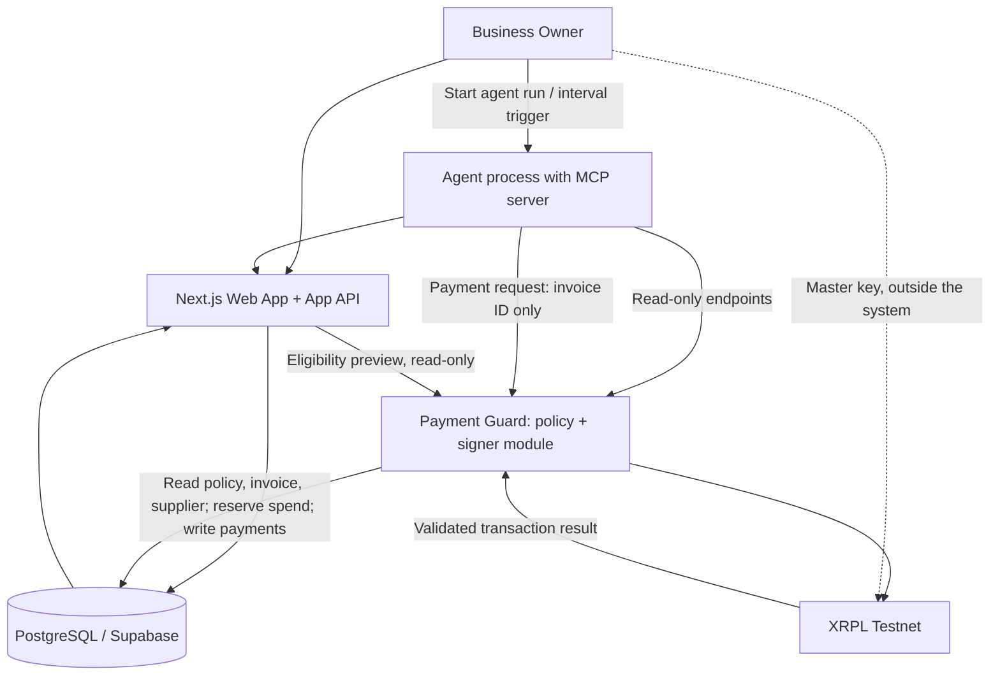

# Flow AI

> **Version:** 3.5.0  
> **Document type:** Product requirements, business case, UX specification and engineering build brief  
> **Prepared:** 11 November 2026  
> **Supersedes:** `Flow_AI_MVP_README_v3.0.md` (kept in the repository as history)  
> **Product owner:** Koeneng Hub  
> **Hackathon track:** Agentic Finance  
> **Network:** XRP Ledger (XRPL) Testnet only  
> **Settlement asset:** RLUSD issued on XRPL Testnet  
> **Status:** Active MVP build specification  
> **Audience:** AI coding agents, software engineers, product/design collaborators and hackathon reviewers

**Product promise:** Flow AI helps small businesses prioritise supplier invoices and run pre-authorised stablecoin payments through an AI agent, while independent controls enforce the business owner's spending rules.

> **Naming rule:** The product name is **Flow AI** and the repository name is `flow-ai`. Use this name in all new code, UI copy, documentation, screenshots and demos. Do not introduce the retired working name into new product surfaces.

---

## 0. Instructions to AI coding agents

### Document control and version history

Version 3.0 consolidated the project concept, Agentic Finance challenge requirements, product scope, system architecture, financial-control model, UX expectations and XRPL implementation references into one build specification. Version 3.5 keeps that architecture, the payment state model (section 5A) and the security rules, and adds ecosystem and judging alignment, a sharper customer story, practical onboarding detail, a smaller build footprint, technical corrections and fixes for internal contradictions.

### What changed in v3.5

**Settled product decisions (not open questions)**

- **Customer framing (both).** The lead narrative is a South African **importer** (persona Thandi) paying **cross-border suppliers** (for example in Lagos or Nairobi) in RLUSD, answering "why RLUSD rather than EFT, SWIFT or ZAR". The secondary corridor is a **domestic ZA supplier** paid in RLUSD for USD-priced stock. One persona, two supplier types. Suppliers carry a `country_code` and a derived corridor. Guard and policy-engine logic are unchanged. See sections 2.4, 2.11 and 2.12.
- **On-ledger backstop (P1).** A revocable XRPL **regular key**: the owner keeps the treasury master key; the payment guard signs with a regular key set by `SetRegularKey`; the owner can rotate or remove it. This is built after the first validated payment and after milestone M6 (section 15). Multi-signing is a P2 stretch. See sections 10.6, 10.7, 13.3.
- **Signer.** Env-seed signer for the MVP. Privy, Open Wallet Standard and Ripple Custody are described as optional or production paths (section 10.8).
- **LLM.** Anthropic Claude (Sonnet-class) with native tool calling behind a thin provider adapter, plus a deterministic fallback agent mode and a recorded fallback run (section 7.2.C).
- **Footprint.** Three deployable processes (section 7.3). The agent has no database credential. The finance-operator role and CSV export are cut from P0. Over-cap payments are hard-blocked in the MVP (no owner-approval routing).
- **Scheduled trigger.** A simple interval-based agent trigger is added as P1 for visible autonomy.

**Judging, accessibility and deployment (new requirements)**

- The three weighted judging criteria (Product design 33%, Technical 34%, Business/Market fit 33%) sit beside Ripple's five criteria and the earlier rubric, with a mapping table to features and acceptance checks (section 14A).
- Accessibility requirements are strengthened and WCAG-minded, with a mobile-first rule (section 11.10).
- A **deployed public demo URL is a P0 acceptance item**, with performance and reliability notes (sections 3.2, 14.3, 14.5).
- The market section adds local-infrastructure integration points as caveated hypotheses, with WhatsApp/email intake as future work (section 2.12).

**Technical corrections**

- Payment construction is rewritten as prepare/autofill, sign, persist hash and `LastLedgerSequence`, submit, reconcile (section 10.3). A payment is definitively failed only when a validated ledger passes `LastLedgerSequence` without the transaction.
- `tec` versus `tes` handling, partial-payment guard (`delivered_amount`) and a per-wallet signing queue are specified.
- Policy gains `valid_until` (mandate expiry) and `allowed_assets` (section 6.2).
- New tests: `LastLedgerSequence` expiry reconciliation, hostile-invoice prompt injection, guard refuses to start on non-Testnet (section 14).

**Contradictions from v3.0 fixed**

- Approved suppliers have a single source: `suppliers.is_approved`. The policy no longer carries a supplier-id list.
- Timezone has a single source: `businesses.timezone`.
- The kill-switch wording (13.1C) is rewritten: default blocked unless explicitly allowed; fail closed if unreadable.
- An invoice-status versus payment-status mapping table is added (5A.1). `CANCELLED` now has defined triggers (5A.2).
- A read-only eligibility preview endpoint is specified for the "Eligible" badge (9.5).
- Balance source is clarified (6.1).
- Timing wording in sections 14A and 15 treats Phase 1 as done; the phases are replaced with milestones M0 to M8 and a cut line.
- Open decisions are replaced with the settled ones (section 19), with a short list of items that are still unverified (19.2).
- New scripts: `preflight`, `reset-demo`, trust-line setup for supplier accounts (section 16).

**Resources added** (sections 10.2, 21, 22): `tryrlusd.com`, XRPL AI starter kit, agentic-transactions guide, Docs MCP server, xrpl-up, XRPL AI Hub, `tec` result-code reference, amendments page, secret-scan rule. Ecosystem fit and future work is new (section 22).

### Priority of requirements

1. The mandatory Agentic Finance MVP requirements and the security boundaries in this document.
2. The P0 user journey and acceptance criteria (including the deployed demo URL).
3. Product quality, accessibility and demo polish.
4. P1 enhancements (regular-key backstop first, then scheduled trigger).

Do not add optional features while a P0 requirement or its test is incomplete.

---

This README is the v3.5 source of truth for the Flow AI product, business case, user experience, architecture, security model and hackathon MVP. Read it fully before creating or changing code, database schemas, UI flows, agent tools, payment logic or deployment configuration. If the repository contains older documentation (including v3.0), prefer this document unless a newer, explicitly approved decision record supersedes it.

### Your operating rules

1. **Build the smallest complete product that proves the core promise.** Prioritise one end-to-end supplier-payment workflow over many disconnected features.
2. **Do not weaken the three Agentic Finance requirements:**
   - At least one XRPL Testnet or Devnet transaction must be initiated autonomously by the AI agent.
   - Spending limits must be enforced by a component the agent cannot control.
   - A human operator must be able to set and change those limits outside the agent.
3. **The agent must never possess the XRPL signing secret.** Only the payment guard's signer module may access the dedicated Testnet signing key, and only after it independently validates a payment request.
4. **The agent must not have tools or credentials to edit policies, add trusted recipients, change wallet configuration, increase limits, or access signing material.** The agent also has no database credential (section 7.2.C).
5. **The payment service must derive the amount, recipient, asset and business from trusted application records.** The agent submits an invoice ID, not arbitrary payment instructions.
6. **All payment rules must be enforced server-side.** UI validation and LLM reasoning are not security controls.
7. **Use deterministic code for arithmetic and policy decisions.** The LLM can explain, prioritise and initiate a workflow, but must not be the source of truth for balances, invoice amounts, spending totals or eligibility.
8. **Test on XRPL Testnet only.** Do not add a Mainnet switch, real-money flow, live custody or production payment capability to this MVP.
9. **Never put secrets in browser code, prompts, chat transcripts, source control, logs or screenshots.** Do not use `NEXT_PUBLIC_` for secrets. Run a secret scan (section 16, M0) because AI coding tools can write seeds into files that end up in public repositories.
10. **Do not invent user research, pilot customers, supplier partnerships, transaction results, regulatory approvals or business traction.** Label sample data and unvalidated assumptions honestly.
11. **Keep the product demoable at every stage.** Add loading, empty, error and success states. A reviewer should understand what happened without reading source code.
12. **Before adding a dependency or major service, explain why it is needed and prefer the simplest reliable option.**
13. **Keep code typed, modular, documented and testable.** Add automated tests for policy enforcement and payment status transitions before polishing secondary features.
14. **Do not silently change this product brief.** When a requirement cannot be met, document the blocker and propose the smallest safe alternative.
15. **Do not use any XRPL amendment-dependent feature** (for example TokenEscrow or Credentials) unless its status is verified live on Testnet at `livenet.xrpl.org/amendments`. Plain `Payment`, `TrustSet` and `SetRegularKey` are the only transaction types this MVP relies on.

### Definition of done

The MVP is not done when a chatbot says it would pay an invoice. It is done when a reviewer can:

1. Open the **deployed public demo URL** and sign in as the demo business owner.
2. View a funded Testnet treasury account, a sample RLUSD balance and supplier invoices (including at least one cross-border and one domestic supplier).
3. Set a per-payment cap, daily spend cap, minimum RLUSD reserve and approved supplier list in the dashboard.
4. Start the treasury agent.
5. See the agent independently select an eligible invoice and call the payment tool without a new per-payment human approval.
6. See the independent policy service validate or reject the request using the owner's current rules.
7. See at least one RLUSD payment submitted and validated on XRPL Testnet.
8. Open the payment record and inspect its transaction hash, recipient, amount, network and final status.
9. Change a policy as the human owner and prove that the agent cannot change it or bypass the new limit.

---

## 1. Product overview

### 1.1 One-sentence description

**Flow AI is an AI-powered treasury assistant that helps small businesses prioritise supplier invoices and autonomously execute owner-authorised stablecoin payments within spending rules enforced by an independent service.**

### 1.2 Product positioning

Flow AI is not a generic finance chatbot, a crypto wallet with a chat interface, or an autonomous agent with unrestricted access to funds.

It is a controlled treasury workflow for small businesses. It brings supplier obligations, a narrow view of available onchain funds, payment policies and transaction records into one understandable workspace. The AI agent helps decide *which eligible invoice to process next*. A separate policy and execution service decides whether the proposed payment is permitted and carries it out only when the rules pass.

**Core principle:**

> The agent recommends and initiates. The policy service validates. The isolated signer executes. XRPL records and confirms. The business owner controls the rules.

### 1.3 Hackathon alignment

The selected track is **Agentic Finance**. The challenge asks for a working product where an AI agent moves money on behalf of a business and the XRP Ledger enforces the rules it plays by. The MVP must include:

- At least one transaction on XRPL Testnet or Devnet executed autonomously by an agent.
- Limits enforced somewhere the agent does not control: on-ledger, by an independent service, or by a funded Payment Channel it cannot overdraw.
- A way for a human operator to set or change those limits outside the agent.
- A real customer pain point, a named target user and a go-to-market strategy.

For this time-boxed MVP, Flow AI uses an **independent payment policy service** as the primary enforcement boundary. This is simpler to demonstrate than a custom on-ledger contract and is explicitly one of the allowed enforcement approaches in the challenge brief. Be honest that this is an application-layer enforcement service, not a trustless on-ledger spending restriction. In v3.5 a revocable regular key adds a cheap on-ledger backstop (section 10.6) that lets the owner cut off the guard's signing authority; it narrows the blast radius but does not enforce spending limits on-ledger.

Devnet is deliberately not used: RLUSD Testnet is the documented path for this MVP, and the Testnet-only rule is a security control.

---

### 1.4 Product identity and positioning

**Name:** Flow AI  
**Category:** AI-enabled treasury operations / Agentic Finance  
**Initial geography:** South Africa  
**Initial customer:** owner-operated South African importers and small distributors who pay suppliers, including suppliers in other African countries  
**Primary workflow:** policy-bounded autonomous supplier payments using RLUSD on XRPL Testnet  
**Product owner:** Koeneng Hub

**Positioning statement:** For South African importers and small distributors who need to pay cross-border and USD-priced suppliers without exhausting operating funds, Flow AI brings invoice prioritisation, owner-defined spending controls and verifiable stablecoin settlement into one workflow. Unlike a generic AI finance assistant, Flow AI can initiate an actual onchain payment, but only after an independent service validates it against the business owner's current rules.

**Short product description:** An AI treasury agent that helps a business decide which supplier invoice to pay next and autonomously processes eligible payments within limits set by the owner.

**Product principle:** useful automation without surrendering financial control.

### 1.5 What Flow AI is and is not

Flow AI **is**:
- A focused treasury workflow for supplier invoices.
- An agentic application that can call a payment tool and initiate a qualifying Testnet transaction.
- A system where human owners set payment limits outside the AI agent.
- An auditable product that explains why a payment was allowed or blocked.

Flow AI **is not**:
- A general-purpose chatbot that gives unverified financial advice.
- An unrestricted autonomous wallet.
- A trading bot, investment platform, lending product or yield product.
- A replacement for bookkeeping, accounting, banks or regulated payment providers.
- A live-money service. The hackathon MVP is restricted to XRPL Testnet and test RLUSD with no financial value.
- A foreign-exchange or remittance product. The MVP does not convert ZAR, does not provide an off-ramp and makes no compliance claims (section 2.12).

### 1.6 The CFO test: four questions the owner can answer

Ripple's challenge material frames a CFO test around what an agent may do, who it can pay, how to stop it and how to prove what it did. Flow AI answers each with a concrete feature.

| CFO question | Flow AI answer | Where specified |
|---|---|---|
| What may the agent do? | Only the five allow-listed tools; payments only for stored invoice IDs; limits set by the owner (per-payment cap, daily cap, reserve, allowed assets, mandate expiry) | 6.2, 7.2.D |
| Who can it pay? | Only suppliers the owner has explicitly approved (`suppliers.is_approved`), at their stored XRPL address | 6.3, 8.1 |
| How do I stop it? | Pause automation in the dashboard; server-side emergency kill switch; and (P1) revoking the guard's regular key on the ledger | 6.5, 13.1C, 10.6 |
| How do I prove what it did and why? | Append-only audit events, decision codes, policy version per decision, validated transaction hash and explorer link | 9.4, 11.9 |

## 2. Business case: why we are building Flow AI

### 2.1 The problem

Small South African importers, retailers and distributors regularly need to pay suppliers while protecting the money required to keep operating. Many of those suppliers are in other African countries or price their stock in US dollars. A business owner may be juggling:

- Several supplier invoices with different due dates, currencies and countries.
- Frequent stock purchases and restocking needs.
- Incoming sales and an uncertain short-term cash position.
- A minimum amount that must remain available for day-to-day operations.
- Payment details spread across spreadsheets, messages, paper invoices and separate banking or payment tools.
- Cross-border payments that can involve intermediary banks, fees, exchange-rate margins and banking-hour delays (to be validated with real owner-operators, see 2.9).

This fragmentation makes it harder to answer basic operating questions:

- Which supplier invoice should be paid first?
- Can the business afford this payment today?
- How much will remain after payment?
- Will paying this supplier leave enough money for the next operating cycle?
- Was the payment actually completed, and where is the proof?

A poor payment decision can create a working-capital squeeze, delay restocking, strain supplier relationships or leave the business short of operating funds.

### 2.2 Why the problem deserves a solution

The product is built around a practical business need, not around adding blockchain for its own sake. Small businesses need clearer payment prioritisation and a reliable record of what has been paid. They also need automation that does not remove their control over business funds.

Flow AI explores whether AI-assisted treasury operations and programmable stablecoin payments can make this workflow easier to understand, more consistent and more auditable.

**Important market-validation note:** The problem statement is the product hypothesis for the hackathon. Do not claim that all South African SMEs experience it in the same way. Validate it with real owner/operators and capture their actual workflow, preferred payment methods, supplier requirements and willingness to use an onchain settlement option.

### 2.3 Initial target customer

**Primary beachhead:** owner-operated South African importers, retailers and small distributors that:

- Purchase stock or services from multiple suppliers, some of them outside South Africa or pricing in USD.
- Have recurring supplier invoices.
- Need to preserve working capital for daily operations.
- Currently use a mixture of spreadsheets, messaging apps, paper records or separate finance tools.
- Are digitally curious and open to testing a wallet-based payment workflow with willing suppliers.

**Primary user:** the business owner or owner-operator who makes payment decisions and is accountable for cash availability.

**Secondary user:** a bookkeeper or operations manager who captures invoices. In the MVP this person does not have a separate role (section 4.2).

**Supplier:** a business receiving payment. Supplier portal access is not required for the MVP; the supplier is represented by an approved XRPL destination address and a `country_code`. Two supplier types are supported by the same persona and the same policy engine:

| Supplier type | Example | Why RLUSD helps (hypothesis) |
|---|---|---|
| Cross-border supplier (lead narrative) | A distributor in Lagos or Nairobi | Settlement is not bound to banking hours; USD-denominated pricing without a bank-by-bank correspondent chain; potentially lower cost and FX margin. All to be validated. |
| Domestic ZA supplier (secondary corridor) | A Johannesburg wholesaler with USD-priced stock | Invoice is priced in USD, so paying in a USD stablecoin avoids a ZAR-to-USD conversion step inside the payment itself. To be validated. |

### 2.4 Example customer story

Use this as a demo persona, not as a real customer testimonial:

> Thandi runs an import business in South Africa. She buys stock from a supplier in Lagos, another in Nairobi and a wholesaler in Johannesburg who prices in US dollars. She has several invoices due, but she also needs to keep enough funds available for the next restock and daily operating costs. Her records are spread across messages and a spreadsheet, and international payments are slow and expensive to arrange. She wants help deciding which invoice can be paid without breaching the reserve she has set for the business. She does not want an AI model to have unlimited control of her money. She wants to set the rules herself, let the system process suitable payments within those rules, and see reliable proof of settlement.

### 2.5 Value proposition

For a small-business owner who needs to manage supplier payments with limited working capital, Flow AI provides:

- **Clarity:** invoices, available RLUSD, payment activity and reserve requirements in one dashboard.
- **Prioritisation:** an agent that identifies the next invoice that fits the business's current rules.
- **Controlled automation:** payments can execute without a separate approval click for every transaction, but only within limits configured by the owner.
- **Transparency:** understandable explanations, policy decisions, audit events and XRPL transaction references.
- **Verifiability:** payment status is based on the XRPL ledger result, not only an internal success message.

### 2.6 Why AI and why XRPL

**AI is used for workflow orchestration, prioritisation and explanation.** It can review the invoice queue, summarise why an invoice is a suitable candidate and call the payment tool. It must not calculate authoritative financial balances, make up payment amounts, or decide whether its own request is allowed.

**XRPL is used for stablecoin settlement and verifiable transaction records.** RLUSD on XRPL Testnet gives the MVP a concrete issued-token payment flow to demonstrate. Each receiving account must have the required trust line with the RLUSD issuer before it can receive the token.

### 2.7 Business model hypothesis

The MVP is for demonstrating product value, not proving revenue. A plausible future model to validate is:

- **Starter subscription:** invoice organisation, treasury visibility and basic payment workflows.
- **Business subscription:** more supplier records, configurable policies, agent automation and reporting.
- **Partner/integration offering:** integrations for wholesalers, distributors, accounting platforms or SME-support programmes.

Do not hard-code prices or imply that customers have agreed to pay. Research willingness to pay and compare subscription pricing with the cost and value of the current manual workflow.

### 2.8 Go-to-market hypothesis

Start with a narrow pilot rather than launching to every SME segment:

1. Identify a small group of South African importers or distributors that pay suppliers in other African countries, in one market or trade corridor.
2. Interview owners about invoice handling, supplier-payment decisions, cash reserves, current payment methods and cross-border payment pain.
3. Map the workflow and identify suppliers willing to test wallet-based settlement in a sandbox.
4. Demonstrate Flow AI using Testnet first, then investigate operational, legal, compliance (including exchange-control and licensing questions, see 2.12) and supplier-readiness requirements before any real-world deployment.
5. Pilot with a small number of businesses only after appropriate review, safeguards and partner readiness.
6. Use feedback to decide which accounting, inventory or supplier integrations have the highest value.

**Next 90 days (plan, not a commitment):** complete 10 to 15 owner/supplier interviews and record the evidence (2.9); measure the real cost, FX margin and time of the current cross-border payment process for at least a few businesses; investigate a licensed ZAR on/off-ramp partner and regulatory requirements with qualified advice; decide whether a pilot with a small number of willing businesses is justified. The hackathon prize includes an accelerator interview where founder potential and ability to keep building are assessed (section 14A), so keep this plan visible in the pitch.

### 2.9 Customer discovery questions and validation evidence

The MVP team should seek direct feedback from owner-operators or people who handle supplier payments. Keep the research lightweight and honest. Ask about the current process before pitching the proposed product.

Suggested interview prompts:
- How do you currently record supplier invoices and payment due dates?
- Who decides which supplier gets paid first when funds are limited?
- How do you decide how much money must remain for stock purchases and daily operating costs?
- What causes the most confusion, delays or rework in the current process?
- How do you confirm that a supplier payment has actually cleared?
- Which payment methods do your suppliers currently accept?
- For suppliers in other countries: how long does a payment take, what does it cost in fees and exchange-rate margin, and what goes wrong?
- Do any suppliers price in US dollars? How do you convert ZAR today?
- Would you consider a system that executes payments automatically within limits you set? What would make you trust or reject it?
- What would need to be integrated with the tools you already use (WhatsApp, email, accounting software, bank portal)?

Record interview date, participant role, anonymised notes, recurring themes and evidence that challenges the product hypothesis. Do not invent quotes, customer numbers, validation results or willingness-to-pay evidence. A statement such as "we plan to validate this with importers and retailers" is acceptable when validation has not yet happened.

### 2.10 Product success metrics

For the hackathon MVP, measure product and technical proof rather than unsupported commercial traction:
- Percentage of seeded invoice scenarios classified correctly by deterministic rules.
- Number of policy-violating requests blocked before signing.
- Number of qualifying agent-initiated payments reaching a validated Testnet result.
- Duplicate payment requests prevented by idempotency.
- Time from agent run start to a final or explicitly pending status.
- Percentage of demo participants who can understand the owner policy and payment status without coaching.

These are prototype metrics, not proof of customer impact. Do not claim reduced costs, faster settlement for real businesses or improved cash flow without measured evidence.

### 2.11 Why RLUSD rather than EFT, SWIFT or ZAR

This section is the answer to "why a stablecoin for this customer". Every comparison below is a **hypothesis to validate**, not a measured result. Do not present these as facts in the demo; present them as the reasons the team believes the pilot is worth running.

| Dimension | Typical bank route (hypothesis) | RLUSD on XRPL (what the Testnet demo can show) |
|---|---|---|
| Speed | Cross-border bank transfers may take a day or more and follow banking hours and cut-offs | XRPL ledgers close in seconds and settle 24/7; the demo shows the elapsed time from request to validated ledger |
| Cost | Correspondent and bank fees can apply; amounts vary by bank and corridor | An XRPL transaction fee is a very small amount of XRP; the demo can display the fee actually burned. Total real-world cost (including on/off-ramps) is unmeasured |
| FX margin | ZAR to USD to local currency can involve margins at each step | A USD-denominated stablecoin removes the conversion inside the payment itself when the supplier prices in USD; the cost of getting ZAR in and local currency out is not removed and is unmeasured |
| Availability | Bank hours and holidays | Ledger operates continuously |
| Proof | Bank statements and proof-of-payment documents | Public transaction hash that anyone can look up on an explorer |
| USD pricing | Supplier quotes in USD, importer holds ZAR | Invoice, treasury and settlement all in the same USD-denominated unit, so reserve and cap maths is in one unit |

Honest limits: in the MVP the importer's treasury is funded from the Testnet faucet, supplier conversion to local currency is not modelled, and no real FX or compliance feature exists. See section 2.12.

### 2.12 Local infrastructure and regulatory awareness

These points position the product in the South African and wider African context. They are **future-work and awareness items, not features of the MVP and not claims of compliance or partnership.**

- **ZAR on/off-ramp story (out of scope for the MVP).** In a real pilot the importer would need a way to convert ZAR into a USD stablecoin, and the supplier a way to convert it into local currency or hold it. This would be done through licensed third-party on/off-ramp providers. Availability, pricing and the regulatory status of any specific provider are **unverified** here and must be researched before a pilot. The MVP only shows the settlement leg.
- **Mobile-first and low-bandwidth.** Many users will be on phones and variable connections. The UI is mobile-first (section 11.10), avoids heavy assets, and tolerates slow responses with clear pending states (section 14.5). Targets are stated there and are unmeasured until tested.
- **EFT and bank rails comparison.** Domestic EFT is the incumbent for ZA-to-ZA payments and is a relevant benchmark. For the domestic-supplier corridor the case rests on USD-priced stock, not on beating EFT on speed or cost. Any quantified comparison needs measured data from interviews (2.9).
- **SARB and FSCA awareness (caveat, not a claim).** Cross-border payments and crypto-asset activity in South Africa may be subject to exchange-control rules administered by the South African Reserve Bank and to licensing or conduct requirements overseen by the Financial Sector Conduct Authority. The team has not obtained legal advice and makes no statement about whether a given Flow AI deployment would be compliant. Obtain qualified legal and compliance advice before any real-world use.
- **Integration with local tools (future work).** Invoices commonly arrive by WhatsApp or email. Intake from those channels, accounting-package integration and bank-portal reconciliation are future work and are not in the MVP; manual entry and seeded data are used instead. If built later, extracted invoice text must be treated as untrusted data (section 13.1A).

---

## 3. Product goals and scope

### 3.1 MVP end goal

Deliver a polished, reliable demonstration of **one complete autonomous supplier-payment journey**:

A business owner configures payment limits outside the agent. The agent reviews invoices and available RLUSD, selects an eligible invoice, calls a narrowly scoped payment tool, and a separate service independently validates the request. If the policy passes, the service signs and submits an RLUSD payment on XRPL Testnet. Flow AI verifies the validated ledger result and displays the transaction evidence.

The MVP should make this sequence obvious to a product judge, technical judge and business judge without requiring an explanation of the source code.

### 3.2 Must-have capabilities (P0)

1. Demo sign-in and a single demo business workspace.
2. Overview dashboard with Testnet treasury balance, invoice totals, remaining daily allowance, reserve floor and recent activity.
3. Supplier records with XRPL destination addresses, `country_code` and an approved/unapproved state. Demo data includes at least one cross-border and one domestic supplier.
4. Manual invoice creation and a seeded demo invoice set. OCR/document extraction is not required.
5. Human-managed policy settings: per-payment cap, daily cap, minimum RLUSD reserve, approved suppliers (via the supplier approval flag) and automation enabled/paused state.
6. Agent that reads the invoice queue, explains a candidate and initiates a payment request through its tools.
7. MCP-compatible tool interface or a clearly documented MCP server exposing only the approved agent capabilities.
8. Independent policy service (payment guard) that validates all payment requests against current stored policies and authoritative invoice/supplier records.
9. Server-side Testnet signer module and XRPL payment submission.
10. Validated transaction result, transaction hash, payment detail page and audit trail.
11. Clear blocked/failed states for policy violations, missing trust lines, insufficient funds and network errors.
12. Automated tests for policy enforcement, idempotency and agent permission boundaries.
13. **A deployed, publicly reachable demo URL** (Testnet only, demo credentials, no real data) for the web app, with the guard and agent running behind it. A localhost-only demo does not satisfy P0. See 14.3 and 14.5.
14. Accessibility baseline in section 11.10 met on the main journey.

### 3.3 Should-have capabilities (P1)

In priority order:

1. **Revocable regular-key backstop** (section 10.6): after the first validated payment and after milestone M6. This is the first item to drop only if time runs out.
2. **Scheduled agent trigger**: a simple interval so the agent visibly acts without a button press.
3. Agent activity feed showing what data it reviewed, what it selected and why.
4. Payment queue status and an easy way to pause automation.
5. Search and filter invoices/payments.
6. A clean seeded demo mode with repeatable sample data (the `reset-demo` script is P0 for rehearsal, see section 16).
7. Testnet explorer link for validated transactions.

### 3.4 Explicit non-goals for this hackathon MVP

Do not build these unless all P0 acceptance criteria are complete:

- XRPL Mainnet or real-money payment capability.
- Fiat deposits, withdrawals, bank connections, fiat conversion or a ZAR on/off-ramp.
- Real cross-border remittance functionality, FX calculations or compliance features. The cross-border story is told through demo data and narrative (2.11, 2.12), not implemented FX.
- Supplier self-service portal or supplier account onboarding.
- Complex accounting, inventory or POS integrations.
- OCR or autonomous document extraction from arbitrary uploaded invoices, and WhatsApp/email intake.
- Multi-currency treasury or foreign-exchange calculations.
- Multiple blockchain networks.
- Autonomous trading, yield generation, lending or investment recommendations.
- A custom smart-contract wallet, payment channel, or Escrow/Credentials-based enforcement. The following **are permitted** as scoped additions once P0 is complete: the revocable regular key (P1, 10.6) and, as a P2 stretch only, a multi-signing `SignerList`. Any other amendment-dependent feature requires verification of its Testnet status first (10.7).
- Owner-approval routing for over-cap payments. In the MVP a payment above the cap is hard-blocked.
- A finance-operator role and CSV export (cut from P0 and P1).
- Production custody, production compliance claims or public launch claims.

---

## 4. Users, roles and permissions

### 4.1 Business owner

Can:
- View all business invoices, balances, payments and audit events.
- Add, edit and approve supplier records.
- Create and update invoices.
- Set and change payment policies.
- Pause or resume the agent.
- Start an agent run and inspect its reasoning summary.
- Cancel a payment that has not yet been signed (5A.2).
- View payment details and transaction evidence.
- (P1) Rotate or remove the guard's regular key through the dashboard action or a script (10.6).

Cannot:
- Change XRPL network configuration from the normal product UI.
- View or export signing secrets.

### 4.2 Finance operator (not in the MVP)

The finance-operator role from v3.0 is cut. The MVP has an `owner` role and a read-only `viewer` role only. Do not build operator-specific permissions. If it is added later, it must not be able to change policy limits or access signing material.

### 4.3 AI treasury agent

Can only:
- Read a business snapshot and eligible invoice queue through narrowly scoped tools.
- Request that a specific stored invoice be considered for payment.
- Read the policy decision and payment status returned by the payment service.
- Explain the decision to the human operator.

Cannot:
- Create or edit policies.
- Add or approve suppliers.
- Change invoice amount, currency, recipient or business identity.
- Change the payment network or token issuer.
- Read the signer secret or sign transactions directly.
- Hold any database credential.
- Cancel or drop a payment.
- Bypass the independent policy service.
- Submit arbitrary XRPL transactions.

### 4.4 Independent policy and execution service (payment guard)

Can:
- Read the authoritative policy, invoice, supplier and treasury records it needs.
- Atomically reserve daily spending capacity.
- Validate payment eligibility and limits.
- Access the dedicated Testnet signer credential (the regular-key seed when 10.6 is enabled, otherwise the env seed).
- Submit approved Testnet transactions and verify results.
- Write payment state and audit events.

Cannot:
- Let the agent change policy records.
- Accept arbitrary asset, issuer, network, recipient or amount values from the agent.
- Execute if the network configuration is not explicitly Testnet (the process refuses to start).

---

## 5. Core user journey

### Journey A: owner configures Flow AI

1. Owner opens the application and signs into the demo business workspace.
2. The dashboard clearly displays **TESTNET DEMO** and the connected treasury address.
3. Owner reviews the treasury's RLUSD balance and confirms that the receiving supplier accounts are configured for the demo.
4. Owner visits **Payment Policies**.
5. Owner sets:
   - Maximum amount per payment.
   - Maximum total automated spend per business day.
   - Minimum RLUSD reserve that must remain after a payment.
   - Approved suppliers (set per supplier; the policy screen shows them as a checklist that writes the supplier approval flag).
   - Agent automation state (enabled or paused).
   - Optional mandate expiry (`valid_until`).
6. Owner saves the policy. The app records who changed it, when and what changed.
7. The policy is persisted outside the agent's access path. The agent cannot edit it through tools or service credentials.

### Journey B: agent processes a supplier invoice

1. Owner starts **Run treasury agent**, or the P1 interval trigger starts a run.
2. Agent calls `get_business_snapshot` and `list_open_invoices`.
3. Agent identifies a candidate invoice based on due date, business priority and available balance.
4. Agent explains its proposed choice in plain language, including amount, supplier and expected remaining reserve. This is an explanation, not the policy decision.
5. Agent calls `request_supplier_payment` with only the stored invoice ID and an idempotency key.
6. Payment guard reloads the invoice, supplier, wallet and policy from trusted storage. It ignores any amount or recipient asserted in agent text.
7. Payment guard checks all payment rules, re-queries the live XRPL balance, and atomically reserves the daily allowance.
8. If the request passes, the signer module prepares and signs the XRPL Payment transaction, persists the hash and `LastLedgerSequence`, and submits it to Testnet (10.3).
9. Service waits for a validated ledger outcome and records the transaction hash and result. If finality cannot be determined because of a timeout, the service records `PENDING_CONFIRMATION` and reconciles the original transaction rather than blindly sending another payment.
10. Agent receives the structured result and reports the outcome accurately.
11. Dashboard updates the payment timeline, invoice status, RLUSD balance, daily allowance and audit feed.

A run is bounded: at most 5 tool calls and at most 1 payment request per run (7.2.C).

### Journey C: policy blocks a payment

1. Agent requests payment for an invoice.
2. Payment service independently checks the current policy.
3. A rule fails, for example the invoice exceeds the per-payment limit, the recipient is not approved, or paying it would breach the reserve.
4. No XRPL transaction is signed or submitted.
5. Service returns a structured rejection code and human-readable explanation.
6. Dashboard shows **Blocked by policy**, the failed rule and the amount/limit involved.
7. Owner can change the policy in the dashboard if appropriate. The agent cannot make that change. Over-cap payments are not routed for owner approval in the MVP; they stay blocked.

### Journey D: owner changes rules

1. Owner edits one or more policy settings in the dashboard.
2. Authenticated application API validates the values and persists the change.
3. An audit event records the previous and new values, actor and timestamp.
4. The policy service reads the latest committed policy for every payment request.
5. The agent receives no policy-edit tool and cannot update the stored policy.

### Journey E (P1): owner revokes the guard's signing authority

1. Owner chooses **Revoke signing key** on the Payment Policies screen (or runs the script in section 16).
2. The owner's master key (held outside the agent and guard) signs a `SetRegularKey` transaction that removes or replaces the regular key.
3. After validation, the guard's key can no longer sign for the treasury account. Any subsequent payment attempt fails on-ledger.
4. The dashboard shows "Guard key revoked" and the audit log records the change. See 10.6.

---

## 5A. Payment lifecycle and status model

Use explicit, durable payment states. The UI, agent and backend must use the same vocabulary.

```text
REQUESTED
   |   | policy fails                 policy passes
   v                                  v
BLOCKED                           RESERVED
                                      |
                                      | transaction prepared, signed, hash and
                                      | LastLedgerSequence persisted, then submitted
                                      v
                                  SUBMITTED
                                      |
                     +----------------+----------------+
                     |                                 |
             validated success                 validated failure
                     |                                 |
                     v                                 v
                 VALIDATED                           FAILED

If submission outcome cannot be determined, use PENDING_CONFIRMATION and reconcile
using the existing transaction hash and LastLedgerSequence rather than creating a
fresh payment.
```

Rules:
- `REQUESTED`: payment request received; no transaction has been signed or submitted.
- `BLOCKED`: independent policy service rejected the request; no onchain transaction should exist.
- `RESERVED`: daily-spend capacity and invoice execution lock are held; transaction is not yet signed.
- `SUBMITTED`: signed transaction was submitted; do not call it paid.
- `PENDING_CONFIRMATION`: submission or network response is ambiguous; reconcile by hash and `LastLedgerSequence`.
- `VALIDATED`: XRPL confirms the transaction in a validated ledger, the transaction result is `tesSUCCESS`, and `meta.delivered_amount` equals the intended amount.
- `FAILED`: a validated `tec` result, a delivered amount that differs from the intended amount, or a transaction that is definitively non-executing (the validated ledger index has passed `LastLedgerSequence` and the transaction is not in any validated ledger). Handle the reservation according to the failure type (10.3).
- `CANCELLED`: a cancellation occurred before signing and the reservation was safely released (5A.2).

Do not move a payment from `VALIDATED` back to `SUBMITTED`. Preserve every transition as an append-only event or auditable history row. A retry must either resume/reconcile the original transaction or create a new, explicitly linked attempt after the prior attempt is definitively non-executing.

### 5A.1 Invoice status versus payment status

The invoice has its own coarse status (`draft`, `open`, `processing`, `paid`, `blocked`, `cancelled`); the payment has the fine-grained states above. The invoice status is always derived from the latest payment attempt as follows. The UI badge "Eligible" is a computed overlay on an `open` invoice (9.5), not a stored status.

| Latest payment status | Invoice status | UI label |
|---|---|---|
| none | `open` | Open (or Eligible, from preview) |
| `REQUESTED`, `RESERVED`, `SUBMITTED`, `PENDING_CONFIRMATION` | `processing` | Processing (Pending confirmation if applicable) |
| `VALIDATED` | `paid` | Paid (validated on XRPL Testnet) |
| `BLOCKED` | `blocked` (returns to `open` when the owner changes a rule or the next preview passes) | Blocked by policy |
| `FAILED` | `open` after the reservation is released, with the failure shown on the payment | Failed (retry allowed after reconciliation) |
| `CANCELLED` | `open` | Open |
| (invoice withdrawn by owner) | `cancelled` | Cancelled |

A `draft` invoice is not visible to the agent.

### 5A.2 Who can cancel or drop a payment

- Only the **owner**, from the dashboard, and the **payment guard itself** (system) can cancel a payment. The agent cannot.
- Cancellation is allowed only in `REQUESTED` or `RESERVED`, before a signature exists. It releases the reservation and writes an audit event.
- The guard's sweeper cancels a payment left in `REQUESTED` or `RESERVED` with no signed transaction after a timeout (default 5 minutes, configurable).
- Once a transaction has been signed and its hash persisted, cancellation is not available. The payment moves through reconciliation to `VALIDATED` or `FAILED`.
- Cancelling the invoice itself (owner action) is only allowed when no payment is in `SUBMITTED` or `PENDING_CONFIRMATION`.

## 6. Product rules and financial logic

### 6.1 Source of truth

- Invoice amounts and supplier destinations come from stored application records.
- Treasury balances come from XRPL ledger queries, not LLM estimates or stale dashboard values. **Balance source:** the guard (through the XRPL adapter) polls the ledger on an interval and writes a balance snapshot with an `as_of` timestamp for the dashboard and agent. The guard **re-queries the live balance at decision time** for every payment request. The snapshot shown to the agent is informational only and never authoritative.
- Daily automated spend comes from payment reservations and completed payments stored by the policy service.
- Payment eligibility is determined by deterministic server-side policy code.
- The blockchain's validated transaction result is the source of truth for onchain settlement status.
- Approved suppliers come from `suppliers.is_approved`. The business timezone comes from `businesses.timezone`. Neither is duplicated in the policy.

### 6.2 Required policy fields

At minimum, each business policy should include:

| Field | Meaning |
|---|---|
| `enabled` | Whether automated execution is currently enabled |
| `max_payment_amount` | Maximum RLUSD value allowed for one payment |
| `daily_spend_limit` | Maximum RLUSD value that may be spent/reserved by automation per business day |
| `minimum_reserve` | Minimum RLUSD balance that must remain after the payment |
| `allowed_assets` | List of allowed (currency hex, issuer) pairs; the MVP contains only the configured RLUSD pair |
| `valid_until` | Optional mandate expiry timestamp. After it passes the guard blocks all payments until the owner re-confirms the policy |
| `updated_by` / `updated_at` | Human actor and timestamp for the latest change |
| `version` | Incrementing policy version used for audit and concurrency checks |

Not in the policy table, by design: the approved-supplier list (single source is `suppliers.is_approved`) and the timezone (single source is `businesses.timezone`, default `Africa/Johannesburg`, used to define the daily spending window).

All amounts must be represented using decimal-safe handling. Do not use JavaScript floating-point arithmetic for money. Persist fixed-precision decimal values or validated decimal strings. Convert to XRPL issued-token amount format only in the XRPL adapter.

### 6.3 Eligibility checks

A payment may proceed only when **all** checks pass:

1. Automation is enabled, the emergency kill switch allows execution (13.1C) and the mandate has not expired (`valid_until`).
2. Business, wallet, invoice and supplier records are active.
3. Invoice is unpaid and belongs to the same business as the request.
4. Supplier is explicitly approved (`suppliers.is_approved`).
5. Supplier destination is a valid XRPL classic address and is not the treasury's own address.
6. Invoice amount is positive, within the configured per-payment cap and uses an asset in `allowed_assets`.
7. The business's RLUSD balance (queried live) can cover the payment.
8. The post-payment RLUSD balance will be greater than or equal to the minimum reserve.
9. Completed daily spend plus pending reservations plus this payment will not exceed the daily spend limit.
10. The payment request is not a duplicate and the invoice is not already being paid.
11. The active network and issuer match the Testnet configuration.
12. The receiving account has a suitable RLUSD trust line and the treasury account meets the necessary XRPL account/reserve requirements.

If any check fails, reject the request without signing or submitting a transaction. Return a specific reason code. Never let the LLM override a rejection. The supplier's `country_code` does not alter any check: the same rules apply to cross-border and domestic suppliers.

### 6.4 Daily spending and concurrency

The policy service must prevent two simultaneous requests from spending the same daily allowance.

- Use a database transaction/row lock or an atomic database function to reserve capacity before signing.
- Treat a pending payment as reserved spend until its final status is known.
- Release a reservation only when a payment is definitively failed or cancelled and cannot still validate.
- Use the business timezone (`businesses.timezone`) when calculating the daily window.
- Do not rely on a frontend calculation for the remaining daily limit.
- **Signing is serialised per treasury wallet.** One account has one `Sequence` stream, so concurrent signings can collide (for example `tefPAST_SEQ`, `terPRE_SEQ`). Use a per-wallet queue or advisory lock around prepare, sign and submit. The daily-cap lock does not replace it.

### 6.5 Human control

The owner must be able to:
- Set and change every policy limit in the dashboard.
- Add or remove approved suppliers.
- Pause and resume agent automation.
- Cancel an unsigned payment (5A.2).
- Inspect an audit trail of all changes.
- (P1) Revoke the guard's regular key on-ledger (10.6).

Policy editing must use a separate authenticated application path. It must not be exposed as an MCP tool to the agent.

---

## 7. Solution architecture

### 7.1 Recommended high-level architecture

Use a modular TypeScript monorepo with **three deployable processes**. The exact framework versions should be selected from current stable releases when the repository is created. Prefer Node.js 22 or a currently supported version compatible with the selected XRPL library.



The agent process has **no database credential**. It reads business context only through the guard's read endpoints (exposed to the agent as MCP tools) and requests payments through the guard's one execution endpoint. The owner's master key never enters any deployed process.

### 7.2 Component responsibilities

#### A. Web application

Responsibilities:
- Authentication and business workspace.
- Dashboard, invoices, suppliers, payment policies, payment history and agent activity.
- Forms and client-side validation for usability only.
- Calls authenticated backend APIs.
- Displays an unmistakable Testnet environment label.

The browser must never connect to a signer secret or receive privileged policy-service credentials.

#### B. Application API (inside the Next.js process)

Responsibilities:
- Authenticated CRUD operations for invoices, suppliers and policies.
- Role and business-ownership checks.
- Dashboard aggregation.
- Audit events for human actions.
- Triggering/monitoring agent runs.
- Owner actions: cancel an unsigned payment, (P1) request guard-key revocation script execution status.

Only authenticated human roles may call policy mutation endpoints. Validate all input server-side.

#### C. AI treasury agent

Responsibilities:
- Read business snapshot and open invoice list.
- Apply understandable prioritisation logic to identify a candidate invoice.
- Explain the candidate using retrieved facts.
- Invoke a narrow payment request tool.
- Report structured success, pending or blocked status.

**Provider.** Anthropic Claude (Sonnet-class) with native tool calling, behind a thin provider adapter selected by environment (`AI_PROVIDER`, `AI_MODEL`, section 17). The adapter exposes one function (messages and tool definitions in, assistant message and tool calls out) so another provider can be swapped in without touching the agent loop or the guard. Rationale: native tool calling keeps the tool surface small and schema-validated, and a single provider reduces integration time. Verify the current model id in the provider's documentation at build time.

**Bounds per run.**
- Maximum **5 tool calls** per run (default, configurable).
- Maximum **1 payment request** per run.
- Run timeout (default 60 seconds) after which the run ends with an explicit status.
- `agent_reason` is capped at **280 characters**, validated by the guard, stored as untrusted text and rendered as plain text only (no markup, no links).

**Deterministic fallback mode.** `AGENT_MODE=deterministic` runs the same loop with a rule-based chooser (earliest due date among invoices the preview marks eligible) instead of the LLM. It **still calls the real MCP tools and the real guard**; it never fabricates a transaction or a hash. Use it if the LLM is unavailable at demo time. Also prepare a **recorded fallback run** (a screen recording of a genuine earlier run with a real validated transaction hash) as a last resort for the demo video. Label it as a recording.

**Independence.** The LLM must not be trusted with financial calculations or policy enforcement. For consistent demo behaviour the LLM may be given a pre-ranked candidate list from deterministic code, but it must itself issue the `request_supplier_payment` tool call so the autonomy claim is genuine.

#### D. MCP tool server (runs inside the agent process; stdio or in-process)

Expose only a small allowlist of tools:

| Tool | Permission | Purpose |
|---|---|---|
| `get_business_snapshot` | Read | Get the latest balance snapshot (with `as_of`), reserve and daily allowance summary. Informational; the guard re-checks live at decision time |
| `list_open_invoices` | Read | List unpaid invoices and supplier metadata (name, country, approved flag), with the read-only eligibility preview |
| `get_invoice_details` | Read | Read a specific invoice |
| `request_supplier_payment` | Execute request | Submit a stored invoice ID for independent policy validation and possible payment |
| `get_payment_status` | Read | Retrieve status and transaction evidence |

**Do not expose:** `update_policy`, `set_spending_limit`, `add_supplier`, `change_recipient`, `change_wallet`, `get_signing_secret`, `sign_transaction`, `submit_arbitrary_transaction`, `cancel_payment` or any generic database-write tool.

Suggested payment tool input:

```json
{
  "invoice_id": "uuid",
  "idempotency_key": "unique-request-key",
  "agent_reason": "Invoice is due and is eligible under the current business context."
}
```

The server must derive business ID, amount, asset and destination from the stored invoice and supplier records. `agent_reason` is untrusted explanatory metadata, not an instruction to the signer.

#### E. Independent payment policy service (payment guard)

This is the most important trust boundary in the MVP.

Responsibilities:
- Authenticate requests from the agent process using a server-to-server credential.
- Accept only invoice ID and idempotency key, with a bounded optional reason string (at most 280 characters).
- Reload current policy and business data from trusted storage.
- Validate every eligibility rule independently, re-querying the live XRPL balance.
- Atomically reserve daily spend capacity.
- Construct the payment from canonical stored records.
- Call the signer module only when all checks pass.
- Persist state transitions and audit events.
- Run balance polling, the reconciliation job and the stale-reservation sweeper.
- Serve read-only endpoints for the agent and for the eligibility preview (9.5).
- Return structured outcomes to the agent.

The payment service must have no endpoint that lets the agent mutate the policy. Its database permissions are scoped to the tables it needs (payments, reservations, audit events, balance snapshots) and it has read access to policy, invoice and supplier data.

#### F. Signer module (inside the payment-guard process)

Responsibilities:
- Load the signer credential from the guard's own environment or a suitable secret manager. The agent and web processes never receive it.
- Refuse to start if the configured network is not Testnet (covered by a test, section 14.2).
- Construct only an RLUSD `Payment` transaction using validated canonical data, without `tfPartialPayment`.
- Prepare/autofill, sign, persist hash and `LastLedgerSequence`, submit, and reconcile (10.3).
- Never reveal the seed/secret in API responses or logs.

**Honest isolation statement.** The guard and signer module share one process. Isolation is from the agent and the browser, not between guard code and signer code inside the process. A bug in the guard could therefore cause the signer to sign something unintended. Mitigations: a typed signer interface that accepts only a policy-approved payment instruction, a hard-coded Testnet assertion, and (P1) a regular key that the owner can revoke on-ledger (10.6). Do not describe the signer as a separate trust domain from the guard.

For this hackathon, a dedicated server-side Testnet demo account is acceptable. This is a controlled demo wallet, not a production custody architecture. The agent does not hold the wallet key and cannot sign directly. See 10.8 for signer backends.

#### G. XRPL adapter

Wrap `xrpl.js` calls behind an interface so the rest of the application is not coupled to low-level ledger response shapes. It should support:
- Testnet connection health, with timeouts and reconnect handling.
- Treasury account information and reserve values (queried, not hardcoded).
- RLUSD trust-line/balance lookup.
- Payment preparation, signing and submission.
- Validated transaction lookup and `delivered_amount` extraction.
- Recipient account/trust-line checks where feasible.
- `TrustSet` and `SetRegularKey` helpers used by scripts.

Do not scatter RPC URLs, issuer addresses or transaction parsing across UI components.

### 7.3 Suggested repository layout

```text
flow-ai/
├── apps/
│   ├── web/                  # Next.js application, dashboard and authenticated app API
│   ├── payment-guard/        # Policy service + signer module (own env and credentials)
│   └── agent/                # Agent loop, provider adapter and MCP server (stdio/in-process)
├── packages/
│   ├── contracts/            # Shared Zod schemas and API types
│   ├── database/             # Schema, migrations, queries and seed data
│   ├── xrpl-adapter/         # XRPL client and RLUSD payment adapter
│   └── policy-engine/        # Pure deterministic eligibility functions
├── scripts/
│   ├── preflight.ts          # Verify network, issuer and currency hex
│   ├── setup-suppliers.ts    # Create/fund supplier accounts and TrustSet RLUSD
│   ├── reset-demo.ts         # Re-fund, re-trust, re-seed
│   └── owner-key.ts          # (P1) set / rotate / remove the guard regular key
├── docs/
│   ├── architecture.md
│   ├── threat-model.md
│   ├── demo-script.md
│   └── decisions/
├── .env.example
├── .gitignore
├── package.json
├── pnpm-workspace.yaml
└── README.md
```

This is a target structure, not a reason to create empty packages prematurely. Build and test each boundary in sequence. Shared UI tokens and lint configuration can live inside `apps/web` and the root until a second consumer exists. Keep separate credentials per process even when code lives in one workspace.

---

## 8. Data model

Use PostgreSQL (Supabase is acceptable) with migrations checked into source control. Apply row-level security for user-facing data access. Keep the guard's credentials separate from the web app's. The agent has no database credential.

### 8.1 Core tables

#### `businesses`
- `id` UUID primary key
- `name`
- `country_code` (default `ZA`)
- `timezone` (default `Africa/Johannesburg`; the single source of timezone)
- `created_at`

#### `business_members`
- `id`
- `business_id`
- `user_id`
- `role` (`owner`, `viewer`)
- Unique constraint on (`business_id`, `user_id`)

#### `treasury_wallets`
- `id`
- `business_id`
- `network` (MVP accepts only `xrpl-testnet`)
- `address`
- `asset_currency` (MVP `RLUSD`)
- `asset_issuer`
- `signing_key_mode` (`master_env`, `regular_key`, `revoked`) for display only
- `is_active`
- `created_at`

Do not store the wallet seed in this table.

#### `balance_snapshots`
- `id`
- `wallet_id`
- `rlusd_balance`
- `xrp_balance`
- `as_of` timestamp
- `ledger_index` nullable

Written by the guard's poller. Informational for the dashboard and agent; the guard re-queries live at decision time.

#### `suppliers`
- `id`
- `business_id`
- `name`
- `xrpl_address`
- `country_code` (for example `NG`, `KE`, `ZA`)
- `is_approved` (the single source of supplier approval)
- `is_active` boolean not null default true (the single source of supplier active status)
- `created_at`
- `updated_at`

Approval (`is_approved`) and active status (`is_active`) are separate single sources: approval is the owner's explicit consent to pay the supplier, while active status marks whether the record is usable at all. A payment requires both (6.3).

The corridor shown in the UI is derived: supplier `country_code` equal to the business country is "Domestic", otherwise "Cross-border". It is a display and reporting field only and does not enter any policy check.

#### `invoices`
- `id`
- `business_id`
- `supplier_id`
- `invoice_number`
- `description` (untrusted text)
- `amount` as fixed-precision decimal/numeric
- `currency` (MVP `RLUSD`)
- `issue_date`
- `due_date`
- `priority` (optional owner-defined value)
- `status` (`draft`, `open`, `processing`, `paid`, `blocked`, `cancelled`; derived per 5A.1)
- `created_at`
- `updated_at`

#### `treasury_policies`
- `id`
- `business_id` unique
- `enabled`
- `max_payment_amount`
- `daily_spend_limit`
- `minimum_reserve`
- `allowed_assets` (list of currency hex and issuer pairs)
- `valid_until` nullable
- `version`
- `updated_by`
- `updated_at`

Approved suppliers are represented only by `suppliers.is_approved`. Timezone is read from `businesses.timezone`. Do not duplicate either in this table.

#### `daily_spend_reservations`
- `id`
- `business_id`
- `business_date`
- `payment_id`
- `amount`
- `status` (`reserved`, `committed`, `released`)
- `created_at`
- `updated_at`

Use a unique/locking strategy that prevents concurrent requests from exceeding the daily cap.

#### `payments`
- `id`
- `business_id`
- `invoice_id`
- `supplier_id`
- `wallet_id`
- `network`
- `asset_currency`
- `asset_issuer`
- `amount`
- `destination_address`
- `status` (`requested`, `blocked`, `reserved`, `submitted`, `validated`, `failed`, `pending_confirmation`, `cancelled`)
- `policy_version`
- `idempotency_key`
- `tx_hash` nullable
- `last_ledger_sequence` nullable
- `ledger_index` nullable
- `result_code` nullable
- `delivered_amount` nullable
- `fee_drops` nullable
- `failure_code` nullable
- `failure_message` nullable and sanitised
- `agent_reason` nullable (at most 280 characters, plain text)
- `requested_at`
- `submitted_at` nullable
- `validated_at` nullable

Add unique constraints for idempotency key within the business and prevent multiple active payment attempts for the same invoice.

#### `agent_runs`
- `id`
- `business_id`
- `status`
- `trigger` (`manual`, `interval`)
- `mode` (`llm`, `deterministic`)
- `started_at`
- `completed_at`
- `summary`
- `tool_call_count`
- `candidate_invoice_id` nullable

#### `audit_events`
- `id`
- `business_id`
- `actor_type` (`human`, `agent`, `policy_service`, `system`)
- `actor_id` nullable
- `event_type`
- `entity_type`
- `entity_id`
- `metadata` JSONB with secrets and unnecessary personal data excluded
- `created_at`

### 8.2 Seed data

Provide a clearly labelled demo business and a handful of sample suppliers/invoices. Include:
- At least one cross-border supplier (for example `NG` or `KE`) and at least one domestic (`ZA`) supplier.
- At least one invoice that should pass all configured rules, ideally one per corridor.
- At least one invoice exceeding the per-payment cap.
- At least one invoice from an unapproved supplier.
- At least one invoice that would breach the minimum reserve.

The data should make both successful and blocked outcomes easy to demonstrate. Never label seed data as customer data. See section 13A for the fixture.

---

## 9. API and tool contracts

The exact routing framework can vary, but the permission boundaries and payload semantics must remain intact.

### 9.1 Human application endpoints

Suggested endpoints:

| Method | Path | Purpose | Access |
|---|---|---|---|
| `GET` | `/api/dashboard` | Dashboard snapshot | Authenticated member |
| `GET/POST` | `/api/invoices` | List/create invoices | Owner |
| `GET/PATCH` | `/api/invoices/:id` | Read/update an invoice | Owner |
| `GET/POST` | `/api/suppliers` | List/create suppliers | Owner |
| `PATCH` | `/api/suppliers/:id` | Update supplier or approval | Owner |
| `GET` | `/api/policy` | Read current policy | Owner |
| `PUT` | `/api/policy` | Update policy | Owner only |
| `POST` | `/api/agent-runs` | Start an agent run | Owner |
| `GET` | `/api/agent-runs/:id` | View run status | Member |
| `GET` | `/api/payments` | List payments | Member |
| `GET` | `/api/payments/:id` | Payment detail | Member |
| `POST` | `/api/payments/:id/cancel` | Cancel an unsigned payment (5A.2) | Owner only |
| `GET` | `/api/audit-events` | Audit history | Owner |

All routes must verify that the authenticated user belongs to the business referenced by the request. Never trust a client-supplied `business_id` without checking membership.

### 9.2 Internal agent/payment endpoint

Suggested internal endpoint on the payment guard:

`POST /internal/payment-requests`

Request body:

```json
{
  "invoice_id": "uuid",
  "idempotency_key": "stable-unique-key",
  "agent_reason": "Invoice is due and is the best eligible candidate in the current queue."
}
```

Response shape:

```json
{
  "payment_id": "uuid",
  "status": "validated",
  "amount": "125.00",
  "currency": "RLUSD",
  "destination": "r...",
  "network": "xrpl-testnet",
  "tx_hash": "ABC123...",
  "explorer_url": "https://testnet.xrpl.org/transactions/ABC123...",
  "policy_decision": {
    "allowed": true,
    "policy_version": 4,
    "checks_passed": [
      "automation_enabled",
      "supplier_approved",
      "per_payment_limit",
      "daily_spend_limit",
      "minimum_reserve",
      "sufficient_rlusd_balance",
      "not_duplicate"
    ]
  }
}
```

This is an illustrative contract. Implement validation schemas and stable enum types. A blocked response must include a machine-readable `failure_code`, a concise human-readable explanation and no transaction hash if nothing was submitted.

### 9.3 Policy decision codes

Use stable codes such as:
- `AUTOMATION_PAUSED`
- `EXECUTION_DISABLED` (emergency kill switch)
- `MANDATE_EXPIRED`
- `INVOICE_NOT_FOUND`
- `INVOICE_NOT_PAYABLE`
- `SUPPLIER_NOT_APPROVED`
- `INVALID_DESTINATION`
- `ASSET_NOT_ALLOWED`
- `PAYMENT_LIMIT_EXCEEDED`
- `DAILY_LIMIT_EXCEEDED`
- `MINIMUM_RESERVE_BREACHED`
- `INSUFFICIENT_RLUSD_BALANCE`
- `MISSING_RLUSD_TRUSTLINE`
- `XRPL_RESERVE_INSUFFICIENT`
- `DUPLICATE_REQUEST`
- `PAYMENT_ALREADY_IN_PROGRESS`
- `NETWORK_NOT_ALLOWED`
- `XRPL_SUBMISSION_FAILED`
- `PARTIAL_DELIVERY`
- `VALIDATION_PENDING`

The M2 policy engine also emits the following codes (additions to the list above):
- `INVALID_REQUEST`: the evaluation request is malformed, has an invalid time or an unknown business timezone, or `agent_reason` exceeds 280 characters.
- `INVALID_AMOUNT`: the invoice amount is not a positive canonical decimal string (negative, zero, NaN, over-precise or non-string).
- `SUPPLIER_INACTIVE`: the supplier record is not active (`suppliers.is_active`, 8.1), independent of approval.
- `RECORD_INACTIVE`: the business or treasury wallet record is not active.
- `RECORD_MISMATCH`: the invoice, supplier or wallet does not belong to the same business as the request.
- `REQUEST_MISMATCH`: an optional agent-claimed amount or destination differs from the canonical invoice and supplier records.
- `BALANCE_UNAVAILABLE`: the live RLUSD balance could not be read, so the payment is blocked.
- `INTERNAL_ERROR`: the engine failed unexpectedly; it fails closed and blocks the payment.

### 9.4 Auditability

Record at least:
- Human policy changes and supplier approval changes.
- Agent run start/stop and selected invoice.
- Payment request received.
- Policy checks and decision code.
- Daily spend reservation committed/released.
- XRPL transaction hash, `LastLedgerSequence` and validated result.
- Failures and retries/reconciliation actions.
- Cancellations and (P1) regular-key set, rotate and revoke events.

Never log signing secrets, API keys, full auth tokens or private credentials. Avoid logging full invoice documents or unnecessary personal information. A log-scrubber test should prove that a seed-shaped string does not appear in logs (14.2).

### 9.5 Read-only eligibility preview

The "Eligible" badge (11.5) and the agent's invoice list need to know whether an invoice would pass today without creating a payment.

`GET /internal/invoices/:id/eligibility` (payment guard, read-only)

- Runs the same deterministic policy-engine functions as a real request, against the current policy, invoice, supplier and the latest balance snapshot.
- **Does not** create a payment, reserve daily capacity, sign or submit anything, and writes no state (it may write a non-sensitive audit-less access log).
- Returns `{ "eligible": boolean, "failed_checks": [codes], "as_of": timestamp, "preview": true }`.
- The result is a **preview**: it can be stale and is never a promise. The real request re-runs every check, re-queries the live balance and reserves atomically.
- The web app calls it through its server-side API; the agent sees the same data in `list_open_invoices`. It grants the agent no additional capability.

---

## 10. XRPL and RLUSD implementation requirements

### 10.1 Network configuration

The MVP must use XRPL Testnet only. Keep network values in server-side configuration and assert them at application startup and again in the payment execution path. The payment guard **refuses to start** when `XRPL_NETWORK` is anything other than `xrpl-testnet` (tested, 14.2).

Suggested environment values:

```dotenv
XRPL_NETWORK=xrpl-testnet
XRPL_WS_URL=wss://s.altnet.rippletest.net:51233
XRPL_RPC_URL=https://s.altnet.rippletest.net:51234/
RLUSD_DISPLAY_SYMBOL=RLUSD
RLUSD_CURRENCY_HEX=524C555344000000000000000000000000000000
RLUSD_ISSUER=rQhWct2fv4Vc4KRjRgMrxa8xPN9Zx9iLKV
```

Treat the issuer as configuration and verify it against Ripple's current documentation before each hackathon deployment. The `preflight` script (section 16, M0) checks it automatically against a faucet-funded account. Do not use the Mainnet issuer or endpoint in this MVP.

### 10.2 RLUSD trust lines, currency encoding, reserves and funding

Use the Testnet RLUSD issuer and network endpoints from Ripple's current documentation:

| Setting | Testnet value |
|---|---|
| Network | `XRPL Testnet` |
| JSON-RPC | `https://s.altnet.rippletest.net:51234/` |
| WebSocket | `wss://s.altnet.rippletest.net:51233/` |
| RLUSD issuer | `rQhWct2fv4Vc4KRjRgMrxa8xPN9Zx9iLKV` |
| RLUSD currency hex | `524C555344000000000000000000000000000000` |
| Explorer | `https://testnet.xrpl.org/` |

**Important currency encoding:** Ripple documents that non-standard issued-token currency codes longer than three characters must be represented as a 40-character hexadecimal string. Use the 40-character `RLUSD_CURRENCY_HEX` value in XRPL transaction objects. Use the human-readable label `RLUSD` only for UI copy and internal display metadata. Do not pass the literal four-character string `RLUSD` as the issued-token `currency` field unless the current official XRPL library/documentation explicitly confirms a supported conversion path.

For an issued-token `Payment`, the amount must include:

```ts
const rlusdAmount = {
  currency: process.env.RLUSD_CURRENCY_HEX!,
  issuer: process.env.RLUSD_ISSUER!,
  value: invoice.amount, // canonical decimal string, never a JS float
};
```

Before any transfer, confirm that the destination account can receive the configured issued token and has a suitable trust line. The issuer and currency must be checked as a pair; matching the display symbol alone is not sufficient.

RLUSD is an XRPL issued token. A receiving account must establish a trust line with the correct RLUSD issuer before it can receive RLUSD. The account also needs sufficient XRP for the account and owner reserves associated with the trust line. Ripple's materials describe a 1 XRP base reserve plus a 0.2 XRP owner reserve per owned object (such as a trust line), but these ledger reserve values can change. Query current values (for example from `server_info`) during setup and at runtime; do not encode them as permanent constants.

**Funding and trust lines (practical path).**
- **Treasury XRP:** fund the treasury account with Testnet XRP from the XRPL Testnet faucet (for example `fundWallet()` in `xrpl.js`). This provides XRP only, not RLUSD.
- **Treasury RLUSD:** claim Testnet RLUSD at **`tryrlusd.com`** (Ripple's RLUSD Testnet faucet; per the hackathon resources it also helps set up the trust line for a connected wallet).
- **Supplier demo accounts:** the RLUSD faucet is wallet-oriented, so do not rely on it for suppliers. Use the scripted path: `scripts/setup-suppliers.ts` creates and funds each supplier account with Testnet XRP and submits a `TrustSet` for the configured currency-hex and issuer pair. Each supplier needs enough XRP for the account reserve plus the owner reserve for each trust line (queried, not hard-coded) and fees.
- **Faucet amount caveat (unverified):** the amount of RLUSD the faucet gives, and any rate limits, are not stated in the resources reviewed. Record the actual amount at M0 and scale the demo fixture to it (13A). Do not assume 1,000 RLUSD.
- **Issuer behaviour caveat (unverified):** the issuer may impose requirements on holders (for example authorisation or freeze behaviour). Prove one transfer to a scripted supplier account at M1 before building on the assumption that supplier trust lines work.

The onboarding/demo instructions must explain:
- The treasury account needs Testnet XRP for account activation, transaction fees and required reserves.
- The treasury account needs a valid RLUSD trust line and Testnet RLUSD balance.
- Every destination used in the demo must be prepared to receive the configured RLUSD issued token.
- Testnet balances and RLUSD Testnet tokens have no real monetary value and may be reset (see `reset-demo`, section 16).

### 10.3 Payment construction, submission and reconciliation

Use the official `xrpl` JavaScript/TypeScript library (`xrpl.js`) behind the XRPL adapter. The hash must be known and persisted **before** the transaction is submitted, so do not call a combined sign-and-submit helper that hides the hash until after submission. Prepare and sign first, then submit the signed blob.

For each payment:
1. Verify the configured network is Testnet.
2. Reload the invoice and supplier destination from trusted records.
3. Query the live treasury balance and required token/trust-line state.
4. Run policy checks and reserve daily spend atomically (inside the per-wallet signing queue, 6.4).
5. Build a native XRPL `Payment` for the configured RLUSD issued token. Do **not** set `tfPartialPayment`. The amount is a safe decimal string with the configured currency hex and issuer.
6. **Prepare/autofill**: let the library fill `Fee`, `Sequence` and `LastLedgerSequence`. If it does not set `LastLedgerSequence`, set it explicitly to a small offset above the current validated ledger so the transaction cannot linger indefinitely.
7. **Sign** with the guard's signing credential (10.8) after all checks have passed. The signed blob determines the transaction hash.
8. **Persist** the transaction hash, the signed blob (or enough to resubmit it unchanged) and `LastLedgerSequence`; set the payment to `SUBMITTED` only in the same step as the persisted values.
9. **Submit** the signed blob. Treat the submit response as an acknowledgement, not as settlement.
10. **Wait** for a validated result by polling the transaction hash (or using the library's wait helper on the already-signed blob) until the transaction appears in a validated ledger or the validated ledger index passes `LastLedgerSequence`.
11. Mark the payment `VALIDATED` only when the response is from a validated ledger (`validated: true`), `meta.TransactionResult` is `tesSUCCESS`, **and** `meta.delivered_amount` equals the intended amount (currency, issuer and value). If the transaction is validated but the delivered amount differs, mark `FAILED` with `PARTIAL_DELIVERY`, alert the owner and never treat it as paid.
12. **Reconcile** uncertain outcomes by looking up the known hash. A payment is **definitively failed only when a validated ledger whose index is greater than `LastLedgerSequence` has been observed and the transaction is not in any validated ledger.** Until then it stays `PENDING_CONFIRMATION`. Never create a new payment or resubmit under a new sequence while the original could still validate. Resubmitting the identical signed blob while `LastLedgerSequence` is still in the future is safe.
13. Update daily spend: commit the reservation on `VALIDATED`; release it only on definitive failure or cancellation (6.4).

**Result codes.** `tes*` means applied. `tec*` means the transaction was included in a validated ledger but failed, and the **fee was consumed** (treat as `FAILED`, release the reservation, record `fee_drops`). `tem*`, `tef*` and `ter*` are not applied to a ledger (malformed, failed, retry); treat according to step 12 and do not assume the fee was burned. See the result-code reference in section 21.

**Fees.** Record the fee actually burned per payment so the demo can display it (supports 2.11); do not claim a fixed fee.

### 10.4 Demo wallet and secrets

- Create a fresh, dedicated Testnet account for the demo.
- Never reuse a Mainnet wallet or secret.
- Store the guard's signing seed (`XRPL_DEMO_SIGNER_SEED`, or the regular-key seed when 10.6 is enabled) only in the payment guard's server-side environment or secret manager. The web and agent processes do not have it.
- Keep `.env`, local secret files and generated wallet files out of Git.
- Add a **secret-scan / pre-commit rule** (for example scanning for XRPL seed patterns starting with `s` and the project's env names) and run it in CI. AI coding tools can write seeds into files that are later pushed to public repositories.
- Redact secrets from error messages and logs, and test the redaction.
- Do not expose the seed to the AI model, MCP tool output, frontend, browser network responses or README examples.
- If a secret has been committed or displayed, treat it as compromised and replace it.

### 10.5 Honest product boundary

The Testnet flow demonstrates technical feasibility, not a live remittance or production payment service. Do not imply that Testnet RLUSD represents cash, is redeemable, or has market value. Do not build Mainnet support into the MVP. Do not describe the demo as FX, off-ramp or compliant cross-border payment (2.12).

### 10.6 P1: revocable regular-key backstop

**What it is.** XRPL accounts can have a regular key pair that signs transactions in place of the master key; it is set and removed by the account with a `SetRegularKey` transaction. Flow AI uses it as a cheap, on-ledger "how do I stop it" control.

**Design.**
- The owner creates and holds the **treasury master key** (Testnet seed kept locally by the owner, never given to the agent, never present in any deployed process, never committed).
- The owner generates a separate key pair for the guard and submits a `SetRegularKey` transaction, signed with the master key, that sets the guard's public key as the account's regular key.
- The guard's signer module holds **only the regular-key seed** (`XRPL_REGULAR_KEY_SEED`) and signs treasury payments with it.
- The master key stays enabled on the account (do not disable it); the owner needs it to rotate or remove the regular key.
- **Rotate:** owner submits `SetRegularKey` with a new key. **Remove / revoke:** owner submits `SetRegularKey` without a `RegularKey` field. Run from `scripts/owner-key.ts` (the owner provides the master seed locally) or from the dashboard action, which in the MVP may simply guide the owner through the script. The dashboard must never accept or store the master seed on the server.
- After revocation, any payment the guard signs with the old key should be rejected by the ledger (expected to be an authorisation failure such as `tefBAD_AUTH`; verify the exact code on Testnet). The guard marks the payment `FAILED`, writes an audit event and sets `signing_key_mode` to `revoked`.

**Acceptance (P1).** After the first validated payment: (1) set the regular key and show a payment signed with it validating; (2) revoke it; (3) show the next agent payment failing on-ledger and nothing moving. Do not use an amendment-dependent feature for this.

**Honest limits.** A regular key can still sign ordinary payments from the account, so this does **not** enforce spending limits on-ledger and does not stop the guard from making a bad but valid payment while the key is active. It narrows the blast radius (the owner can cut off the guard's authority without the guard's cooperation, and the guard never holds the master key). Spending limits remain enforced by the independent service. Multi-signing with a `SignerList` (guard plus owner) is a **P2 stretch only**: it would allow routing above-cap payments to an owner co-signature instead of a hard block, but it is not part of the MVP.

### 10.7 XRPL primitives used (for judges) and amendment status

| Primitive | Used for | Status in Flow AI |
|---|---|---|
| `Payment` (issued token) | RLUSD supplier payments | P0 |
| Trust lines (`TrustSet`) | Treasury and supplier accounts can hold RLUSD | P0 (scripted for suppliers) |
| Validated ledger results and `delivered_amount` | Proof of settlement; partial-delivery guard | P0 |
| `LastLedgerSequence` | Bounded transaction lifetime; safe reconciliation | P0 |
| Account reserves | Treasury and supplier reserve checks | P0 |
| Regular key (`SetRegularKey`) | Revocable guard signing authority | P1 |
| Multi-signing (`SignerList`) | Owner co-signature for large payments | P2 stretch, not planned |
| MPTs, Escrow of tokens, Credentials, Permissioned Domains, Batch, other amendments | Possible future controls | Not used. Only use after checking status |

**Amendment note.** Before using any amendment-dependent feature, verify its status at `livenet.xrpl.org/amendments`. Features not live on the network the MVP uses (Testnet) must not be used; moving to Devnet to try a voting-stage feature would conflict with the Testnet-only rule and is out of scope. The mix of primitives above is small by design; the stronger story is the independent control boundary plus the owner-revocable key, honestly described.

### 10.8 Signer backends

| Backend | Role | Notes |
|---|---|---|
| **Env-seed** (`XRPL_DEMO_SIGNER_SEED`, or `XRPL_REGULAR_KEY_SEED` with 10.6) | **MVP default** | Seed in the guard's environment only. Acceptable for a Testnet demo; not a production custody design |
| Privy agent wallet with its policy engine | Optional / production path | Would add a second, independent enforcement layer outside Flow AI's own service. Not built in the MVP. Verify current capabilities before relying on it |
| Open Wallet Standard (OWS) | Optional / production path | An alternative way to keep the raw key away from the agent. Not built in the MVP. Verify before relying on it |
| Ripple Custody | Production custody mention | A production deployment would need institutional custody and a security review. Not in scope |

Implement the signer behind an interface (`sign(preparedTx) -> signedBlob`) so a backend can be swapped without changing the guard.

---

## 11. UI/UX and visual design direction

### 11.1 Product feel

The interface should feel like a modern, trustworthy small-business treasury tool: clear, calm, practical and polished. Avoid a generic crypto trading terminal, neon hacker aesthetic, excessive charts or a chatbot-first layout.

The owner should understand four things quickly:
1. How much RLUSD is in the demo treasury?
2. How much automated payment capacity remains today?
3. Which invoices need attention?
4. Is Flow AI active, paused, processing or blocked by a rule?

### 11.2 Visual design principles

- Use a light, professional application canvas with a strong dark-ink text colour.
- Use one restrained green/teal accent for positive financial actions and validated payments.
- Use amber for pending or needs-attention states and red only for failures or blocked risks.
- Use neutral slate/grey surfaces for navigation, cards and secondary information.
- Reserve colour for meaning; do not colour every card or metric. Colour is never the only carrier of meaning (11.10).
- Use consistent spacing, typography, icon sizing, border radius and button hierarchy.
- Prefer clean data tables and concise explanations over decorative charts.
- Use a contemporary sans-serif font with clear numeric alignment for money values.
- Avoid tiny low-contrast labels and dense, all-caps dashboards.

### 11.3 Application shell

Design **mobile-first**: build the narrow layout first and enhance for larger screens.

Desktop layout:
- Fixed or collapsible left sidebar.
- Top bar with business name, Testnet environment badge, wallet status and user menu.
- Main content with a clear page title, short description and one primary action.
- Responsive content grid that collapses cleanly for tablet and mobile.

Mobile layout: bottom or collapsible navigation, single-column cards, tables that become stacked rows, and the Testnet badge always visible.

Suggested sidebar:
1. Overview
2. Invoices
3. Suppliers
4. Payments
5. Agent activity
6. Payment policies
7. Settings (only what the MVP needs)

### 11.4 Overview dashboard

The overview should contain:

**Header:** `Good morning, [Owner]` or `Business overview`, business name and `TESTNET DEMO` badge.

**Primary metrics:**
- Treasury balance (RLUSD), with the `as_of` time of the snapshot.
- Today's automated spend.
- Remaining daily allowance.
- Minimum reserve requirement.

**Invoice queue:**
- Supplier name and country/corridor (Cross-border or Domestic).
- Invoice reference.
- Due date.
- Amount.
- Status.
- Priority or due indicator.

**Agent panel:**
- Agent state: Ready, Running, Paused or Needs attention.
- Last run time and trigger (manual or interval).
- Short explanation of the latest decision.
- `Run treasury agent` action.
- Link to full activity timeline.

**Recent payment activity:**
- Supplier.
- Amount.
- Payment status.
- Date/time.
- Short transaction hash with copy action.

Do not let mock values look like live values. If a balance is seeded or unavailable, label it clearly.

### 11.5 Invoice experience

Provide a readable invoice list and details panel/page. Keep the MVP invoice form short:
- Supplier (select an existing supplier).
- Invoice number.
- Description.
- Amount in RLUSD.
- Issue date and due date.
- Optional priority.

Show badges or labels for Open, Eligible, Processing, Paid, Blocked and Cancelled using the mapping in 5A.1. "Eligible" comes from the read-only preview endpoint (9.5), not a client guess; show its `as_of` time and label it a preview.

Invoice details should show:
- Supplier, country/corridor and destination address (shortened with copy action).
- Amount and due date.
- Eligibility summary.
- Related payment, if any.
- Why it is blocked, when applicable.

### 11.6 Supplier experience

Supplier rows should show:
- Supplier/business name and country.
- Shortened XRPL address and copy action.
- Approved or not approved state.
- Number of open invoices.

Owner can add or edit a supplier and explicitly approve it for autonomous payments. Make it clear that approving a supplier allows the agent to request payment to that address within the owner's other limits.

### 11.7 Payment Policies screen

This screen is central to the judging demonstration. It must clearly show that the human owner controls the rules.

Required fields:
- Automated payments: On/Off.
- Maximum per payment (RLUSD).
- Daily automated spend limit (RLUSD).
- Minimum RLUSD reserve.
- Approved suppliers (checklist). **UI note:** this checklist is a view over `suppliers.is_approved`. Saving it updates the supplier records, not a field on the policy, and the audit log records both.
- Optional mandate expiry (`valid_until`).
- (P1) Guard signing key status with a "Revoke signing key" guidance action (10.6).

UX expectations:
- Show a short explanation of each limit.
- Validate numeric values and relationships.
- Show a confirmation summary before saving.
- Show `Last updated by` and timestamp.
- Save through an authenticated human API endpoint.
- Display a clear message: `These limits are enforced by Flow AI's independent payment service. The AI agent cannot change them.`
- Provide an obvious Pause automation control.

Do not allow the agent panel to edit or suggest applying policy changes as an action. It may explain that a payment was blocked and tell the owner which rule failed.

### 11.8 Agent activity timeline

Each event should explain:
- What the agent inspected.
- Which invoice it selected and why.
- Which tool it called.
- Which policy decision was returned.
- Whether a transaction was submitted and validated.

Keep LLM reasoning concise and user-facing. Do not expose hidden chain-of-thought or raw private prompts. Render `agent_reason` as plain text, capped at 280 characters. Show a short decision summary supported by actual data, e.g.:

> Selected invoice INV-104 because it is due soon, the supplier is approved, and the payment fits the current per-payment and daily limits while leaving the required reserve untouched.

If blocked:

> Payment not submitted. The invoice is above the business's per-payment limit. No funds were moved.

### 11.9 Payment details

Show:
- Status with plain-language definition.
- Supplier, country and destination.
- Amount and asset.
- Network (`XRPL Testnet`).
- Transaction hash.
- Validated ledger index/time where available, delivered amount and fee burned.
- Policy version and checks passed/failed.
- Link to the XRPL Testnet explorer when a transaction hash exists.

Never show `Paid` merely because the transaction was submitted. Use `Submitted` or `Pending confirmation` until a validated successful result is confirmed.

### 11.10 Component and accessibility requirements

The target is a WCAG 2.2 AA-minded implementation. Meeting these items does not by itself establish WCAG conformance; full validation requires manual testing with assistive technologies and expert accessibility review, which is outside the hackathon timebox. Do not claim WCAG compliance in the demo; say "built to WCAG 2.2 AA guidelines, not formally audited".

- **Semantics.** Use semantic headings and landmarks (`header`, `nav`, `main`), one `h1` per page, real `button`, `a`, `table` elements.
- **Keyboard.** Every interactive element reachable and operable by keyboard alone, in a logical order, with no keyboard traps. Provide a "skip to main content" link. Dialogs trap focus while open and restore it on close. Acceptance: the whole main journey (sign in, set policy, run agent, open payment detail) is completed with keyboard only.
- **Focus.** Visible focus indicator on every focusable element, with at least 3:1 contrast against adjacent colours; never remove outlines without a replacement.
- **Contrast.** Text contrast at least 4.5:1 (3:1 for large text and for UI component boundaries and icons that convey meaning). Check status badges and the Testnet badge specifically.
- **Not by colour alone.** Every status (Eligible, Blocked, Validated, Pending, Failed, Paused) has a text label and an icon in addition to colour.
- **Labels and errors.** Label every form field with a visible `label`; do not rely on placeholder text. Link errors and hints to fields (`aria-describedby`), state what went wrong and how to fix it, and move focus to the first error on submit. Use `autocomplete` where appropriate.
- **Live updates.** Announce agent and payment status changes with a polite live region (`aria-live="polite"`) without moving focus; avoid layout shift when status changes.
- **Reduced motion.** Respect `prefers-reduced-motion`: no essential information conveyed by animation, and skeleton/progress animations are reduced or static when the preference is set.
- **Touch targets.** Interactive targets at least 24 by 24 CSS pixels (WCAG 2.2 minimum) and aim for 44 by 44 on mobile.
- **Reflow and zoom.** Usable at 320 CSS pixels wide without horizontal scrolling for content, and with text resized to 200%. No fixed-pixel layouts that clip content. Do not disable pinch-zoom.
- **Mobile-first and low-bandwidth.** Build the single-column mobile layout first. Keep the initial payload small (system fonts or one font file, no heavy images or chart libraries, no required video), and make pending/slow states clear. Many ZA users will be on phones and constrained data; targets in 14.5 are stated and unmeasured until tested.
- **Copyable data.** Format addresses and hashes so they can be copied without selecting hidden characters, with a copy button that announces success.
- **Loading and states.** Show loading skeletons or clear progress states for network calls. Include responsive empty, loading, success, blocked and error states.
- **Plain language.** Short sentences, no unexplained jargon (explain "trust line" and "validated" once, in context).
- **Automated check.** Run an automated accessibility check (for example axe) on the main pages in CI or before the demo, plus one manual screen-reader pass of the main journey if time allows. Record the result honestly.

---

## 12. Product copy and terminology

Use consistent language:

| Prefer | Avoid |
|---|---|
| Treasury balance | Cash balance (unless it is actually fiat) |
| RLUSD Testnet | Dollars, cash or real RLUSD |
| Automated payment | Guaranteed payment |
| Validated on XRPL Testnet | Completed, before validation |
| Blocked by policy | Agent error, when a policy rule caused it |
| Payment policy | AI instructions |
| Approved supplier | Trusted person, without verification |
| Cross-border supplier / Domestic supplier | Remittance recipient |
| Demo business / sample data | Customer or pilot customer, unless real |

Suggested product message:

**Smarter supplier payments, with business-controlled limits.**

Suggested explanation below the agent:

`Flow AI can process eligible supplier payments automatically. Your payment rules are managed by you and checked by a separate service before any transaction is submitted.`

---

## 13. Reliability, security and risk controls

### 13.1 Hard security requirements

- Testnet-only allowlist enforced in code and configuration; the guard refuses to start otherwise.
- Server-side signer credential isolated from web and agent processes.
- Agent has no database credential and cannot call policy update routes or write policy tables.
- Owner-only policy mutation with server-side authorization.
- Payment service reloads all authoritative records before execution.
- Payment service validates the exact currency, issuer, destination, amount and network.
- Database-level idempotency and duplicate-payment prevention.
- Atomic daily spend reservation, and per-wallet serialised signing.
- Rate limit internal payment requests and the public "Run agent" action on the deployed demo.
- Validate all IDs, amount formats and XRPL addresses.
- Sanitize logs and user-facing errors.
- Audit policy changes and every payment decision.
- Never permit arbitrary transaction blobs from the agent.
- The server-to-server token between agent and guard (`AGENT_TO_PAYMENT_GUARD_TOKEN`) is a single shared secret. That is acceptable for the MVP and is a known limitation.

### 13.1A Agent and data-boundary protections

Invoices, supplier names, invoice descriptions, uploaded text and other business records are untrusted data. They may contain accidental or malicious instructions. Treat them only as business data, never as instructions that can override the system prompt, agent policy or payment tool contract.

- The agent may receive only the fields it needs to rank or explain invoices.
- Escape or render user-supplied text safely; do not execute embedded scripts or markup.
- Do not let invoice text add a new supplier, alter a wallet destination, change an amount or request a policy update.
- The payment guard must ignore recipient, amount, token, issuer, network and business identifiers supplied by the model. Resolve these only from canonical database records.
- Do not expose broad database query tools, shell tools or generic HTTP tools to the agent.
- Restrict tool outputs to structured data; do not include environment variables, credentials or raw stack traces.
- Apply timeouts, rate limits and maximum tool-call counts to agent runs (defaults: 5 tool calls, 1 payment request, 60-second timeout).
- Bound `agent_reason` to 280 characters and render it as plain text only.
- Validate every tool input and output against a schema.
- A hostile-invoice test (14.2) must show that instruction-like text in an invoice description cannot change the destination, amount, approval state or policy.

### 13.1B Separation of duties and credential scopes

Use distinct identities/credentials for:
- Human application sessions (web app).
- Agent access to the guard (server-to-server token; the agent has no database credential).
- Payment-guard database access.
- Guard signer credential (regular-key seed or env seed).
- Owner master key (held by the owner, outside every deployed process).

The agent must not use a database service-role credential, because that bypasses row-level security; it should have no database credential at all and use only the guard's read endpoints and the one payment endpoint. The payment guard should receive only the data and write permissions it needs. Policy administration must be performed through a separate authenticated human endpoint. The signer should accept a typed, policy-approved payment instruction from the guard, not arbitrary user/model-provided transaction JSON.

### 13.1C Operational kill switch

The owner-facing `Automation: Paused` setting must be read by the payment guard on every request. Also provide an operator-controlled emergency kill switch in server configuration or deployment controls (`PAYMENT_EXECUTION_ENABLED`) for disabling all automated payment execution.

The emergency switch **defaults to blocked**: payments execute only when it is explicitly set to the exact value `true`. If the setting is missing, malformed or cannot be read, the guard **fails closed** and rejects the request with `EXECUTION_DISABLED`. Setting it to `true` for the Testnet demo is a deliberate, documented step in the deployment checklist.

### 13.2 Failure handling

| Scenario | Expected behaviour |
|---|---|
| Agent asks to pay an unapproved supplier | Block; no transaction submitted |
| Payment exceeds per-payment cap | Block (hard block in the MVP); show actual cap and invoice amount |
| Daily cap would be exceeded | Block; show remaining allowance |
| Payment would breach minimum reserve | Block; show expected remaining RLUSD and reserve |
| Insufficient RLUSD | Block; no signing or submission |
| Missing RLUSD trust line | Block with setup guidance |
| Insufficient XRP reserve/fees | Block with Testnet setup guidance |
| Mandate expired (`valid_until`) | Block; ask the owner to re-confirm the policy |
| Kill switch off, missing or unreadable | Block with `EXECUTION_DISABLED`; fail closed |
| Duplicate request | Return existing payment/request state; do not resubmit |
| XRPL network unavailable before submission | Keep request pending/failed appropriately; do not claim payment occurred |
| Submission timeout after a hash exists | Reconcile the same hash until a validated ledger passes `LastLedgerSequence`; do not blindly create a new payment |
| XRPL result is `tec` or delivered amount differs | Mark failed with a safe, understandable reason; record fee burned |
| Guard regular key revoked (P1) | Payment fails on-ledger; mark failed; audit event; nothing moves |
| LLM provider unavailable | Fall back to deterministic agent mode, which still uses the real tools and guard |
| Policy changed during an agent run | Payment service uses the latest committed policy at execution time |
| Automation paused | Reject new automated payments immediately |

### 13.3 Trust and threat model

The payment policy service is an independent application service, not a trustless blockchain enforcement mechanism. The hackathon requirement accepts an independent service, but judges should be able to see that the agent cannot administer or bypass it.

For the MVP, the trust assumptions are:
- The business owner trusts the application API to save policy changes correctly.
- The policy service is isolated from the agent and has limited permissions. The guard and signer module share one process; isolation is from the agent and browser only (7.2.F).
- The Testnet signer is trusted to sign only transactions approved by the policy service.
- XRPL Testnet provides a public, inspectable transaction result but no real financial value.
- (P1) With the regular-key backstop, the owner can revoke the guard's signing authority on-ledger without the guard's cooperation. This narrows the blast radius if the guard is compromised or misbehaves. It is **not** trustless limit enforcement: while the key is active, the guard can sign any valid transaction type the regular key is permitted to sign for that account, and spending limits are still enforced by the service, not by the ledger.

Document this honestly. A production design would need a deeper custody/security review (for example institutional custody such as Ripple Custody, or a policy-engine wallet) and may move more enforcement to constrained on-ledger controls or a separately governed signer architecture. Known limitations to state in `docs/threat-model.md`: single shared agent-to-guard token, env-seed key custody on a hosted platform, and guard and signer in one process.


### 13.4 Secure coding standards (binding)

Security controls for M3 onward are specified as testable rules in [`docs/secure-coding-standards.md`](docs/secure-coding-standards.md), mapped to OWASP ASVS, the OWASP Top 10 and the OWASP LLM Top 10. They bind coding agents and humans alike and extend 13.1 to 13.3 and the coding-agent contract in section 20. The current audit of the M0 to M2 code is in [`docs/security-review.md`](docs/security-review.md), and vulnerability reporting is described in `SECURITY.md`. Where a standard conflicts with a milestone shortcut, the standard wins unless the owner records an explicit exception in `docs/threat-model.md`.

---

## 13A. Repeatable demo fixture

Use clearly labelled Testnet-only sample values. The values below are illustrative and should be stored as seed data, not represented as real customer activity.

**Scaling rule.** The faucet's RLUSD amount is unverified (10.2). The values below assume a starting treasury of `1,000.00 RLUSD`. At seed time, read the actual balance and, if it differs, multiply every amount below (caps, reserve and invoices) by `actual_balance / 1000`, rounded to cents, so the same scenarios still pass or fail. The seeded numbers must never exceed the real balance.

**Demo policy example:**
- Automation: enabled.
- Maximum per payment: `200.00 RLUSD`.
- Daily automated spend limit: `400.00 RLUSD`.
- Minimum treasury reserve: `250.00 RLUSD`.
- Treasury balance at start: `1,000.00 RLUSD` (scaled to the actual faucet balance).
- Allowed assets: the configured RLUSD currency-hex and issuer pair.
- Mandate valid until: unset (or a date after the demo).
- Approved suppliers: `Supplier A` (Lagos, `NG`) and `Supplier C` (Johannesburg, `ZA`).

**Seed suppliers:**

| Supplier | Country | Corridor | Approved |
|---|---|---|---|
| Supplier A | `NG` (Lagos) | Cross-border (lead narrative) | Yes |
| Supplier B | `KE` (Nairobi) | Cross-border | No |
| Supplier C | `ZA` (Johannesburg, USD-priced stock) | Domestic (secondary) | Yes |

**Seed invoices:**

| Invoice | Supplier | Amount | Example status under the policy | Reason |
|---|---|---:|---|---|
| `INV-101` | Supplier A (approved, cross-border) | `120.00 RLUSD` | Eligible | Within per-payment and daily caps; reserve remains intact |
| `INV-102` | Supplier A (approved, cross-border) | `275.00 RLUSD` | Blocked | Exceeds per-payment cap |
| `INV-103` | Supplier B (not approved, cross-border) | `90.00 RLUSD` | Blocked | Supplier is not approved |
| `INV-104` | Supplier A (approved, cross-border) | `800.00 RLUSD` | Blocked | Would breach the configured reserve and per-payment cap |
| `INV-105` | Supplier C (approved, domestic) | `60.00 RLUSD` | Eligible | Within caps; shows the domestic corridor |

`INV-101` plus `INV-105` total `180.00 RLUSD`, within the `400.00` daily limit, so both can pay in one day.

**Scaled fixture for the real Testnet faucet (verified in M1).** The RLUSD faucet gives 10 RLUSD per claim per 24 h, so the real treasury holds about 8 to 10 RLUSD, not 1,000. Suggested live values, which keep the same outcome classes: treasury 10.00 RLUSD; max per payment 2.00; daily automated limit 4.00; minimum treasury reserve 2.50; `INV-101` 1.20 (eligible), `INV-102` 2.75 (blocked: per-payment cap), `INV-103` 0.90 (blocked: supplier not approved), `INV-104` 8.00 (blocked: reserve and per-payment cap), `INV-105` 0.60 (eligible). `INV-101` plus `INV-105` is 1.80, inside the 4.00 daily limit. This is the 1/100 scaling of the table above. Any real payment spends real faucet budget, so rehearse with the dry-run path and keep live payments to `INV-101` and `INV-105`.

After a successful `INV-101` payment, the demo should show a reduced onchain RLUSD balance, the updated daily spend allowance and a validated transaction record. Use `reset-demo` (section 16) before each full demo. The exact Testnet balance can differ if the Testnet is reset; the application must query the ledger rather than rely on a hardcoded balance.

## 14. Testing and acceptance criteria

### 14.1 Unit tests

- Payment amount parser rejects invalid, negative, zero and excessive precision values.
- Per-payment limit accepts a value at the cap and rejects a value above it.
- Daily limit accounts for committed spend and pending reservations.
- Minimum reserve calculation blocks a payment that would leave less than the reserve.
- Unapproved supplier (`suppliers.is_approved` false) is always rejected.
- Asset not in `allowed_assets` is rejected.
- Expired `valid_until` rejects new requests.
- Paused automation rejects new agent payment requests.
- Kill switch: missing, malformed or non-`true` value blocks execution (fail closed).
- Agent payload cannot override canonical invoice amount or destination.
- Policy version is recorded against each decision.
- Fixture scaling keeps the same pass/fail outcomes for a different starting balance.
- `agent_reason` longer than 280 characters is rejected or truncated by the guard.
- Supplier `country_code` does not change any eligibility outcome.

### 14.2 Integration tests

- Owner can update policy through an authenticated endpoint.
- Agent credential cannot update policy; the agent process holds no database credential.
- Agent can read only the business context it is authorised to access.
- Agent can request payment only through the narrow payment tool.
- Payment guard fetches the latest policy and canonical invoice/supplier records.
- Duplicate idempotency key does not create a second transaction.
- Concurrent payment requests cannot exceed daily limits.
- Concurrent signings from the same wallet are serialised (no sequence collisions).
- XRPL adapter can query Testnet account and RLUSD balance.
- Receiving account trust-line state is checked before payment.
- Payment status changes only after the relevant ledger result.
- **`LastLedgerSequence` expiry reconciliation:** a signed transaction that is never included stays `PENDING_CONFIRMATION` until a validated ledger passes `LastLedgerSequence`, then becomes `FAILED` (definitively non-executing) and the reservation is released; a transaction that validates before expiry becomes `VALIDATED`.
- **Partial delivery:** a validated result whose `delivered_amount` differs from the intended amount is `FAILED` with `PARTIAL_DELIVERY`.
- **`tec` handling:** a validated `tec` result is `FAILED`, releases the reservation and records the fee.
- **Hostile invoice:** an invoice description containing instructions (for example to change the recipient, raise the cap, or approve a supplier) does not alter destination, amount, approval or policy, and the agent run does not perform any off-allowlist action.
- **Non-Testnet startup:** the payment guard refuses to start when `XRPL_NETWORK` is not `xrpl-testnet`.
- **Log scrubber:** a seed-shaped string passed through error paths does not appear in logs or API responses.
- Cancellation is allowed before signing and rejected after a hash is persisted; the agent cannot cancel.
- The eligibility preview endpoint creates no payment and no reservation.
- (P1) After the regular key is revoked, a guard payment fails and nothing is delivered.

### 14.3 End-to-end demo acceptance

The following must work on a clean demo environment:

- [ ] **A deployed public demo URL is reachable and works end to end (P0).** It is Testnet only, uses demo credentials, exposes no secrets, and has been opened from a fresh browser session and a phone.
- [ ] Owner signs into the demo business.
- [ ] UI clearly identifies XRPL Testnet.
- [ ] Treasury wallet address and RLUSD balance (with `as_of`) are visible.
- [ ] Suppliers show both a cross-border and a domestic example.
- [ ] Owner can set and save a payment cap, daily cap, reserve and approved supplier.
- [ ] Owner can pause and resume automation.
- [ ] Agent can read invoices and choose an eligible candidate.
- [ ] Agent can initiate a payment request without a new per-payment approval click.
- [ ] Payment service validates using current policy and trusted invoice/supplier data.
- [ ] A violating request is blocked before signing/submission.
- [ ] A qualifying request causes at least one actual RLUSD Testnet payment.
- [ ] Payment is marked validated only after confirmation from XRPL (and delivered amount matches).
- [ ] Transaction hash and Testnet explorer link are visible.
- [ ] Audit feed records policy decision and payment result.
- [ ] Agent has no policy-edit, database or signer-secret access.
- [ ] Main journey completed with keyboard only; automated accessibility check run on main pages (11.10).
- [ ] Main journey usable at 320 CSS pixels wide on a phone.
- [ ] `preflight` passes and `reset-demo` restores a clean state.
- [ ] Deterministic fallback agent mode works against the real guard.
- [ ] A three-minute demo video can show the complete journey, and its link has been tested while logged out.
- [ ] (P1) Regular key set, payment validates with it, key revoked, next payment fails on-ledger.
- [ ] (P1) Scheduled interval run starts an agent run without a button press.

### 14.4 Security proof for judges

Prepare a short, controlled demonstration:

1. Set the maximum payment amount below the amount of a seeded invoice.
2. Let the agent request that invoice.
3. Show the independent service blocking it and confirm that no transaction hash was created.
4. As the human owner, raise the limit through the dashboard.
5. Run the agent again.
6. Show it autonomously requesting and executing a qualifying payment.
7. Show the validated XRPL Testnet transaction.
8. Explain that the agent has no tool or credential to change the limit, read the database or access the signer.
9. (P1) Show the owner revoking the guard's regular key and the next payment failing on the ledger.

This makes the core distinction visible: the agent can initiate a payment, but the independent service decides whether it is permitted, and the owner can cut off signing authority.

### 14.5 Performance and reliability notes

The figures below are **targets to check during rehearsal, not measured results.** Record the actual numbers before quoting any of them.

- **Deployment.** Host the web app, guard and agent on a platform with secret management and a stable public URL. The guard and agent must be reachable from the web app but the guard must not accept the agent token from the public internet beyond what is needed (restrict by network or token). Hosting provider is not fixed; decide and confirm it early (M0). Add a health endpoint per process and check the public URL before every rehearsal and before submission.
- **Page weight and load.** Target an initial dashboard that renders meaningful content in under about 3 seconds on a typical mobile connection, with server-rendered content, no heavy charts, and lazy-loaded secondary views.
- **Agent run.** Target a complete run, from start to a final or explicitly pending status, within the 60-second run timeout. Show progress while it runs.
- **Ledger latency.** XRPL ledgers close in seconds, but the public Testnet node can be slow or drop connections. Use request timeouts, automatic reconnect, and the `PENDING_CONFIRMATION` path. Never show a failure for something still pending.
- **Polling.** Poll balance on an interval (for example every 15 to 30 seconds) in the guard, not from every browser; the browser reads the stored snapshot and refreshes on a modest interval or on events.
- **Idempotent retries.** Make all retry paths safe: repeated requests return the existing payment.
- **Rehearsal.** Do at least one full rehearsal on the deployed URL on the day, with known balances, and keep the recorded fallback run and deterministic mode ready.
- **Resilience of the demo.** If the faucet or Testnet is down, fall back to the previously funded accounts; do not mock a transaction.

---

## 14A. Judging alignment

### Sources and authority

The hackathon **Participant Hub** (the organiser's document linked from the Ripple "start here" resources) is the authority for dates, rules and the scoring rubric. The figures below come from team-supplied guidance and the Ripple material and have **not been verified against the Participant Hub by this document's author**; re-check them there.

### Weighted judging criteria (supplied by the product owner from the hackathon judging brief; confirm against the Participant Hub)

| Criterion | Weight | What judges assess |
|---|---:|---|
| Product design | 33% | UX design, interface quality, usability, user flow, accessibility, overall polish |
| Technical | 34% | Code quality, architecture, functionality, deployment status, technical implementation, performance, reliability |
| Business / market fit | 33% | African market problem identification, solution-market fit, target user understanding, commercial viability, go-to-market, integration with local infrastructure |

An earlier version of this document described a 90-point rubric with three equal 30-point categories under the same three headings. The weights above supersede it; the weights were supplied by the product owner from the hackathon judging brief; confirm against the Participant Hub.

### Mapping: criterion to README features and acceptance checks

| Criterion | Judging aspect | Flow AI feature | Acceptance check |
|---|---|---|---|
| Product design | UX design, interface quality | Calm treasury UI, four-question overview (11.1), clear Testnet badge | Overview answers the four questions in under a minute (14.3) |
| Product design | Usability, user flow | Owner policy screen, one primary action per page, explained blocked states (11.7, 11.8) | A demo participant understands policy and status without coaching (2.10) |
| Product design | Accessibility | WCAG 2.2 AA-minded requirements (11.10) | Keyboard-only main journey; automated accessibility check; 320 px usable (14.3) |
| Product design | Overall polish | Loading, empty, error, blocked and success states; fixture and `reset-demo` | Clean demo run from `reset-demo` (14.3) |
| Technical | Code quality, architecture | Three processes, four packages, typed contracts, pure policy engine (7.3) | Typecheck, lint, tests green |
| Technical | Functionality, implementation | Real agent-initiated RLUSD payment with validated result, delivered-amount check (10.3) | Validated tx hash visible on the explorer (14.3) |
| Technical | Security and enforcement | Independent guard, no agent DB credential, kill switch, regular-key backstop (13, 10.6) | Security proof (14.4) and integration tests (14.2) |
| Technical | Deployment status | Public demo URL, health endpoints, secrets in host secret manager | Public URL works from a fresh browser and phone (14.3) |
| Technical | Performance, reliability | Reconciliation by `LastLedgerSequence`, idempotency, per-wallet queue, fallback agent mode (10.3, 14.5) | `LastLedgerSequence` expiry test; rehearsal figures recorded (14.2, 14.5) |
| Business / market fit | African problem identification | Importer paying cross-border and USD-priced suppliers (2.1, 2.4) | Interview evidence recorded, or honestly labelled as planned (2.9) |
| Business / market fit | Target user understanding | Persona Thandi; owner as primary user (2.3, 2.4) | Persona and discovery questions present, no invented quotes |
| Business / market fit | Solution-market fit, viability | Why RLUSD vs EFT/SWIFT/ZAR table (2.11); business model hypothesis (2.7) | Comparison labelled as hypothesis; no unsupported cost claims |
| Business / market fit | Go-to-market | Narrow pilot plan and next 90 days (2.8) | Pilot plan in the pitch |
| Business / market fit | Local infrastructure | ZAR on/off-ramp story, mobile-first, EFT comparison, SARB/FSCA awareness, WhatsApp/email intake as future work (2.12) | Presented as caveated hypotheses, not claims |

### Ripple's judging criteria (Agentic Finance track)

The Ripple "start here" material scores the track on five criteria. Flow AI's evidence for each:

| Ripple criterion | Flow AI evidence |
|---|---|
| Viability | A named customer, pain point and pilot path; the one-journey MVP is realistic (2, 3) |
| Autonomy | Agent selects and calls the payment tool with no per-payment click; scheduled trigger (P1); fallback still uses real tools (5, 7.2.C) |
| Enforcement | Independent guard the agent cannot administer; hard-block demo; owner-revocable regular key (P1) (7.2.E, 10.6, 14.4) |
| Use of XRPL | Issued-token payments, trust lines, validated results, `LastLedgerSequence`, reserves, regular key (10.7) |
| Originality | Treasury controls for importers paying cross-border suppliers, a customer type the resources suggest teams may overlook (2.3). Whether other teams cover this is unknown |

For the sponsored Agentic Finance track, demonstrate meaningful use of XRPL and RLUSD. The key proof is a real agent-initiated Testnet transaction and a policy boundary the agent cannot administer.

### Prize and next steps

The Ripple material lists a prize for the track, including an accelerator (UDAX) interview in Cape Town where founder potential and ability to keep building are assessed. Confirm the prize terms in the Participant Hub. Prepare a short founder/continuation narrative and a "what we build next" slide based on section 2.8 and section 22.

### Submission items

According to the participant guidance supplied by the team (verify in the Participant Hub and BuilderBase):
- Checkpoint: Monday 9 November 2026, 17:00 SAST (mandatory feedback checkpoint; **this has passed** as of this document's preparation date, 11 November 2026).
- Final submission: Friday 13 November 2026, 23:59 SAST.
- Judging: Saturday 14 November 2026 at Park View Event Space, Woodstock, Cape Town; time to be confirmed by organisers.
- BuilderBase submission requires a demo video of up to three minutes, hosted on YouTube or Google Drive with access set to `Anyone with the link can view`.

Do not infer extra submission requirements beyond the current organiser guide. Recheck BuilderBase and official organiser updates for any changes.

## 15. Delivery plan, milestones and hackathon priorities

As of 11 November 2026 the checkpoint (Monday 9 November, 17:00 SAST) has passed and **Phase 1 (foundation and checkpoint evidence) is treated as done or historical**. Roughly two days remain to the final submission on Friday 13 November 2026, 23:59 SAST, so the plan below is ordered by risk and has a cut line. Judging is on Saturday 14 November 2026 at Park View Event Space, Woodstock, Cape Town (exact times to be confirmed). The demo video is at most three minutes, hosted on YouTube or Google Drive with `Anyone with the link can view` permissions. Schedule the video and the deployed URL test; do not leave them to the last hour.

### Milestones

| # | Milestone | Outcome | Rough time (estimate) |
|---|---|---|---|
| M0 | Preflight | Repo, strict TypeScript, `.env.example`, secret scan, `preflight` script (network, issuer, currency hex against a faucet-funded account). Treasury funded with XRP (faucet) and RLUSD (`tryrlusd.com`). Supplier accounts created and trusted via script. Actual faucet amount recorded and fixture scaled. Hosting chosen | about 1 hour |
| M1 | One real RLUSD payment from a script | Prepare, sign, persist hash and `LastLedgerSequence`, submit, confirm `validated: true`, `tesSUCCESS` and `delivered_amount`. Verify on `testnet.xrpl.org`. Highest-risk item; unblocks everything | about 2 hours |
| M2 | Policy engine | Pure functions with unit tests (14.1), decimal-safe money, fixture cases | about 2 hours |
| M3 | Payment guard with persistence | State machine (5A), idempotency, atomic reservation, per-wallet signing queue, reconciliation job, kill switch, integration tests (14.2) | about 3 hours |
| M4 | Owner policy API and page, audit events | A policy change affects the next request | about 2 hours |
| M5 | Agent plus MCP tools | Five tools only; agent has no DB credential; provider adapter; deterministic fallback mode; bounds (5 calls, 1 payment, 280 chars). One blocked and one validated run end to end | about 4 hours |
| M6 | Dashboard screens and states | Overview, invoices, suppliers, payments, agent activity, policy page, Testnet badge; accessibility baseline; **deployed public URL** | about 4 hours |
| M7 | P1 on-ledger backstop | Regular key set, payment validates with it, key revoked, next payment fails (10.6). Scheduled interval trigger if time permits | about 1.5 hours |
| M8 | Demo hardening | `reset-demo`, scheduled run, recorded fallback run, 3-minute video, public link test while logged out, docs and threat model | about 3 hours |

Time figures are rough estimates, not measurements: about 18 hours to the cut line (M0 to M6) and about 22.5 hours with M7 and M8, which fits a roughly two-day build with buffer for faucet and deployment problems.

**Cut line: stop after M6 and ship.** M7 is the first item to drop, and only if time runs out; the product owner wants the regular-key backstop, so it is the next item immediately after M6. Do not start M7 before M6 is done and a validated payment exists on the deployed environment.

A beautiful dashboard without an actual autonomous Testnet payment does not meet the track's MVP requirement, so M1 to M5 come before UI polish.

### Three-minute demo structure

**0:00-0:30 — Problem and customer**  
Show Thandi's supplier invoices (a Lagos supplier, a Nairobi supplier and a Johannesburg USD-priced supplier) and explain the working-capital and cross-border payment problem. State that the comparison with EFT/SWIFT is a hypothesis being validated.

**0:30-1:00 — Owner control**  
Set a daily cap, per-payment cap, minimum reserve and approved suppliers.

**1:00-1:40 — Agent decision**  
Run Flow AI (or show the scheduled run). Show the invoice chosen and a short factual explanation.

**1:40-2:30 — Independent enforcement and execution**  
Show a blocked request or policy validation, then the autonomous qualifying RLUSD Testnet payment.

**2:30-3:00 — Proof and business**  
Open the validated transaction, show its hash, (if built) the revocable key, and explain the pilot/customer path and next 90 days.

---

## 16. Technical implementation sequence for coding agents

Follow this sequence (it maps to milestones M0 to M8 in section 15) unless the repository already contains a working equivalent. Inspect the codebase before creating files; do not overwrite existing project structure without understanding it.

### Step 1 (M0): inspect, establish the repository and run preflight

- Identify existing framework, package manager, application routes and current design system.
- Record existing conventions in a short `docs/implementation-notes.md`.
- Set up TypeScript strict mode, linting, formatting and environment validation.
- Add a safe `.env.example` and ensure secrets are ignored by Git.
- Add a secret scan / pre-commit hook for seed-shaped strings and `.env` files, and run it in CI (10.4).
- Write `scripts/preflight.ts`: connect to Testnet; fund a throwaway account from the XRP faucet; set a trust line to the configured currency-hex and issuer pair; confirm it succeeds and that the issuer and currency hex produce the expected line; report the network, reserve values and result. Fail loudly on any mismatch.
- Fund the treasury (XRP from the faucet, RLUSD from `tryrlusd.com`). Record the actual RLUSD amount received and scale the fixture (13A).
- Write `scripts/setup-suppliers.ts` to create, fund and `TrustSet` the supplier accounts (one cross-border, one domestic at minimum).
- Decide hosting for the deployed demo URL and confirm secret management (14.5).

### Step 2 (M1): build the XRPL adapter and prove one transfer

- Connect to Testnet.
- Use the faucet-funded accounts from Step 1 and the configured RLUSD issuer.
- Query balances.
- Prepare, sign, persist hash and `LastLedgerSequence`, submit, and wait for validation (10.3).
- Verify `meta.delivered_amount` and the transaction on a Testnet explorer.
- Prove a transfer to a scripted supplier account, which also tests the supplier trust-line assumption.

M1 is the highest-risk item, so it comes before the policy engine: the first real validated RLUSD payment from a script must exist before M2 begins.

### Step 3 (M2): build the domain and policy engine

- Define typed domain models for businesses, suppliers, invoices, policies, payment requests and payments.
- Implement pure functions for eligibility checks.
- Add comprehensive unit tests before connecting AI to the payment path.
- Use fixed-precision decimal handling.

### Step 4 (M3): isolate the signer and payment guard

- Create the payment-guard process with the signer module and its own environment.
- Load the signer credential only in that process.
- Add strict Testnet assertion (refuse to start otherwise).
- Implement server-to-server authentication from the agent process.
- Add idempotency, daily spend reservation, the per-wallet signing queue, the reconciliation job, the sweeper and the kill switch.
- Add the read-only eligibility preview endpoint.
- Ensure the agent cannot write policy records and holds no database credential.

### Step 5 (M4): add the human policy workflow

- Build the Payment Policies screen.
- Connect it to owner-only policy endpoints.
- Persist audit events.
- Test that changing a rule immediately affects the next payment request.

### Step 6 (M5): add agent orchestration and MCP tools

- Implement the provider adapter (Anthropic default) and the deterministic fallback mode.
- Expose read-only business and invoice tools through the guard's read endpoints.
- Expose only the narrow `request_supplier_payment` execution tool.
- Use structured outputs and stable error codes.
- Enforce 5 tool calls, 1 payment per run, 60-second timeout and 280-character reasons.
- Make the agent choose one eligible invoice and invoke the payment tool autonomously.
- Keep arithmetic and policy decisions deterministic.
- Record a fallback run (a real run with a real validated hash).

### Step 7 (M6): complete UI, status handling and deployment

- Implement the full user journey and every important state, mobile-first, to the accessibility requirements in 11.10.
- Add repeatable seed data.
- Deploy the web app, guard and agent so a public demo URL works (P0).
- Add `scripts/reset-demo.ts`: re-fund XRP if needed, re-establish trust lines, re-claim or re-scale RLUSD, re-seed the database and fixture, and confirm via preflight. Use it before every rehearsal and after any Testnet reset.
- Ensure no secret or real personal data appears in screenshots or recordings.

### Step 8 (M7, P1): regular-key backstop and scheduled trigger

- Implement `scripts/owner-key.ts` and the dashboard status/guidance (10.6).
- Add the interval trigger for the agent (simple timer in the agent process, with the same bounds).

### Step 9 (M8): demo hardening

- Add the demo script and test the three-minute path on the deployed URL.
- Record the demo video and test its public link logged out.
- Write `docs/threat-model.md` and `docs/architecture.md`.

---

## 17. Environment variables

Create a validated environment schema per process. These names are suggestions; keep secrets server-side and use separate variables for each process. Variables are grouped by the process that may read them. **The agent process receives no database or signer variables.**

```dotenv
# ---- Shared (non-secret) ----
NODE_ENV=development
APP_BASE_URL=http://localhost:3000

# XRPL: Testnet only (read by web for display, guard for execution)
XRPL_NETWORK=xrpl-testnet
XRPL_WS_URL=wss://s.altnet.rippletest.net:51233
XRPL_RPC_URL=https://s.altnet.rippletest.net:51234/
RLUSD_DISPLAY_SYMBOL=RLUSD
RLUSD_CURRENCY_HEX=524C555344000000000000000000000000000000
RLUSD_ISSUER=rQhWct2fv4Vc4KRjRgMrxa8xPN9Zx9iLKV

# ---- Web app + app API only ----
# Business timezone lives in the businesses table (default Africa/Johannesburg), not here.
SUPABASE_URL=
SUPABASE_ANON_KEY=
DATABASE_URL=
PAYMENT_GUARD_INTERNAL_URL=http://localhost:4002

# ---- Payment guard only (policy + signer module) ----
GUARD_DATABASE_URL=
SUPABASE_SERVICE_ROLE_KEY=
# MVP default signer: env seed (10.8). With the P1 backstop use the regular-key seed instead.
XRPL_DEMO_SIGNER_SEED=
XRPL_REGULAR_KEY_SEED=
# Emergency kill switch: execution is allowed ONLY when this is exactly "true". Missing or invalid = blocked.
PAYMENT_EXECUTION_ENABLED=false
STALE_RESERVATION_TIMEOUT_SECONDS=300
BALANCE_POLL_INTERVAL_SECONDS=30
AGENT_TO_PAYMENT_GUARD_TOKEN=

# ---- Agent process only (no database, no signer) ----
AI_PROVIDER=anthropic
# Set to a current Sonnet-class model id from the provider's documentation (verify; not confirmed here).
AI_MODEL=claude-sonnet-4-5
AI_API_KEY=
AGENT_MODE=llm                  # llm | deterministic
AGENT_MAX_TOOL_CALLS=5
AGENT_MAX_PAYMENTS_PER_RUN=1
AGENT_REASON_MAX_CHARS=280
AGENT_RUN_TIMEOUT_SECONDS=60
AGENT_SCHEDULE_INTERVAL_MINUTES=  # P1: empty disables the interval trigger
# Same shared token as the guard's AGENT_TO_PAYMENT_GUARD_TOKEN
AGENT_TO_PAYMENT_GUARD_TOKEN=
PAYMENT_GUARD_INTERNAL_URL=http://localhost:4002

# ---- Owner scripts only (run locally by the owner; never set in any deployed process) ----
OWNER_TREASURY_MASTER_SEED=
```

Important:
- Do not commit `.env` files.
- Do not expose `SUPABASE_SERVICE_ROLE_KEY`, signer seeds, `AI_API_KEY`, `OWNER_TREASURY_MASTER_SEED` or internal service tokens to the browser. The service-role key belongs to the guard only.
- The agent must not receive any database key or signer seed.
- In deployment, use a secret manager or encrypted environment variables supported by the host.
- Validate that `XRPL_NETWORK` is exactly `xrpl-testnet`; fail closed for any other value.
- If using Supabase, design RLS and backend access deliberately. A service-role key can bypass RLS and must not be shared with the agent or browser. If the Supabase setup becomes a time sink, use a simpler Postgres setup where only the web app and the guard have database credentials.
- Keep `AI_MODEL` and other values behind the environment so the provider and model can change without code changes.

---

## 18. Definition of product quality

A successful hackathon MVP should feel like a small but credible financial operations product, not a prototype held together by screenshots.

### Product quality
- Main user journey is self-explanatory.
- Owner can understand and change rules without developer assistance.
- Agent decisions are explained with real business data.
- Blocked payments explain exactly what rule failed.
- Testnet status is visible wherever payment data appears.
- The product is mobile-first and meets the accessibility requirements in 11.10.

### Technical quality
- Clear separation between UI, agent, policy guard and signer module.
- Strict TypeScript types and validated API payloads.
- No arbitrary transaction execution from the model.
- Deterministic money calculations.
- Idempotent payment execution and reliable status handling, including reconciliation by `LastLedgerSequence`.
- Automated tests cover security boundaries and policy rules.
- Transaction is verifiably validated on XRPL Testnet.
- The demo is deployed at a public URL and has been rehearsed there.

### Business quality
- Target user is specific and African-market context is clear.
- Problem is described in practical operating terms.
- Value proposition is understandable to a non-technical importer or retailer.
- Go-to-market plan starts with interviews and a small pilot.
- Local-infrastructure and regulatory points are presented as caveated hypotheses.
- Unvalidated assumptions are presented honestly.

---

## 19. Decisions and open items

### 19.1 Settled decisions

These were open in v3.0 and are now settled. Document any change in `docs/decisions/`.

| Decision | MVP default |
|---|---|
| First customer segment | South African importers and small distributors paying cross-border and USD-priced suppliers; domestic ZA suppliers as the secondary corridor |
| First user | Business owner/operator |
| Country/timezone | South Africa / `Africa/Johannesburg` (stored in `businesses.timezone`) |
| Asset | RLUSD on XRPL Testnet |
| Enforcement approach | Independent payment policy service, plus the P1 owner-revocable regular key |
| Signer model | Env-seed signer in the payment-guard process (MVP); Privy, Open Wallet Standard and Ripple Custody as optional/production paths |
| LLM | Anthropic Claude (Sonnet-class), native tool calling, thin provider adapter; deterministic fallback mode and a recorded fallback run |
| Agent bounds | Max 5 tool calls and 1 payment per run; `agent_reason` max 280 characters, plain text |
| Agent data access | No database credential; guard read endpoints and MCP tools only |
| Deployables | Three processes: web + app API, payment-guard (policy + signer), agent (MCP server stdio/in-process) |
| Packages | `policy-engine`, `xrpl-adapter`, `contracts`, `database` |
| Over-cap payments | Hard-block in the MVP; no owner-approval routing |
| Roles | `owner` and read-only `viewer`; finance-operator role and CSV export cut |
| Approved suppliers | Single source: `suppliers.is_approved` |
| Timezone | Single source: `businesses.timezone` |
| Agent trigger | Manual button (P0); simple interval trigger (P1) |
| Human approval | Owner sets rules in advance; no per-payment click for an eligible automated payment |
| Amount source | Canonical stored invoice record |
| Recipient source | Approved supplier record |
| Invoice capture | Manual entry and seeded demo data |
| Public demo | Deployed public URL is a P0 acceptance item |
| Commercial model | Subscription hypothesis to validate |
| Production deployment | Out of scope |

Questions to validate after the MVP:
- Do small-business owners experience this payment-prioritisation and cross-border payment problem frequently enough to pay for a tool?
- Which records do they currently use to track supplier invoices and cash availability?
- Would suppliers accept RLUSD or another digital settlement method?
- What onboarding, compliance (exchange control and licensing), accounting and local payment integrations would be required before real-world use?
- Is the independent service enforcement model, with an owner-revocable key, sufficient for a pilot, or is stronger on-ledger restriction required?

### 19.2 Open items to verify before relying on them (unverified)

None of the following could be confirmed from the sources reviewed. Treat each as **unverified** until checked.

- [ ] **RLUSD issuer address** and **currency hex** in this document: verify against Ripple's current documentation and with `preflight`.
- [ ] **Amount of RLUSD** the `tryrlusd.com` faucet provides, and any rate limits.
- [ ] **Supplier trust-line behaviour:** whether the issuer imposes extra requirements (authorisation, freeze) on scripted supplier accounts.
- [ ] **Amendment status** of anything beyond `Payment`, `TrustSet` and `SetRegularKey`, at `livenet.xrpl.org/amendments`.
- [ ] **Exact failure code** when a revoked regular key signs a transaction (expected authorisation failure; confirm on Testnet).
- [ ] **Current Anthropic model id** for `AI_MODEL`.
- [ ] **Judging weights, dates and prize terms** in the Participant Hub.
- [ ] **Capabilities of Privy and Open Wallet Standard** before relying on them as signer backends.
- [ ] **Regulatory position** (SARB exchange control, FSCA licensing) for any real-world deployment: needs qualified advice; no claim is made here.
- [ ] **Cross-border cost, speed and FX comparisons** in 2.11: hypotheses, no measured data.

---

## 20. Coding-agent execution contract

When an AI coding agent receives this repository, it must follow this contract.

### Before making changes
1. Read this entire README.
2. Inspect the actual repository tree, package scripts, environment files, migrations and current implementation.
3. Identify what is already implemented and what is incomplete. Do not assume the repository is empty.
4. Produce a concise implementation plan mapped to P0 acceptance criteria and milestones M0 to M8.
5. Identify security-sensitive files and confirm that no secrets are present in source control. Confirm that no tool writes a seed into a tracked or public file.
6. Read `docs/secure-coding-standards.md` (13.4) and treat its rules as part of this contract; run `pnpm lint`, `pnpm secret-scan` and `pnpm audit` before reporting a task complete.

### While implementing
1. Work in small, testable increments. After each increment, run relevant type checks, linting and tests.
2. Implement deterministic policy checks before connecting the AI agent.
3. Prove one XRPL Testnet RLUSD transfer before polishing secondary screens.
4. Keep `agent`, `payment guard` and `signer` privileges separate. The guard and signer module share a process, but neither the agent nor the browser may receive their credentials, and the agent has no database credential.
5. Never replace a mandatory onchain action with a fake success animation or a mocked transaction hash. The deterministic fallback agent must still call the real tools and guard.
6. If external services are unavailable, use explicit `DEMO_UNAVAILABLE` or `PENDING_CONFIRMATION` states. Do not falsely report a completed payment.
7. Keep sample data visibly labelled. Do not invent customer interviews, adoption, partner approvals, regulatory approvals or live-payment capability.
8. Do not silently widen the scope, change the payment asset, switch networks or weaken controls.
9. Do not use amendment-dependent XRPL features without verifying status (10.7).
10. Build mobile-first and to the accessibility requirements in 11.10.

### At the end of each implementation task
Return:
- What was implemented.
- Files changed.
- Commands/tests run and their actual results.
- Known defects or unimplemented acceptance criteria.
- Any configuration the human developer must provide.
- Whether an actual Testnet transaction was executed and validated (include its public transaction hash only if one genuinely exists; never fabricate it).

### Stop conditions
Stop payment execution and report a blocker if:
- Network cannot be positively identified as XRPL Testnet.
- RLUSD issuer/currency configuration does not match this document and current official Ripple documentation.
- Signer secret is missing, appears exposed or is accessible from the agent/browser process.
- Current policy cannot be loaded or validated.
- Supplier or invoice canonical records are inconsistent.
- Duplicate payment state cannot be resolved.
- Ledger transaction result is ambiguous and cannot safely be reconciled (before `LastLedgerSequence` has passed).
- The kill switch is not explicitly `true` or cannot be read.

Do not work around these conditions by bypassing the policy service or weakening a check.

---

## 21. Official technical references

Use official sources as the primary reference and verify current values before deployment:

- [Ripple: RLUSD on the XRP Ledger](https://docs.ripple.com/products/stablecoin/developer-resources/rlusd-on-the-xrpl) — Testnet endpoints, issuer, RLUSD currency encoding, trust-line process and reserve notes.
- [XRPL: Send a Trust Line Token](https://xrpl.org/docs/tutorials/payments/send-a-trust-line-token) — recipient trust-line requirements and issued-token payment flow.
- [XRPL: Send XRP / transaction submission and validation concepts](https://xrpl.org/docs/tutorials/payments/send-xrp) — Testnet connectivity, submission, validation and transaction-result inspection. Apply the same validated-ledger discipline to issued-token payments.
- [xrpl.js API reference](https://js.xrpl.org/) — JavaScript/TypeScript client library.
- [XRPL Testnet Explorer](https://testnet.xrpl.org/) — inspect Testnet transactions.
- [Model Context Protocol specification](https://modelcontextprotocol.io/specification/) — current MCP tool and transport standards. Use the current stable specification and SDK documentation at implementation time.
- [MCP authorization specification](https://modelcontextprotocol.io/specification/2025-11-25/basic/authorization) — authorization considerations for HTTP-based protected MCP servers. Internal service authentication and Flow AI's own payment policy checks remain mandatory regardless of MCP transport.

**Added in v3.5 (from the Ripple "start here" resources and workshop slides; links as given there, verify before use):**

- `tryrlusd.com` — RLUSD Testnet faucet (Testnet only).
- `xrpl.org/docs/agents/agentic-transactions` — XRPL AI starter kit / agentic-transactions guide: get an agent sending its first transaction.
- `mcp.xrpledger.ai` — XRPL Docs MCP server: plug XRPL documentation into a coding agent such as Claude or Cursor.
- `github.com/ripple/xrpl-up` — xrpl-up: local sandbox and Claude Code plugin.
- `xrpl-ai.org` — XRPL AI Hub: directory of agent services.
- `xrpl.org/docs/references/protocol/transactions/transaction-results/tec-codes` — result-code reference for `tes` and `tec` codes.
- `livenet.xrpl.org/amendments` — amendment status (what is live and what is in voting).
- The hackathon **Participant Hub** (organiser document) — authority for dates, rules and the rubric.

Optional: the Ripple resources mention an "XRPL DevEx hook" feedback tool for coding-agent sessions. Installing it is the team's choice; do not install it automatically and do not copy any invite code into repository files.

### Implementation notes from current Ripple RLUSD documentation

At the time the v3.0 document was prepared, Ripple's official RLUSD page listed the Testnet WebSocket URL, JSON-RPC URL, issuer address and 40-character currency hex code shown above. It also stated that Testnet RLUSD has no financial value and is not backed by real-world assets. Testnet state and balances can be reset. These values were not re-fetched for v3.5; the `preflight` script exists to check them. Treat the issuer and network values as environment configuration that must be checked before a build, not as permission to connect to Mainnet.

---

## 22. Ecosystem fit and future work (not in the MVP)

Nothing in this section is built in the MVP. It places Flow AI in the wider XRPL agent ecosystem for judges and for planning.

- **x402 and MPP.** Agent-payment protocols described in the workshop material let agents pay for services. Flow AI's supplier-payment flow is different (invoices to approved suppliers) but a future version could expose the same policy layer to agent-to-service payments.
- **Claw Credit mandates.** The workshop material describes an owner-signed mandate with a cap, daily total, permitted merchants or assets and an expiry. Flow AI's policy (per-payment cap, daily limit, approved suppliers, `allowed_assets`, `valid_until`) follows the same shape. The service is beta and registration needs an invite code; no integration is planned or claimed.
- **MPT-tokenised invoices or receivables.** Multi-Purpose Tokens could represent invoices or receivables. Interesting but out of scope; verify status first (10.7).
- **Single Asset Vault and Lending.** Mentioned in the resources as Devnet-stage features; the MVP is Testnet-only and does not use them.
- **Owner co-signature.** A multi-signing `SignerList` could route above-cap payments to an owner co-signature instead of a hard block (P2, 10.6).
- **Credentials and permission delegation.** Candidate future on-ledger controls, subject to amendment status.
- **Invoice intake and local rails.** WhatsApp and email invoice intake, accounting integrations and a licensed ZAR on/off-ramp (2.12).
- **Production custody.** Privy, Open Wallet Standard or Ripple Custody (10.8).

---

## Final product test

Before calling Flow AI ready for judging, ask this one question:

> Can a business owner set or change a payment rule outside the agent, watch Flow AI autonomously select and initiate an eligible supplier payment, see a separate policy service independently enforce that rule, and verify the resulting RLUSD transaction in a validated XRPL Testnet ledger, on a publicly reachable deployed demo?

If the answer is not an unequivocal **yes**, keep building the core workflow before adding more features.
